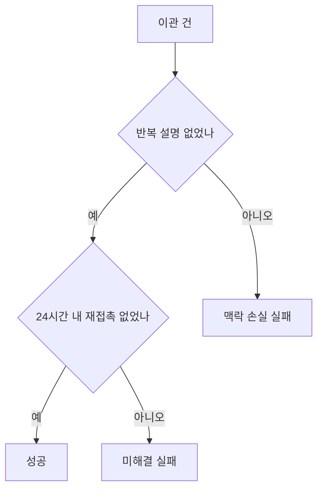
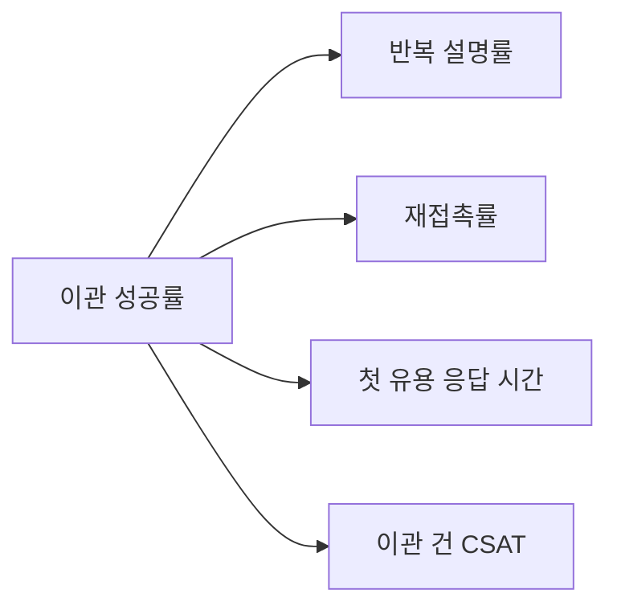

# 이관 성공률

> 사람에게 넘어간 건 중에서, 맥락이 제대로 전달되고 문제가 풀린 비율. 표준 정의가 없어 "무엇을 성공으로 볼지"를 먼저 정해야 한다.

## 쉽게 말하면
릴레이에서 바통을 넘긴 횟수가 아니라, 바통이 떨어지지 않고 다음 주자가 바로 달렸는지를 세는 것이다. 이관 건수가 많아도 매번 바통을 놓치면 좋은 이관이 아니다.

## 자세히
공식 표준은 확인하지 못했다. 열어 본 글들이 제안하는 지표를 조합해 정의한다.
- **반복 설명률**: 상담사가 AI가 이미 받은 정보(계정번호·문제 설명)를 다시 묻는 비율(channel.tel).
- **24시간 재접촉률**: 이관된 대화를 표시해 같은 고객의 재접촉을 추적. 20~25%를 넘으면 이관이 문제를 못 푼다는 신호라는 벤더 주장.
- **첫 의미 있는 응답까지 시간**: 사람이 맡은 뒤 실질적 말을 하기까지. 정보가 있으면 30초 안쪽, 콜드 스타트는 약 90초라는 벤더 주장(검증 안 됨).
- **이관 후 처리 시간**: 상담사가 맥락을 다시 만드느라 길어지는 정도를 가늠하는 간접 지표.
- **이관 건 vs 비이관 건 CSAT 격차**: 크면 AI 품질보다 이관 설계 문제(같은 글).
- **오탐·미탐(Twig 글)**: 상담사가 AI가 이미 가진 정보로 푼 이관(과잉 이관), 이관이 늦어 불만이 쌓인 건(과소 이관). 이관 시점이 최고조 불만 이전이었는지, 어떤 트리거(신뢰도·감정·규칙)가 일으켰는지 귀속한다.
- 대화 품질 점수와 별도로 이관 품질 차원을 둔다. 대화 트레이스를 열어 상담사가 제안된 첫 행동을 따랐는지도 본다.
- 주의: Twig 글의 임계값 예시와 Gartner 전망(불필요 이관 최대 40% 감소)은 이관 품질 벤치마크가 아니다.

## 그림으로 보기

## 예시
- 이관 100건 중 상담사가 계정번호를 다시 물은 건 18건, 24시간 내 재접촉 22건 → 두 지표를 합쳐 이관 패킷 개선 우선순위 결정.
- 교육 실습: 이관 대화 10건에서 반복 질문 횟수를 세어 본다.

## 헷갈리는 것과 비교
| 개념 | 차이 |
|---|---|
| 이관 성공률 | 이관의 품질 |
| [에스컬레이션율 목표](#escalation-rate-target) | 이관의 양 |
| [반복 설명률](#repeat-explanation-rate) | 이관 성공률의 구성 지표 |
| [첫 유용 응답까지 시간](#time-to-first-useful-response) | 이관 후 속도 지표 |

## 더 읽을거리
- [channel.tel: Agent-human handoff context package](https://www.channel.tel/blog/agent-human-handoff-context-package) — 이관 지표 목록(벤더)
- [Twig: How smooth is the handoff](https://www.twig.so/blog/how-smooth-is-handoff-from-ai-to-live-agent) — 오탐·미탐·트리거 귀속(벤더)
