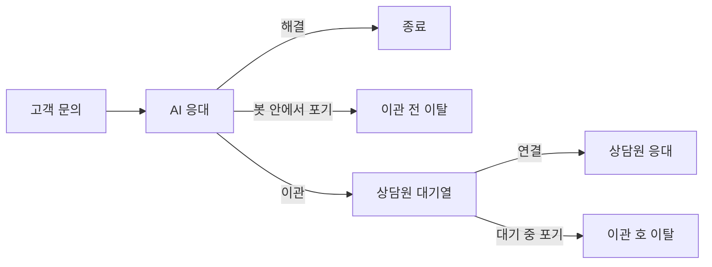
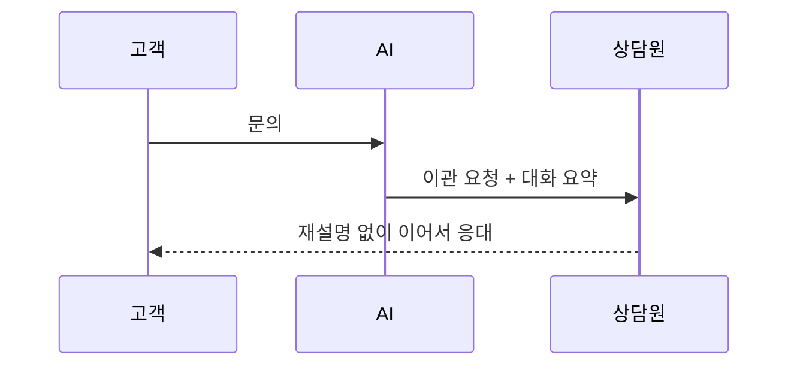

# 이관 호 이탈

> 이관 호 이탈은 AI가 먼저 응대하다 사람 상담원에게 넘겨진(이관된) 고객이 대기·재설명 과정에서 떠나는 현상이다. AI가 문의를 "해결"했는지가 아니라 넘겨진 뒤 어떻게 됐는지를 따로 재야 보인다.

## 쉽게 말하면
안내 데스크 직원이 "담당자에게 연결해 드릴게요" 하고 돌려보냈는데, 담당자 앞에서 처음부터 다시 설명하고 또 줄을 서야 한다면 많은 사람이 포기한다. 이때 포기한 사람은 "AI가 응대한 건수"에도, "상담원이 받은 건수"에도 잘 안 잡혀 통계에서 사라지기 쉽다.

## 자세히
- **왜 따로 보나**: 일반 [대기열 이탈률](#queue-abandonment)에는 AI를 거친 고객과 처음부터 상담원을 찾은 고객이 섞인다. AI를 거친 고객은 이미 시간을 썼고 짜증이 쌓인 상태라 이탈 패턴이 다를 수 있다(추정).
- **봇 안에서의 이탈과 구분**: 이관 전 이탈(봇 루프에서 포기)과 이관 후 이탈(대기·재설명 중 포기)을 나눠 센다. Berkeley CMR(2026-04) 글은 사람에게 연결해 주지 않고 같은 질문을 되풀이하는 "챗봇 루프"를 가장 큰 짜증 요인으로 꼽지만, 이탈률 수치는 제시하지 않는다.
- **소비자 반응 수치(Twilio, 2026-08-28, 자사 조사)**: 소비자 78%가 AI를 우회해 사람을 찾으려 한 적이 있고, 63%는 언제든 쉽게 사람에게 가길 원하지만 쉬운 경로를 주는 브랜드는 47%다. AI가 실패한 뒤 이관되면 상호작용당 약 81초가 낭비된다고 주장한다. 벤더 조사이므로 방향성 자료로 본다.
- **맥락 전달**: 대화 이력·고객 정보를 상담원에게 함께 넘겨야 재설명이 줄어든다(두 출처 공통 권고).
- **측정 팁**: 이관된 호에 표식을 붙여 ① 이관 후 대기 시간 ② 이관 후 이탈률 ③ 이관 후 재문의율을 AI 미경유 호와 나란히 비교한다. 해결률만 보면 "AI 해결"과 "포기"를 구분할 수 없다.

## 그림으로 보기

## 예시
- 통신사 챗봇: 이관된 고객의 이탈률이 직접 상담원을 찾은 고객의 2배라면, 이관 시 대화 요약 전달 기능부터 점검한다.
- 프롬프트 예: "상담 로그에서 AI 경유 이관 호와 직접 호를 나눠 대기 시간 중앙값과 포기율을 비교하는 표를 만들어 줘."

## 헷갈리는 것과 비교
| 개념 | 차이 |
| --- | --- |
| [대기열 이탈률](#queue-abandonment) | 전체 대기열 기준. 이관 호 이탈은 AI 경유 고객만 |
| [구간별 보고](#interval-level-reporting) | 시간대로 쪼개 보는 방법. 이관 호에도 적용 가능 |
| 컨테인먼트(봇 해결률) | 봇이 끝까지 처리한 비율. 이관 후 결과는 알려 주지 않음 |

## 더 읽을거리
- [Twilio: Why 78% of customers try to bypass your AI agent](https://www.twilio.com/en-us/blog/insights/why-customers-bypass-ai-agents) — 우회 시도·맥락 전달 수치(자사 조사)
- [Berkeley CMR: Chatbot Frustration Is Real](https://cmr.berkeley.edu/2026/04/chatbot-frustration-is-real-hidden-costs-and-best-practices/) — 챗봇 루프와 핸드오프 권고
