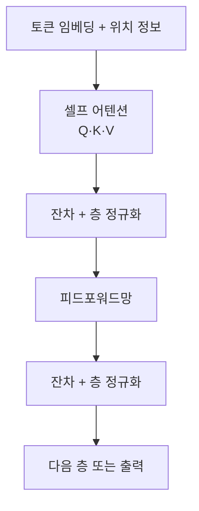
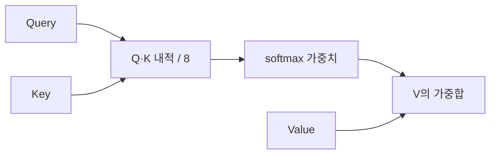

# Transformer

> Transformer는 2017년 논문 "Attention Is All You Need"(arXiv 1706.03762)에서 나온 신경망 구조로, 문장 속 모든 단어가 서로를 직접 참조(어텐션)해 문맥을 파악한다. GPT·Claude 같은 LLM의 기반이다.

## 쉽게 말하면
회의록을 읽는데, 한 줄씩 순서대로 외우는 대신 모든 줄에 형광펜을 들고 "이 단어는 앞뒤 어느 단어와 가장 관련 있지?"를 동시에 표시하는 방식이다. 순서대로 읽는 이전 방식(RNN)보다 병렬로 처리해 빠르게 학습된다.

## 자세히
- **구성**: 원 논문은 인코더 6층 + 디코더 6층. 각 인코더 층 = 셀프 어텐션 + 피드포워드망, 각 하위층에 잔차 연결과 층 정규화. 디코더는 중간에 인코더-디코더 어텐션이 있고, 셀프 어텐션은 미래 위치를 가려(mask) 앞 토큰만 본다.
- **셀프 어텐션(Q, K, V)**: 각 토큰 임베딩(논문 512차원)에 학습된 행렬 WQ·WK·WV를 곱해 질의(Query)·키(Key)·값(Value) 벡터(64차원)를 만든다. Q와 모든 K의 내적 → √64=8로 나눔 → softmax로 가중치 → V의 가중합이 출력이다.
- **멀티헤드**: 논문은 8개 헤드를 병렬로 써서 서로 다른 관계(문법, 지시어 등)를 본다. 결과를 이어 붙여 WO로 합친다.
- **위치 인코딩**: 어텐션은 순서를 모르므로 사인·코사인 기반 위치 정보를 임베딩에 더한다.
- **변형**: 인코더만(BERT), 디코더만(GPT 계열, 현재 LLM 주류), 둘 다(T5 등). 이후 모델들은 위치 인코딩·정규화 등을 개량했다(일반 지식).
- 한계: 어텐션 비용이 입력 길이의 제곱으로 늘어 긴 컨텍스트가 비싸다(일반 지식).

## 그림으로 보기

## 예시
"은행에 돈을 맡겼다"와 "강 은행에 앉았다"에서 "은행"은 주변 단어에 따라 어텐션 가중치가 달라져 서로 다른 표현이 된다. 챗봇이 긴 대화에서 앞의 지시를 기억하는 것도 어텐션 덕분이다.

## 헷갈리는 것과 비교
| 개념 | 차이 |
| --- | --- |
| RNN/LSTM | 순차 처리, 병렬화 어려움. Transformer는 병렬 |
| 어텐션 | 핵심 연산. Transformer는 어텐션으로 쌓은 전체 구조 |
| [역전파](#backpropagation) | Transformer를 학습시키는 알고리즘 |
| [LLM과 생성형 AI](#llm-basics) | Transformer 디코더를 크게 키운 응용 |

## 더 읽을거리
- [The Illustrated Transformer — Jay Alammar](https://jalammar.github.io/illustrated-transformer/) — 그림으로 배우는 정석 해설
- [Attention Is All You Need](https://arxiv.org/abs/1706.03762) — 원 논문
