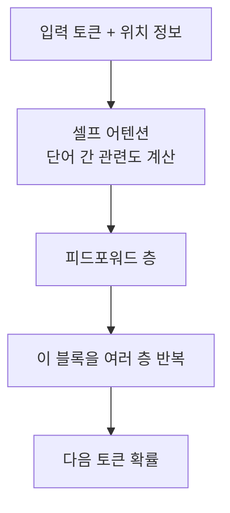
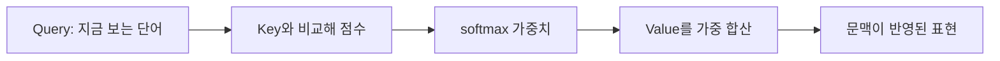

# 트랜스포머와 어텐션

> 트랜스포머는 2017년 논문 "Attention Is All You Need"에서 나온 신경망 구조로, 어텐션(attention)을 이용해 문장 속 각 단어가 다른 어떤 단어와 관련 깊은지 계산한다. 거의 모든 현대 LLM의 뼈대다.

## 쉽게 말하면
회의록에서 "그는 그것을 거절했다"를 읽으면, "그"와 "그것"이 누구·무엇인지 앞쪽을 훑어 찾아야 한다. 어텐션은 단어마다 문장 전체를 돌아보며 "지금 이해하는 데 어느 단어가 중요한가"에 점수를 매기는 장치다. 예전 모델(RNN)은 단어를 한 글자씩 순서대로 읽어 앞 내용을 잊기 쉬웠고, 트랜스포머는 전체를 한꺼번에 보고 병렬로 계산해 학습이 빠르다.

## 자세히
- **셀프 어텐션(Q·K·V)**: 각 단어 벡터에서 질의(Query)·키(Key)·값(Value) 세 벡터를 만든다. 내 Query를 모든 단어의 Key와 곱해 관련도 점수를 내고, 정규화(softmax)한 비율대로 Value를 섞어 새 표현을 만든다(Jay Alammar, Illustrated Transformer).
- **멀티헤드**: 이 계산을 여러 세트(원논문 8개)로 병렬 수행해, 헤드마다 다른 관계(문법·지시어 등)를 보게 한다.
- **위치 정보**: 어텐션만으로는 어순을 모르므로 위치 벡터를 입력에 더한다(원논문은 사인·코사인 함수).
- **구조 종류**: 인코더 전용(BERT류), 디코더 전용(GPT류, 현재 대화형 LLM 대부분), 인코더-디코더(T5류). 디코더는 미래 단어를 가리고 앞만 보며 다음 [토큰](#token-tokenization)을 예측한다.
- **한계**: 어텐션 계산량이 입력 길이에 따라 크게 늘어, 긴 입력이 비싸다 → [컨텍스트 윈도우](#context-window).

## 그림으로 보기

## 예시
- "은행에 갔다"에서 "은행"이 금융기관인지 강둑인지는 주변 단어(돈, 강)에 어텐션을 두어 구분한다.
- 긴 문서에서 질문과 관련된 문장에 높은 가중치를 두어 답을 만든다.

## 헷갈리는 것과 비교
| 개념 | 차이 |
| --- | --- |
| RNN | 순서대로 읽어 병렬화 어렵고 먼 앞 내용을 잊기 쉬움 |
| 트랜스포머 | 전체를 한 번에 보고 병렬 학습 |
| 어텐션 | 트랜스포머의 핵심 연산 한 부분 |
| [LLM](#llm-basics) | 트랜스포머(디코더)를 크게 키워 대량의 글로 학습한 모델 |

## 더 읽을거리
- [Attention Is All You Need (arXiv 1706.03762)](https://arxiv.org/abs/1706.03762) — 2017-06 원논문
- [The Illustrated Transformer (Jay Alammar)](https://jalammar.github.io/illustrated-transformer/) — Q/K/V를 그림으로 설명한 고전
- [Hugging Face LLM Course](https://huggingface.co/learn/llm-course/chapter1/4) — 인코더/디코더 구조 정리
