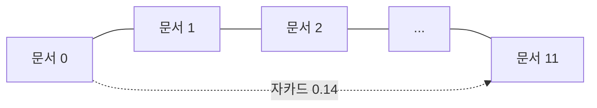
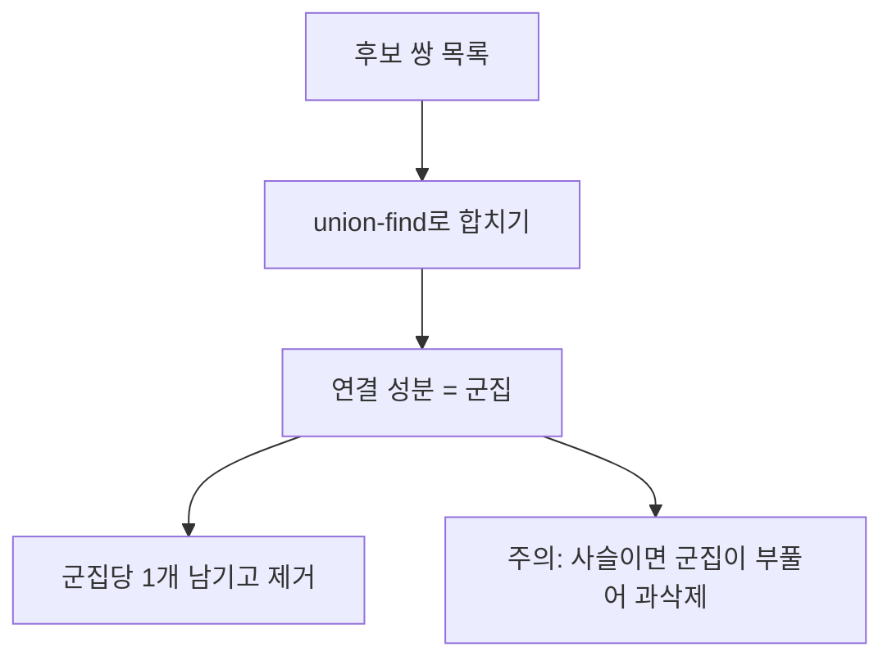

# 전이적 군집화

> "A와 B가 비슷하고 B와 C가 비슷하면 A·B·C를 한 군집으로 묶는다"는 방식이다. 중복 문서 군집을 만들 때 흔히 쓰는 union-find가 이 방식이며, 사슬처럼 이어진 문서가 **서로 닮지 않았는데도 한 덩어리로 묶이는** 위험이 있다.

## 쉽게 말하면
친구의 친구는 친구라고 계속 묶으면 결국 전교생이 한 모임이 된다. 인접한 사람끼리는 가깝지만 양 끝사람은 서로 모른다. 문서도 조금씩 바뀐 버전이 이어지면 처음과 끝은 전혀 다른 글인데 한 군집이 된다.

## 자세히
- **구현**: 후보 쌍(예: MinHash LSH가 낸 쌍)마다 두 문서를 같은 집합으로 합치는 union-find(서로소 집합)를 쓴다. 경로 압축과 크기 기준 합치기를 하면 연산당 사실상 상수 시간이다(Wikipedia 확인). datatrove의 `MinhashDedupCluster`도 `parent`/`union`(작은 집합을 큰 집합에 붙이는 방식) 코드로 연결 성분을 만든다(설치해 소스 확인). 이 단계는 `world_size`가 1이어야 한다는 단언도 있다.
- **직접 실행**(단어 100개 문서 12개의 사슬, 각 문서는 바로 앞 문서에서 단어 12%를 교체. 자카드 임계값 0.7):
  - 이웃 문서 자카드는 모두 약 0.78~0.79(임계 이상).
  - **첫 문서와 마지막 문서의 자카드는 0.14.**
  - union-find 결과: 12개가 **하나의 군집**. 군집 안 66쌍 중 **55쌍이 임계값 미만**(서로 안 닮음).
  - 대표 문서 기준(앞에서부터 대표와 0.7 이상이면 편입) 결과: 2개씩 6개 군집.
- 해석: 전이적 군집화는 **재현율은 높지만(비슷한 것을 놓치지 않음) 군집이 부풀 수 있다**. 문서 한 건씩만 남기는 중복 제거에서는 군집 하나에서 대표 하나만 남기므로 사슬 전체에서 11개 문서가 사라질 수 있다. 이 장난감은 일부러 사슬 구조를 만든 것이고 실제 코퍼스에서 그런 비율은 측정하지 않았다.
- **대책(제안)**: ① 군집 크기 분포를 보고 비정상적으로 큰 군집을 따로 검토([군집 크기](#duplicate-cluster-size)) ② 대표 문서 방식이나 군집 내 최소 유사도 검사 ③ 임계값을 높여 사슬 연결을 끊음 ④ 큰 군집에서는 전체를 하나로 줄이지 말고 샘플링.

## 그림으로 보기

## 예시
- 공지문이 해마다 조금씩 개정되어 이어진 버전 20개: 전이적 군집화는 20개를 하나로 묶어 최신본 하나만 남길 수 있다. 의도에 따라 좋을 수도 나쁠 수도 있다.
- 교육: 사슬 데이터를 만들어 두 방식의 군집 결과를 비교하는 20줄짜리 실습.

## 헷갈리는 것과 비교
| 개념 | 차이 |
|---|---|
| 전이적(연결 성분) 군집 | 이웃으로 이어지면 같은 군집. 사슬에 약함 |
| 대표(center) 군집 | 대표와 비슷해야 편입. 군집이 작고 균일 |
| [군집 크기](#duplicate-cluster-size) | 군집 크기 분포로 이상 징후 확인 |
| [MinHash LSH](#minhash-lsh) | 후보 쌍을 만들어 주는 단계 |

## 더 읽을거리
- [Disjoint-set data structure — Wikipedia](https://en.wikipedia.org/wiki/Disjoint-set_data_structure) — union-find 연산과 복잡도(열어 확인).
- [datatrove minhash 소스](https://github.com/huggingface/datatrove) — MinhashDedupCluster의 union-find 구현(설치해 소스 확인).
