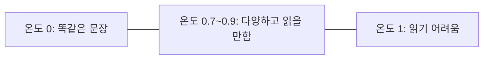
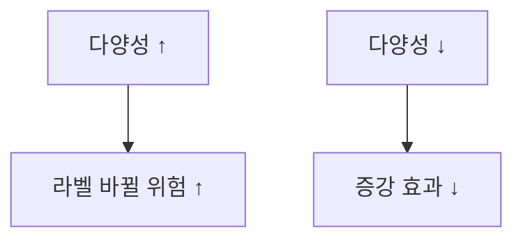

# 번역 품질과 다양성 맞교환

> 역번역 증강에서 **번역을 너무 정확하게 하면 원문과 똑같은 문장이 나와 증강 효과가 없고, 너무 거칠면 뜻이 변해 라벨이 틀어진다.** 다양성(diversity)과 타당성(validity) 사이의 균형을 맞추는 것이 핵심이다.

## 쉽게 말하면
통역사에게 "같은 말을 다르게 표현해 줘"라고 하되 틀린 말은 하지 말라고 하는 상황이다. 너무 조심하면 앵무새가 되고, 너무 자유로우면 엉뚱한 말이 된다.

## 자세히
- 출처: UDA 논문(Xie et al., arXiv 1904.12848)의 역번역 설명과 부록의 "다양성-타당성 맞교환" 절을 읽었다.
- 역번역 절차: 언어 A의 문장 x를 언어 B로 번역한 뒤 다시 A로 되돌려 증강본 x̂를 얻는다. 논문은 역번역이 "의미를 보존하면서 다양한 패러프레이즈(의역)를 만든다"고 설명한다.
- **다양성이 중요하다**: 그래서 빔 서치 대신 **온도(temperature)를 조절한 무작위 샘플링**으로 번역문을 생성한다(WMT'14 영어-프랑스어 모델을 양방향으로 사용).
- 온도의 효과(논문 부록):
  | 소프트맥스 온도 | 결과 |
  |---|---|
  | 0 | 무작위 샘플링이 탐욕 디코딩으로 변해 **완전히 타당하지만 똑같은** 의역 |
  | 1 | **매우 다양하지만 거의 읽을 수 없는** 의역 |
  | 0.7, 0.8, 0.9 | 가장 좋은 성능 |
- 논문 예(그림 2 설명): 원문 `Given the low budget and production limitations, this movie is very good.`의 역번역 결과로 `Since it was highly limited in terms of budget, and the production restrictions, the film was cheerful.` 같은 자연스러운 변형과, `Due to the small dollar amount and production limitations the ouest film is very beautiful.`처럼 부자연스러운(오탈자 `ouest` 포함) 변형이 함께 나온다. 같은 설정에서도 품질이 들쭉날쭉하다.
- 원리: 다양성은 원문의 일부를 바꿔서 얻기 때문에 "정답 라벨까지 바뀔 위험"이 따라온다(논문 문장의 취지). 그래서 이 맞교환을 데이터와 과제마다 튜닝한다.
- 실무 점검(제안): 온도·중간 언어·샘플 수를 바꿔 가며 변형 문장 50개를 사람이 읽고 "뜻 유지·자연스러움·원문과 다름" 세 가지를 표시해 비율을 본다. 임계값은 과제에 따라 정한다([텍스트 증강의 라벨 보존](#text-augmentation-label-preservation)).
- 한계: 이 문서의 수치는 논문 부록의 서술이며, 직접 번역 모델을 돌려 재현하지는 않았다.

## 그림으로 보기

## 예시
- 영어 리뷰 데이터를 영→프→영으로 온도 0.8 샘플링해 변형 문장을 만든다.
- 교육: "번역기도 설정에 따라 증강 품질이 달라진다"는 하이퍼파라미터 설명.

## 헷갈리는 것과 비교
| 개념 | 차이 |
|---|---|
| 온도 낮음 | 안전하지만 변형 없음 |
| 온도 높음 | 변형 크지만 의미·문법 손상 |
| 빔 서치 | 가장 확률 높은 번역 하나(다양성 낮음) |
| [중간 언어 거리](#pivot-language-distance) | 어떤 언어를 거치느냐도 변형 크기를 좌우 |

## 더 읽을거리
- [Unsupervised Data Augmentation (arXiv 1904.12848)](https://arxiv.org/abs/1904.12848) — 역번역 절·부록 맞교환 논의(읽음).
