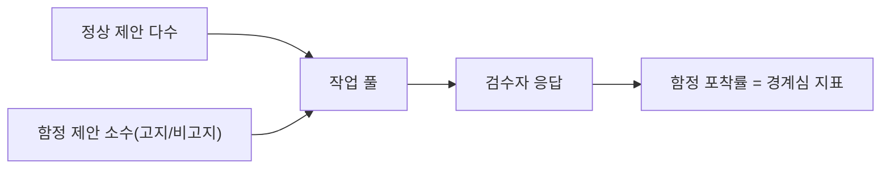
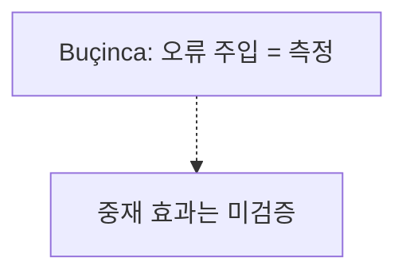

# 함정 제안(일부러 틀린 AI 제안)

> 검수자의 경계심을 점검·유지하려고 일부러 틀린 AI 제안을 섞어 보여 주는 운영 아이디어다. 이 방식 자체를 개입으로 검증한 연구는 이번에 찾지 못했고, 실험에서는 오류 주입이 "측정 도구"로 쓰였다.

## 쉽게 말하면
보안 훈련에서 가짜 피싱 메일을 보내 직원이 잘 걸러내는지 확인하는 것과 같은 발상이다. 단, 이를 직원 교육·태도 개선 수단으로 쓸 때의 효과는 별도로 검증해야 한다.

## 자세히
(하위 에이전트가 Buçinca 외 2021과 Green & Chen AAAI-20 요약을 읽은 노트 기준. Bansal 외 2021은 열지 못함.)
- **측정 도구로서의 오류 주입**: Buçinca 외(arXiv 2102.09692)의 시뮬레이션 AI는 **설계상 25% 틀리도록**(정확도 75%) 해 틀린 제안에 대한 과신을 측정했다. AI 없음 대비 AI가 틀릴 때 사람의 성능이 더 나빴다. 교육·경계심 유지를 위한 중재로 쓴 것은 아니다.
- **Green & Chen(2019/2020)**: 알고리즘 인 더 루프 결정에서 참가자들은 자신과 AI 예측의 품질을 일관되게 평가하지 못했고 AI의 실제 성능에 따라 의존도를 다르게 하지 않았다. 사람이 감독 책임을 다하지 못하는 "빈 감독 순환(empty cycle of oversight)"을 우려. 인종 편향도 관찰(FAT* 2019: 흑인 피고에 대해 위험 예측을 높이는 쪽 영향이 25.9% 더 강함 등).
- **운영 고려(제안)**: 함정 비율, 사전 고지 여부, 수용률 측정 목적(모니터링 vs 평가), 작업자 신뢰 훼손 가능성, 윤리·계약상 허용 여부. 노출·비노출 대조군과 함께 쓰면 [틀린 제안 수용률](#wrong-suggestion-acceptance-rate)을 측정할 수 있다.
- **미확인**: 함정 제안이 장기적으로 경계심을 높이는지에 대한 직접 증거.

## 그림으로 보기

## 예시
- 검수 100건 중 3건에 알려진 오류 제안을 섞어 월별 포착률을 대시보드에 기록([편향 대시보드](#bias-dashboard)).
- 교육 활용: 함정을 사후에 공개하고 피드백하는 훈련 설계 논의.

## 헷갈리는 것과 비교
| 개념 | 차이 |
|---|---|
| 함정 제안 | 의도적으로 틀린 제안 삽입 |
| 인지 강제 장치 | UI로 생각을 유도 |
| 대조군 | 제안 자체를 숨긴 비교군 |

## 더 읽을거리
- [To Trust or to Think (arXiv 2102.09692)](https://arxiv.org/abs/2102.09692) — 25% 오류 시뮬레이션 AI.
- [Algorithm-in-the-Loop Decision Making (AAAI-20)](https://ojs.aaai.org/index.php/AAAI/article/view/7115) — 사람의 의존도 보정 실패.
