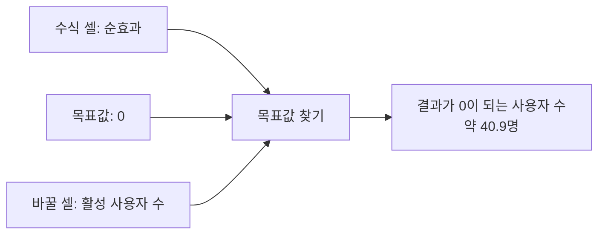
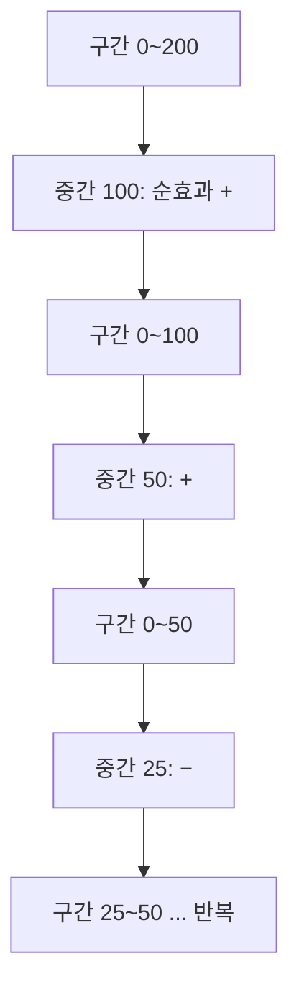

# 시행착오로 구하기

> 시행착오로 구하기는 스프레드시트에서 입력값 하나를 바꿔 가며 결과 셀이 원하는 값(예: 순효과 0)이 될 때까지 조정해 "결과가 뒤집히는 입력값"을 찾는 방법이다. 엑셀의 목표값 찾기(Goal Seek)가 이를 자동으로 해 준다.

## 쉽게 말하면
수도꼭지를 돌려 물 온도를 맞추듯, 너무 뜨거우면 줄이고 너무 차가우면 올리며 점점 범위를 좁히는 방법이다. 손으로 해도 되지만 도구가 대신해 준다.

## 자세히
- **엑셀 목표값 찾기(Microsoft 지원 문서, 열람)**: 데이터 탭 → 가상 분석 → 목표값 찾기. 입력 세 칸이 있다. 수식 셀(결과를 맞출 셀), 목표값(원하는 결과), 값을 바꿀 셀(조정할 입력 셀, 수식이 이 셀을 참조해야 함). 문서는 입력 변수가 하나뿐인 경우에만 쓸 수 있고, 여러 입력은 해 찾기(Solver) 추가 기능을 쓰라고 한다.
- **원리는 이분법과 비슷(Wikipedia Bisection method, 열람)**: 함수가 연속이고 양 끝 값의 부호가 반대면 그 구간에 해가 있다. 중간값을 계산해 부호가 같은 쪽 끝을 중간값으로 바꾸면 구간이 매번 절반이 되며 해를 둘러싼다. 아주 단순하고 견고하지만 "비교적 느려서" 더 빠른 방법의 출발점으로도 쓴다고 한다. 엑셀 목표값 찾기가 내부적으로 어떤 알고리즘을 쓰는지는 확인하지 못했다.
- **직접 해 본 계산(Python 이분법, 앞선 [손익분기점](#breakeven-point) 가상 모델)**: 순효과 = 활성 사용자 × 사용자당 연 공헌이익(118,236원×12) − 고정비 5,800만 원을 0으로 만드는 사용자 수를 0~200 구간에서 이분법으로 찾으면 반복 1회 100, 2회 50, 3회 25(음수), 4회 37.5(음수), 5회 43.75(양수) … 14회 40.881로 닫힌 해 5,800만 ÷ 1,418,832 = 40.879와 소수 둘째 자리까지 일치한다. 구간 폭 200을 0.01까지 줄이는 데 15회면 충분하다(log₂(200/0.01)).
- **스프레드시트 순서(해석)**: ① 결과 셀(순효과)이 입력 셀(활성 사용자 수)을 수식으로 참조하는지 확인 ② 목표값 0 ③ 해가 있는 범위를 가늠하고 초기값을 그 안으로 ④ 결과를 한 번 손으로 대입해 검산 ⑤ 같은 방식으로 다른 입력(절감 시간, 단가)의 중단선도 구해 표로 남긴다.
- **한계**: 한 번에 입력 하나만 바꾼다. 해가 여러 개이거나 결과가 불연속이면 못 찾거나 엉뚱한 값을 줄 수 있다(이분법 전제 해석). 구한 값은 가정이 맞을 때만 의미가 있다.

## 그림으로 보기

## 예시
- 파일럿 계획표에서 "순효과가 0이 되려면 활성 사용자가 몇 명이어야 하나"를 목표값 찾기로 구해 손익분기 사용자 수를 중단선으로 적는다.
- 교육 활용: 손으로 이분법을 5번 해 본 뒤 엑셀 결과와 비교하는 실습.

## 헷갈리는 것과 비교
| 개념 | 차이 |
| --- | --- |
| [중단 기준 정하기](#stop-criteria) | 상위 주제. 이 글은 스위칭 값을 구하는 실무 방법 |
| 해 찾기(Solver) | 여러 입력과 제약을 동시에 다룸 |
| 닫힌 해 | 식을 정리해 바로 구함. 가능하면 이것이 더 정확 |
| [손익분기점](#breakeven-point) | 구해야 할 값의 한 예 |

## 더 읽을거리
- [Microsoft: Use Goal Seek to find the result you want](https://support.microsoft.com/en-us/office/use-goal-seek-to-find-the-result-you-want-by-adjusting-an-input-value-320cb99e-f4a4-417f-b1c3-4f369d6e66c7) — 목표값 찾기 사용법
- [Wikipedia: Bisection method](https://en.wikipedia.org/wiki/Bisection_method) — 이분법 절차와 장단점
