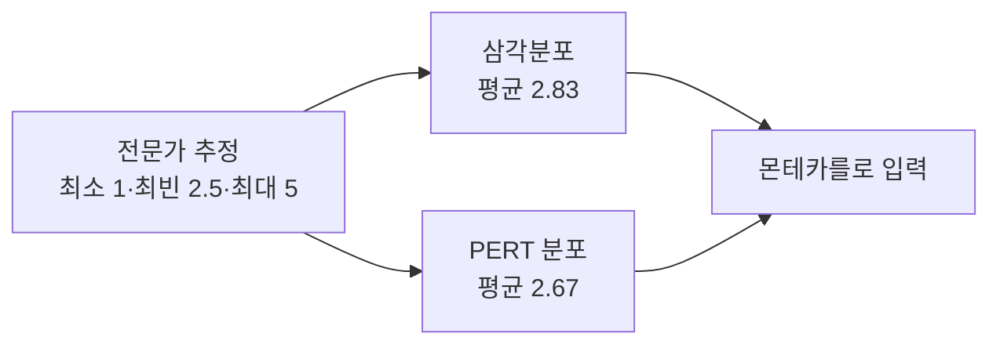
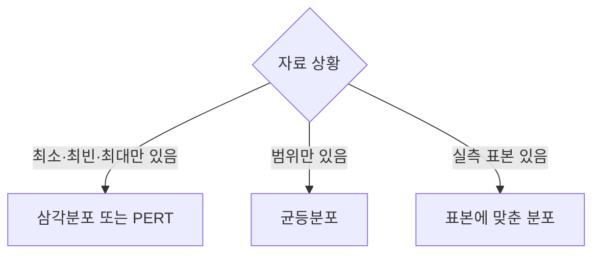

# 삼각분포

> 삼각분포는 최솟값·최빈값(가장 그럴듯한 값)·최댓값 세 숫자만으로 정하는 확률분포다. 자료가 거의 없을 때 전문가의 "최소·보통·최대" 추정을 몬테카를로 시뮬레이션 입력으로 바꾸는 가장 간단한 방법이다.

## 쉽게 말하면
"이 작업, 빨라야 1시간, 보통 2시간 반, 길면 5시간쯤"이라는 말을 그대로 삼각형 모양 그래프로 바꾼 것이다. 가운데 봉우리가 가장 그럴듯한 값이고 양 끝으로 갈수록 가능성이 선형으로 줄어든다.

## 자세히
- **모수(Wikipedia, 열람)**: 하한 a, 상한 b, 최빈값 c(a ≤ c ≤ b). 평균은 (a+b+c)/3, 분산은 (a²+b²+c²−ab−ac−bc)/18이다.
- **쓰임**: 표본 자료가 적거나 모으기 비싼 모집단을 주관적으로 기술할 때 쓴다. 최솟값·최댓값과 최빈값의 "영감 어린 추정"만 필요해 "지식 부족(lack of knowledge) 분포"라 불린다. 최빈값을 모르면 균등분포가 대안이다. 프로젝트 관리의 PERT·CPM 입력으로도 쓴다.
- **가상 예시(직접 계산)**: 월 절감 시간을 최소 1, 최빈 2.5, 최대 5시간으로 두면 평균 2.83시간, 분산 0.68(표준편차 약 0.82)이다. 최빈값(2.5)과 평균(2.83)이 다른 것은 오른쪽 꼬리가 길기 때문이다.
- **PERT 분포와 비교(Wikipedia PERT 문서, 열람)**: 같은 세 값을 쓰지만 평균을 (최소 + 4×최빈 + 최대)/6으로 계산한다. 위 예에서는 2.67시간이다. 문서는 극값이 가장 덜 알려져 있어 삼각분포의 평균은 극값에 같은 비중을 주어 덜 믿을 만하며, 삼각분포의 각진 모양보다 PERT가 부드러워 주관적 지식에 더 맞는다고 설명한다. PERT는 표준편차가 범위의 약 1/6이 되도록 설계됐다.
- **한계(해석)**: 양 끝이 반드시 상·하한이라고 가정하므로 드물게 그 밖의 값이 나오는 경우를 담지 못한다. 전문가는 보통 최대를 너무 낮게 잡는 경향이 있으므로 범위를 넓게 물어본다. 모양이 단순해 실제 자료가 생기면 실측 분포로 교체한다.
- **연결**: [몬테카를로 ROI](#monte-carlo-roi) 입력, [확률적 민감도 분석](#probabilistic-sensitivity-analysis)의 분포 선택 중 자료가 빈약할 때의 선택지다.

## 그림으로 보기

## 예시
- AI 문서 요약 도입 ROI: 팀장 3명에게 "월 절감 시간 최소·보통·최대"를 묻고 각각 삼각분포로 만든 뒤 몬테카를로로 1만 번 돌려 ROI 범위를 얻는다.
- 교육 활용: 세 숫자를 질문하는 인터뷰 양식을 만들어 보고, 평균·표준편차를 엑셀로 계산해 본다.

## 헷갈리는 것과 비교
| 개념 | 차이 |
| --- | --- |
| 균등분포 | 범위 안 모든 값이 같은 가능성. 최빈값 정보가 없을 때 |
| PERT 분포 | 같은 세 값, 평균에 최빈값을 4배 가중, 부드러운 모양 |
| [몬테카를로 ROI](#monte-carlo-roi) | 시뮬레이션 방법. 삼각분포는 거기에 넣는 입력 분포의 하나 |

## 더 읽을거리
- [Wikipedia: Triangular distribution](https://en.wikipedia.org/wiki/Triangular_distribution) — 모수·평균·분산·쓰임
- [Wikipedia: PERT distribution](https://en.wikipedia.org/wiki/PERT_distribution) — 삼각분포와의 비교
