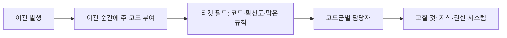
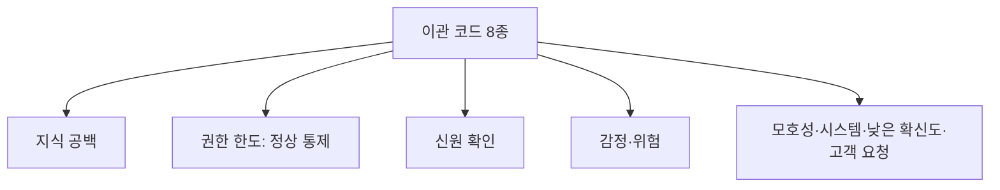

# 트리거 귀속

> 각 이관(에스컬레이션)이 **어떤 신호 때문에** 일어났는지를 코드로 기록하는 일이다. "상담원에게 넘김"이라는 한 줄 라벨로는 무엇을 고쳐야 할지 알 수 없다.

## 쉽게 말하면
병원 접수처가 환자를 전문의에게 보낼 때 "그냥 보냄"이라고 쓰지 않고 "검사 결과 해석 불가", "보험 한도 초과", "환자가 요청함"처럼 사유를 적는 것이다. 사유가 쌓여야 접수처 교육을 고칠지 규정을 고칠지 알 수 있다.

## 자세히
(Robylon 글은 직접 열어 확인한 벤더 글이다. 수치는 **자사 이메일 배포 데이터의 자체 집계**이고 독립 연구가 아니다.)
- **흔한 트리거(검색 결과 기준)**: 낮은 확신도, 민감·정책 제한 주제, 반복 실패, 감정적·긴급 표현, 사용자의 명시적 사람 요청. 비즈니스 규칙이 확신도를 덮어쓰는 경우가 있고, 어떤 주제는 확신도와 무관하게 항상 사람이 맡는다.
- **Robylon 분류 8가지(이관 스레드 210만 건 라벨링)**: 지식 공백 28.4% / 권한 한도 19.1% / 신원·확인 11.6% / 감정·위험 10.8% / 모호성 9.7% / 시스템 장애 8.2% / 낮은 확신도(잔여) 7.2% / 고객 요청 5.0%. 표본은 12개 업종 940만 통의 인바운드 이메일(18개월), 평균 이관율 22.3%. 배포 첫 14일은 제외. 지식 베이스가 부실한 팀은 지식 공백 비중이 더 클 것이라는 단서가 붙는다.
- **기록 방법**: 이관 **순간에** 코드를 부여(사후 추론 아님), 주 코드 1개+선택적 보조 코드, 헬프데스크 티켓에도 저장(AI 플랫폼에만 두지 않음), 확신도·막은 정책 규칙을 필드로, 전체 추론 트레이스는 감사용으로 AI 플랫폼에 보관. 코드군마다 담당자를 정한다.
- **활용**: 건수가 아니라 **처리 시간**으로 가중해 우선순위(예: 감정 건 중앙값 14분 vs 권한 한도 건 3분). 지식 베이스 모순을 먼저 고친다. 사람이 거의 항상 승인하면 권한 한도가 잘못 설정된 것. 권한 한도 이관은 의도된 통제이니 없애려 하지 않는다. 90일 뒤 재실행 시 34%는 이관이 불필요해졌다는 자사 사례.
- **주의**: 위 수치는 업계 기준이 아니라 한 회사 데이터다. 자사 데이터로 코드 분포를 먼저 만든다.
- 이 기록이 있어야 [과잉 이관](#over-escalation-false-positive)과 [과소 이관](#late-escalation-false-negative)의 원인을 트리거별로 쪼갤 수 있다.

## 그림으로 보기

## 예시
- 월간 검토: 코드별 건수와 평균 처리 시간을 곱해 "시간 비용" 상위 3개 코드를 개선 과제로.
- "낮은 확신도(잔여)" 비율이 8%를 넘으면 코드 체계가 현실을 못 담는다는 신호(Robylon 제안).

## 헷갈리는 것과 비교
| 개념 | 차이 |
|---|---|
| 트리거 귀속 | 이관 사유를 코드로 기록 |
| [이관 성공률](#transfer-success-rate) | 이관 결과가 좋았는지 |
| [과잉 이관](#over-escalation-false-positive) | 트리거별 과잉 비율을 보려면 귀속 기록이 필요 |
| 에스컬레이션 규칙 | 언제 넘길지의 설계(입력), 귀속은 사후 기록 |

## 더 읽을거리
- [Robylon: AI 이관 사유 코드 분류](https://www.robylon.ai/blog/ai-escalation-reason-codes-taxonomy) — 8개 코드와 기록·활용 방법(직접 열어 확인, 벤더 자체 데이터).
- [Twig: AI는 언제 사람에게 넘기는가](https://www.twig.so/blog/how-does-ai-know-when-to-escalate-to-human-agent) — 3가지 트리거(검색 결과 기준, 본문 미열람).
