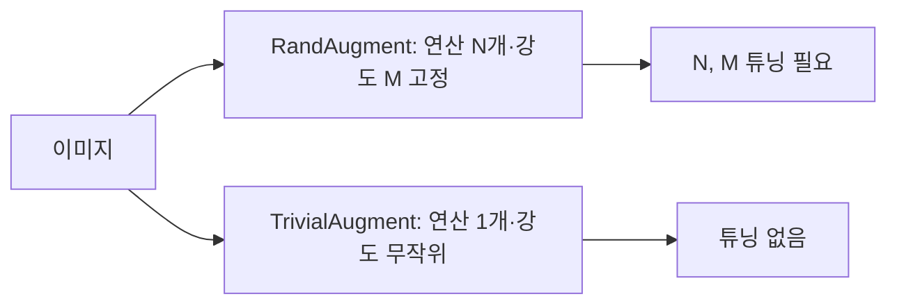
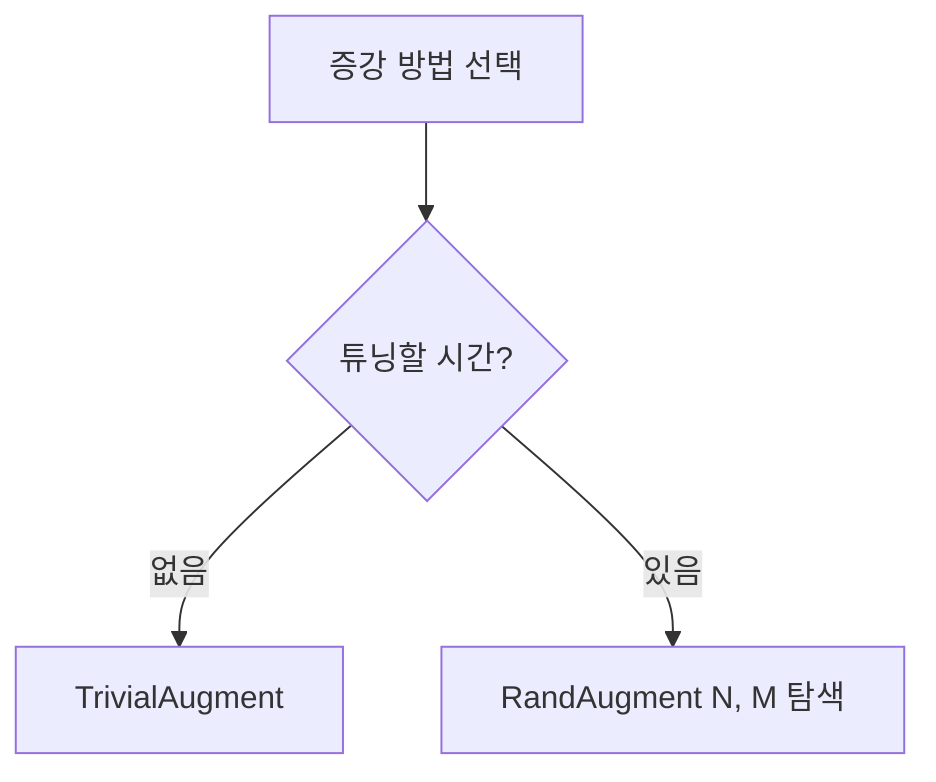

# TrivialAugment vs RandAugment

> 둘 다 이미지 데이터 증강을 자동으로 고르는 방법이다. RandAugment는 "몇 개를 얼마나 세게"를 사람이 튜닝하고, TrivialAugment는 이미지마다 **연산 1개·강도 무작위**로 정해 튜닝이 필요 없다.

## 쉽게 말하면
사진을 변형해 학습 자료를 늘리는 일을 요리에 비유하자. RandAugment는 "양념 2가지를 중간 세기로"라는 레시피를 맛보며 조정해야 한다. TrivialAugment는 매번 양념 하나와 세기를 주사위로 정한다. 놀랍게도 주사위 쪽이 레시피 조정 없이도 비슷하거나 낫다.

## 자세히
- **RandAugment**: 연산 목록에서 N개를 무작위로 뽑아 전부 같은 강도 M으로 적용. N, M은 사람이 격자 탐색해야 한다(torchvision 기본값은 num_ops=2, magnitude=9 — 기억 기준, 확인 필요).
- **TrivialAugment**: 이미지마다 연산 하나와 강도를 균등 무작위로 뽑아 적용. 논문 표현: "parameter-free", 이미지당 증강 하나(arXiv 2103.10158, 2021).
- 논문 표(추출본 기준, 정확도 %): CIFAR-10 98.2 vs 98.0, CIFAR-100 84.3 vs 83.3, SVHN 98.9 vs 99.0, ImageNet 78.1 vs 77.6 (TrivialAugment vs RandAugment). 열 순서는 추출 때문에 완전히 확실하지 않다.
- 탐색 비용: AutoAugment 계열은 정책 탐색이 필요하지만 TrivialAugment는 0.
- torchvision `TrivialAugmentWide`는 `num_magnitude_bins=31`이 기본값이며 uint8 텐서나 PIL 이미지를 받는다.
- 한계: 이미지 분류 벤치마크 결과이며 의료·위성 등 다른 도메인에서도 우위인지는 별도 검증이 필요하다(주의).

## 그림으로 보기

## 예시
- PyTorch: `transforms.TrivialAugmentWide()`를 학습 변환 앞쪽에 한 줄 추가.
- 교육: "복잡한 자동 탐색이 단순 무작위를 못 이긴다"는 기준선 사례([증강 기준선 관행](#augmentation-baseline-practice)).

## 헷갈리는 것과 비교
| 개념 | 차이 |
|---|---|
| RandAugment | N·M 두 값 튜닝 |
| TrivialAugment | 튜닝 없음, 이미지당 1연산 |
| [TrivialAugment](#trivialaugment) | 방법 자체 설명 |

## 더 읽을거리
- [TrivialAugment 논문](https://arxiv.org/abs/2103.10158) — 초록·Table 1 읽음.
- [torchvision TrivialAugmentWide](https://docs.pytorch.org/vision/stable/generated/torchvision.transforms.TrivialAugmentWide.html) — 파라미터 문서 읽음.
