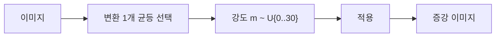
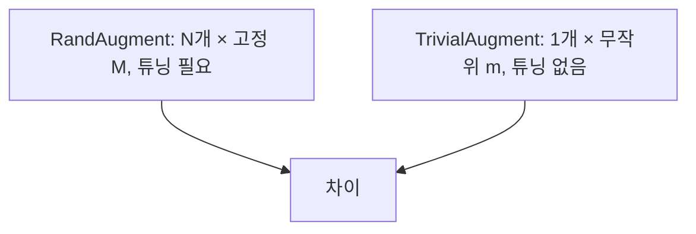

# TrivialAugment

> **이미지마다 변환 하나를 균등 확률로 고르고, 강도도 0~30에서 균등 확률로 뽑아 한 번만 적용하는** 파라미터 없는(튜닝이 필요 없는) 자동 증강이다. 논문은 이렇게 단순한 방법이 복잡한 이전 방법과 견줄 만하거나 앞선다고 보고했다.

## 쉽게 말하면
룰렛을 한 번 돌려 변환 하나를, 한 번 더 돌려 강도를 정한다. 어떤 양념을 얼마나 넣을지 연구할 필요 없이 매번 무작위로 하나만 넣는데, 그게 정교하게 튜닝한 레시피만큼 맛있다는 것이다.

## 자세히
(Müller & Hutter 2021, arXiv 2103.10158 PDF 본문을 직접 읽음)
- 알고리즘 1: ① 증강 집합 A에서 변환 a를 균등하게 선택 ② 강도 m을 {0,…,30}에서 균등하게 선택 ③ a(x, m)을 반환. 끝.
- 파라미터가 없다(RandAugment는 N·M 두 개를 데이터마다 탐색). **TrivialAugment는 RandAugment의 특수한 경우가 아니다**: RA는 모든 이미지에 같은 최적 강도 하나를 쓰지만 TA는 이미지마다 강도를 새로 뽑는다.
- 이전 방법들이 여러 변환을 연달아 쓰는 데 반해 TA는 **이미지당 변환 1개**만 쓴다. 논문은 TA로 증강된 데이터 분포를 "각 변환을 전체 데이터에 적용한 분포들의 평균"으로 해석한다.
- 결과(논문 주장): 여러 이미지 분류 설정(CIFAR-10·100, SVHN, ImageNet; Wide-ResNet, ShakeShake 등)에서 AutoAugment·RandAugment 등과 비교해 같거나 더 높은 성능을 냈고, 일부 설정에서는 별도의 복잡한 강화학습 파이프라인(공개되지 않음)과 같은 성능이라고 쓴다. 표의 세부 수치는 여기서 재현하지 않았다(PDF 표 추출이 불완전).
- 논문 결론의 시사점: 자동 증강 연구의 상당 부분이 정체돼 있을 수 있으니, 새 방법은 이런 단순 기준선과 비교해야 한다는 모범 사례를 제안한다.
- 실무(제안): 튜닝할 시간이 없으면 TrivialAugment로 시작하고, 부족하면 RandAugment 격자 탐색을 시도한다. torchvision에 `TrivialAugmentWide`가 있다(확인하지 않은 기억 기반 정보이므로 설치 후 확인).

## 그림으로 보기

## 예시
- 새 이미지 데이터셋 기준선: TrivialAugment 적용 → 검증 정확도 → 필요하면 RandAugment와 비교.
- 교육: "단순한 무작위가 복잡한 탐색에 필적할 수 있다"는 연구 교훈.

## 헷갈리는 것과 비교
| 개념 | 차이 |
|---|---|
| TrivialAugment | 변환 1개, 강도 이미지마다 무작위, 튜닝 없음 |
| [RandAugment](#randaugment-magnitude-tuning) | 변환 N개, 고정 강도 M, 격자 탐색 |
| [AutoAugment](#augmentation-policy-search) | 강화학습으로 정책 탐색 |

## 더 읽을거리
- [TrivialAugment (arXiv 2103.10158)](https://arxiv.org/abs/2103.10158) — 알고리즘 1과 비교 실험(PDF 본문 읽음).
