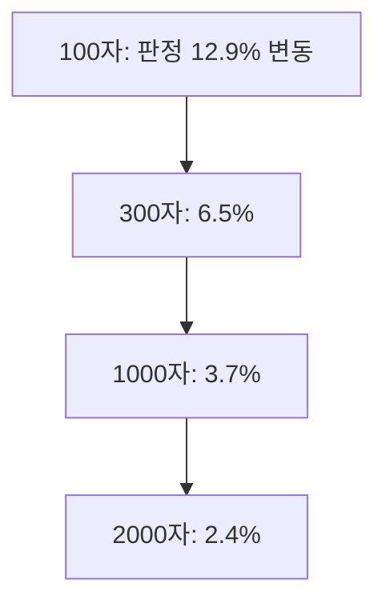

# 입력 토큰 제한

> 분류기에 문서 전체를 넣지 않고 **앞부분 N글자(또는 N토큰)만 넣어 추론 비용을 줄이는** 방법이다. 비용은 줄지만 판정이 달라지는 문서가 생기므로, 어디까지 잘라도 결과가 안정적인지 표본으로 확인한다.

## 쉽게 말하면
책 한 권의 장르를 맞히는 데 첫 몇 쪽만 읽어도 대부분 맞힌다. 하지만 너무 적게 읽으면 틀리는 책이 늘어난다. "몇 쪽이면 충분한가"를 정하는 일이다.

## 자세히
- 직접 실험(2026-11-27, fastText `lid.176.ftz`, Common Crawl WET 샘플 앞 2MB의 문서 587개, 평균 6,925자. 기준 = 전체 텍스트로 식별한 결과. FineWeb식 판정 = "영어이고 점수 ≥ 0.65면 유지"):
  | 입력 | 최고 확률 언어가 전체 입력과 같음 | 유지/제외 판정이 달라진 문서 | 유지율 (전체 입력 0.274) |
  |---|---|---|---|
  | 앞 100자 | 92.8% | 76개 (12.9%) | 0.179 |
  | 앞 300자 | 95.6% | 38개 (6.5%) | 0.250 |
  | 앞 1,000자 | 97.8% | 22개 (3.7%) | 0.271 |
  | 앞 2,000자 | **99.0%** | 14개 (2.4%) | **0.274** |
- 읽는 법: 2,000자까지 보면 **언어 판정이 99%, 전체 유지율이 같게(0.274)** 나왔다. 100자는 판정이 크게 흔들려 유지율이 0.274 → 0.179로 **35% 감소**했다. 비용은 읽는 글자 수에 거의 비례해 2,000자 절단이 문서당 처리량을 약 4배로 올렸다([처리량 외삽](#throughput-extrapolation): 674 → 2,692 문서/초).
- 주의:
  1. **앞부분만 보는 편향**: 문서 앞이 메뉴·머리글이고 본문이 뒤에 있으면 앞 2,000자는 대표가 아니다([보일러플레이트 제거 효과](#boilerplate-removal-effect) — 추출 후에 자르는 것이 안전). 또 앞은 영어, 뒤가 다른 언어인 혼합 문서는 놓친다([문단 단위 언어 판정](#paragraph-level-langid)).
  2. **과제 의존성**: 언어 식별은 짧은 입력으로 충분하지만 교육 가치·독성 같은 판정은 **문서 후반 내용**이 중요할 수 있다. 같은 자르기 길이가 다른 과제에서 안전하다는 보장은 없다.
  3. 트랜스포머 분류기는 **최대 입력 토큰 수** 제약이 있어(모델마다 다름) 어쩔 수 없이 자르는 경우가 많다. FineWeb-Edu 분류기 사용 예에서는 `truncation=True`로 토큰화한다(모델 카드 열람) — 자르는 기준이 점수에 영향을 줄 수 있다.
- 방법(제안): ① 대표 표본에서 **전체 입력 대비 판정 일치율**을 N별로 측정해 임계 길이를 정한다 ② 앞·중간·뒤에서 나눠 뽑은 조각(예: 앞 1,000 + 중간 500 + 뒤 500)을 합치는 방식을 비교 ③ 판정이 불확실한 문서(점수가 임계값 근처)만 전체 입력으로 재판정하는 2단계 구조.
- 한계: 이 결과는 영어 중심의 언어 식별이며, 한 파일의 앞부분 표본이다. 다른 분류 과제(품질·독성)에서는 직접 측정이 필요하다.

## 그림으로 보기



## 예시
```python
label, prob = m.predict(text[:2000].replace("\n", " "))
```
- 교육: 입력 길이를 바꿔 가며 판정 안정성 곡선을 그리는 실습.

## 헷갈리는 것과 비교
| 개념 | 차이 |
|---|---|
| 입력 절단 | 앞부분만 사용해 비용 절감 |
| 슬라이딩 윈도 | 문서를 여러 조각으로 나눠 모두 판정 |
| 2단계 분류 | 싼 판정 후 애매한 것만 정밀 판정 |
| [분류기 추론 비용](#classifier-inference-cost) | 절단이 줄이는 비용 전체 |

## 더 읽을거리
- [fineweb-edu-classifier 모델 카드](https://huggingface.co/HuggingFaceFW/fineweb-edu-classifier) — `truncation=True` 사용 예(읽음).
- 직접 실행: fastText로 입력 길이별 판정 안정성.
