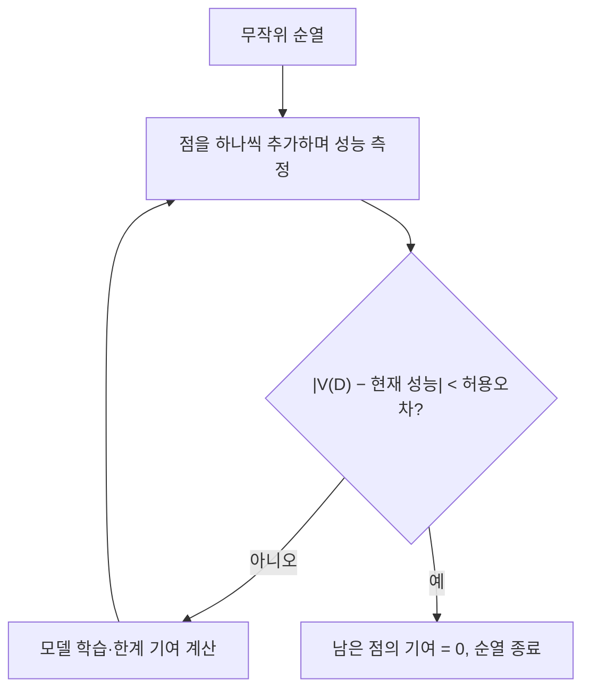
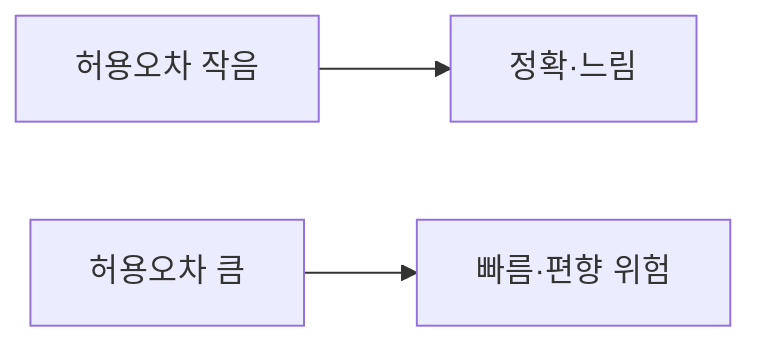

# 절단 허용오차

> TMC-Shapley가 한 순열을 훑다가 **현재 성능이 전체 데이터 성능과 "허용오차" 이내로 가까워지면 남은 점들의 한계 기여를 0으로 두고 계산을 멈추는 기준**. 모델 재학습 횟수를 크게 줄이는 대신 약간의 근사 오차를 받아들인다.

## 쉽게 말하면
이미 90점 가까이 오른 뒤로는 학생 한 명을 더 넣어도 점수가 거의 안 변한다. 그 시점부터는 "더 넣어 봐야 변화 없음"으로 보고 계산을 접는다. 측정 자체의 흔들림보다 작은 변화는 어차피 구별되지 않기 때문이다.

## 자세히
- **알고리즘(Ghorbani & Zou, arXiv 1904.02868 부록 A, 본문 열어 확인)**: 무작위 순열 π를 뽑고 앞에서부터 점을 하나씩 더해 가며 성능 V를 계산한다. 반복 j에서 |V(D) − v_{j−1}| < 성능 허용오차이면 v_j = v_{j−1}로 두어 **모델을 새로 학습하지 않고** 한계 기여를 0으로 친다. 여러 순열에 걸친 평균을 수렴할 때까지 반복.
- **허용오차를 정하는 근거**: 시험 세트가 유한하므로 V(S) 자체가 진짜 성능의 근사이고 **내재적 잡음**이 있다. 같은 예측기를 시험 세트 **부트스트랩 표본**에서 재 본 성능의 변동으로 허용오차를 정의한다. 또한 S가 커질수록 점 하나를 더해 얻는 성능 변화는 작아진다. 두 관찰을 합쳐 "측정 잡음 수준까지만 정밀하게 추정하면 충분"하다는 절단 접근이 나온다.
- **정확도 점검(논문 부록 E, 저자 보고)**
  - 정확한 샤플리 값을 구할 수 있는 합성 데이터(4~14개 점, 로지스틱 회귀)에서 TMC-Shapley와 진짜 값의 **피어슨 상관 98.4~99.5%**.
  - 절단 위치 실험: 데이터 1,000개에서 "절단 10%"는 각 순열의 **처음 100개 점**만 계산하고 나머지는 0으로 근사. **절단 25%**여도 절단 없는 값과의 **순위 상관이 약 0.8**. 논문은 절단이 "의미 있는 추정 편향 없이 상당한 계산 절감"을 준다고 결론.
- **허용오차가 바꾸는 것**
  | 허용오차 | 계산량 | 위험 |
  |---|---|---|
  | 작게 | 많음(절단이 늦게 일어남) | 비용 증가 |
  | 크게 | 적음 | 뒤쪽 점들의 기여를 0으로 만들어 **편향**, 순위 흔들림 |
  뒤에 놓인 점일수록 0으로 처리될 확률이 높아 순서와 가치의 상관이 생길 수 있어, 순열을 충분히 많이 평균해 완화한다.
- **실무 설정(제안)**: 허용오차 = 시험 세트 부트스트랩 성능의 표준편차 정도로 시작, 작은 데이터에서 절단 없는 결과와 순위 상관을 확인한 뒤 큰 데이터에 적용. 수렴 여부는 [수렴 점검](#shapley-convergence-check)으로 본다.
- **한계**: 순위 상관 0.8은 평균적으로 높아도 낮은 가치(오염 후보) 하위 구간의 정확도는 따로 확인해야 한다(일반 주의).

## 그림으로 보기



## 예시
```python
tol = bootstrap_std_of_val_score(model, X_val, y_val)   # 시험 세트 부트스트랩 변동
full = score(train_all)
for perm in permutations_sample(n_iter):
    prev = score_empty
    for j, i in enumerate(perm):
        if abs(full - prev) < tol:      # 절단: 남은 점은 기여 0
            break
        cur = score(perm[:j+1]); phi[i] += cur - prev; prev = cur
```
- 학습 점 5,000개 평가를 하루 안에 끝내려면 허용오차와 절단 비율로 순열당 학습 횟수 상한을 정한다.

## 헷갈리는 것과 비교
| 개념 | 설명 |
|---|---|
| 절단 허용오차 | 순열 내부에서 계산을 멈추는 기준 |
| 수렴 기준 | 순열 반복을 멈추는 기준 |
| 부트스트랩 변동 | 허용오차를 정하는 근거 |
| [효율성 공리](#shapley-efficiency-axiom) | 절단 때문에 합이 약간 어긋날 수 있음 |

## 더 읽을거리
- [Data Shapley (arXiv 1904.02868)](https://arxiv.org/abs/1904.02868) — TMC-Shapley 알고리즘 1과 부록 A·E(PDF 본문 열어 확인).
