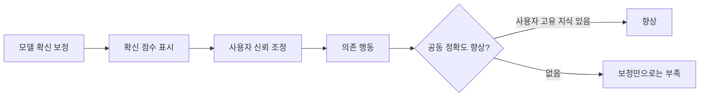
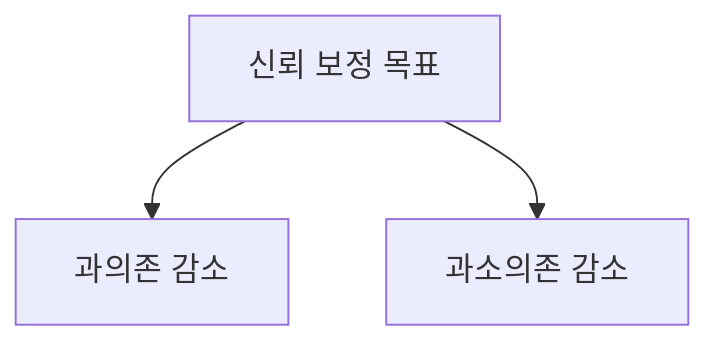

# 신뢰 보정

> 사용자가 AI를 믿는 정도를 AI의 실제 신뢰도(맞을 확률)에 맞추는 설계 목표. 과의존과 과소의존을 함께 줄이는 것이 핵심이지만, 신뢰만 맞춘다고 결과가 자동으로 좋아지지는 않는다.

## 쉽게 말하면
일기예보에서 "비 올 확률 80%"를 보고 우산을 챙기는 것과 같다. 80%라는 말이 실제로 10번 중 8번 맞고, 사용자가 그 숫자대로 행동할 때 신뢰가 보정됐다고 한다.

## 자세히
- **신뢰 보정 ≠ AI의 확신 보정**: 앞쪽은 사람이 AI를 믿는 정도, 뒤쪽은 [모델 확신이 정답률과 맞는지](#confidence-calibration-handoff)다. 둘 다 필요하다.
- **확신 점수 표시(Zhang·Liao·Bellamy, FAT* 2020, 초록 열람)**: 예측별 확신 점수를 보여 주면 사용자가 언제 의존하고 언제 의심할지 판단하는 데 도움이 됐다. 그러나 보정된 신뢰가 공동 정확도 향상으로 이어지지는 않았다. 이득은 사람이 AI 오류를 바로잡을 고유 지식을 갖고 있느냐에 달렸다. 예측별 설명은 효과가 없거나 문제가 있다고 지적하며 새 설명 방법 연구를 촉구한다. 실험은 사람과 AI의 단독 성능이 비슷한 조건 두 개였다.
- **분류기 보정만으로는 부족(arXiv 2508.18317, 초록 열람)**: 분류기를 보정해도 비전문가의 결정이 크게 바뀌지 않았고, 전망이론에 근거한 추가 보정을 넣었을 때 사람의 결정이 모델 예측과 더 맞았다. 다만 "더 믿느냐"는 직접 질문에는 방법 간 차이가 없었다.
- **의존을 바꾸는 장치(Smith 글 열람)**: 추천 전에 먼저 결정하게 하는 인지 강제 기능이 설명보다 과의존을 더 줄인다.
- **측정**: 신뢰 설문은 적절한 의존을 알려 주지 않을 수 있어 실제 행동 기반 지표가 필요하다는 주장(2604.23896).
- 정리: 보정 설계는 (1) 정확한 확신 표시, (2) 먼저 생각하게 하는 순서, (3) 오류를 바로잡을 수 있는 사용자 지식 활용을 함께 본다.

## 그림으로 보기

## 예시
- 챗봇이 "확실하지 않음" 표시를 붙인 답은 사용자가 출처를 확인하도록 유도.
- 교육 실습: 같은 AI 답 10개에 확신 점수를 붙여 주고 점수 유무에 따라 수용/거부 정확도가 어떻게 달라지는지 비교.

## 헷갈리는 것과 비교
| 개념 | 차이 |
|---|---|
| 신뢰 보정 | 사람의 믿음이 실제 정확도에 맞음 |
| [신뢰도 보정과 이관](#confidence-calibration-handoff) | 모델의 확신 수치가 정확도에 맞음 |
| [AI 과소의존](#undertrust-ai) | 신뢰 보정이 깨진 한쪽 |
| [의도적 마찰 설계](#friction-by-design) | 보정을 돕는 UX 수단 |

## 더 읽을거리
- [Effect of Confidence and Explanation on Accuracy and Trust Calibration (arXiv 2001.02114)](https://arxiv.org/abs/2001.02114v1) — 확신 점수와 설명의 효과(초록 열람)
- [Does Calibration Affect Human Actions? (arXiv 2508.18317)](https://arxiv.org/abs/2508.18317) — 분류기 보정의 한계(초록 열람)
