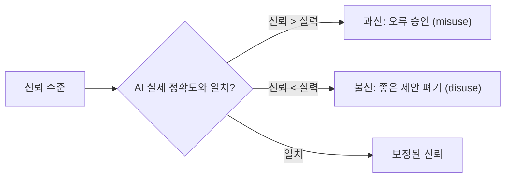
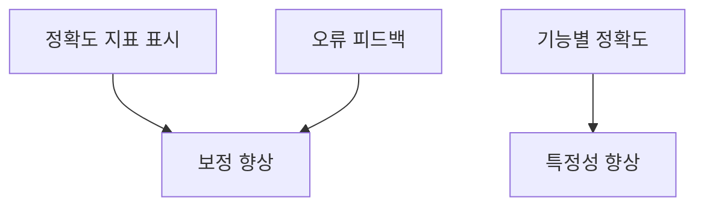

# 신뢰 보정 불량

> 사람이 AI에게 보내는 **신뢰의 크기가 AI의 실제 정확도와 맞지 않는 상태**다. 실제보다 더 믿으면 오류를 놓치는 과신(과의존), 실제보다 덜 믿으면 좋은 제안도 버리는 불신(과소의존)이 된다. 라벨링 검수에서는 틀린 사전 라벨을 승인하는 것으로 나타난다.

## 쉽게 말하면
내비게이션이 80%만 맞는데 100% 맞다고 믿고 따르면 막다른 길로 들어가고, 반대로 아예 안 믿으면 잘 맞는 안내도 못 쓴다. 필요한 것은 "믿음의 양"이 "실력"과 맞아 있는 상태, 즉 보정(calibration)이다.

## 자세히
(Liao & Sundar, FAccT 2022 "Designing for Responsible Trust in AI Systems"의 PDF와 Lee & See 2004의 검색 요약, Beck 2025 논문을 직접 확인. Lee & See 원문은 열어 보지 못해 2차 요약에 의존한다.)
- **적절한 신뢰의 세 측면(Liao & Sundar)**: **보정(calibration)** = 신뢰가 시스템의 신뢰할 만한 정도와 일치, **분해능(resolution)** = 시스템의 신뢰성이 변할 때 사용자의 신뢰도 따라 변함, **특정성(specificity)** = 시스템의 기능별로 다르게 신뢰할 수 있음. 저자들은 이를 정보 표시와 소통으로 만들어야 한다고 말하고, 보정은 정오(맞음/틀림)가 아니라 **확률적**이라고 설명한다(정확도 지표를 보여 주면 예측만 보여 주는 것보다 보정이 나을 수 있지만 완벽하지는 않다).
- **과신의 심리(같은 논문)**: "기계는 인간보다 믿을 만하다"는 기계 휴리스틱, 설명이 있으면 유능해 보인다고 느끼는 **설명 휴리스틱**이 과신을 낳는다고 소개한다. 설명 기능(XAI)이 오히려 과신을 부른다는 연구도 인용한다.
- **고전 틀(Lee & See 2004, 검색 결과의 2차 요약)**: 신뢰가 낮으면 자동화를 쓰지 않는 **disuse**, 높으면 지나치게 의존하는 **misuse**로 이어진다고 정리된다. 이 구분은 원문 전체를 확인하지 못했다.
- **라벨링 검수에서(Beck 2025 실험, 2,784명)**: AI에 호의적인 검수자는 **과소교정**(틀린 AI 라벨을 못 고침)이 많았고, 규칙 이해가 필요한 오류는 31%, 맞는 것을 알아보려 해도 전문 지식이 필요한 표는 정확도 21%까지 떨어졌다([사전 라벨 자동화 편향](#automation-bias-prelabel)). 첫 3건의 AI 정확도는 이후 검수에 의미 있는 영향을 주지 않았다 — 즉 "처음에 틀리는 걸 보면 경계하게 된다"는 가정이 이 실험에서는 지지되지 않았다.
- **직접 계산(단순 산술 모델, 가정)**: 검수자가 확인하면 정확도 0.95, 확인 없이 승인하면 AI 정확도 그대로라고 두고, 확인 없이 승인하는 비율(신뢰 t)로 최종 정확도를 구함. AI 정확도 0.90: t=0→0.95, 0.5→0.925, 0.9→0.905, 1.0→0.90. AI 정확도 0.60: t=0→0.95, 0.5→0.775, 0.9→0.635, 1.0→0.60. **AI가 약할수록 신뢰가 클 때의 손실이 커진다.**
- **보정을 돕는 방법(제안)**: ① 작업 시작 때 AI의 실제 정확도·약점 유형을 알려 주기(표본으로 측정한 값) ② 검수 중 **누적 오류 피드백**(방금 잡은 오류 N건) ③ 일부 문항에 의도적 오류를 심고 검출률을 신뢰 지표로 ④ 확신도 표시를 보정된 확률로 ⑤ 기능별(영역별) 정확도를 나눠 보여 주기(특정성).

## 그림으로 보기

## 예시
- 사전 라벨 정확도가 60% 수준인 신규 클래스를 90%짜리 기존 클래스처럼 믿고 승인하는 검수자 → 클래스별 정확도를 대시보드로 공유하고 신규 클래스는 사전 라벨 없이 라벨링.
- 교육 소재: "AI를 얼마나 믿어야 하는가?"를 위 산술표로 설명(업무 자동화 교육의 승인 단계 정책).

## 헷갈리는 것과 비교
| 개념 | 차이 |
|---|---|
| 신뢰 보정 불량 | 신뢰 크기가 실제 정확도와 안 맞음 |
| [사전 라벨 자동화 편향](#automation-bias-prelabel) | 신뢰 과다로 나타나는 구체적 행동 |
| [예측 확률 보정](#pred-probs-calibration) | 모델의 확률 값이 맞는지(모델 쪽 보정) |
| [검수자의 AI 태도](#annotator-ai-attitude) | 신뢰를 좌우하는 개인 요인 |

## 더 읽을거리
- [Designing for Responsible Trust in AI Systems: A Communication Perspective (arXiv 2204.13828)](https://arxiv.org/abs/2204.13828) — 보정·분해능·특정성 정의, 과신 휴리스틱(PDF 직접 확인).
- [Trust in automation: designing for appropriate reliance (Lee & See, 2004)](https://pubmed.ncbi.nlm.nih.gov/15151155/) — 신뢰 보정 고전(초록 페이지는 직접 열지 못하고 검색 요약만 확인).
- [Bias in the Loop (arXiv 2509.08514)](https://arxiv.org/abs/2509.08514) — 라벨링 검수에서의 과소교정 실험(PDF 직접 확인).
