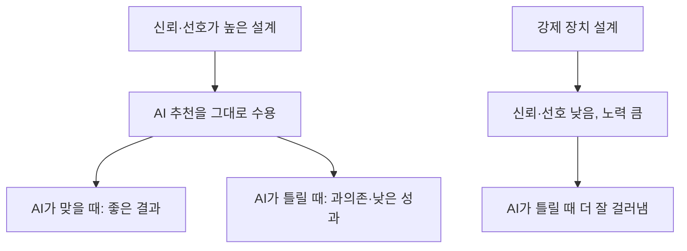
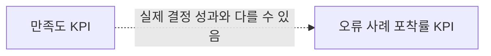

# 신뢰와 효과의 긴장

> 사용자가 좋아하고 신뢰하는 AI 인터페이스가 반드시 올바른 결정을 돕는 것은 아니다. 인지적 강제 장치 실험에서 신뢰·선호가 높을수록 AI가 틀린 사례의 성과가 낮았고, 과의존을 줄이는 설계는 덜 좋아하는 경향이 있었다.

## 쉽게 말하면
편한 내비게이션일수록 우리는 끝까지 믿고 따른다. 그러다 잘못된 길로 들어서도 눈치채지 못한다. 반대로 매번 "먼저 어느 길로 갈지 정하세요"라고 묻는 내비게이션은 귀찮지만 길을 틀렸을 때 알아챌 가능성이 높다. 제품 설문에서 만족도가 높다고 해서 사용자가 실제로 더 정확한 결정을 한다는 보장이 없다.

## 자세히
출처: Buçinca, Malaya, Gajos CSCW 2021(arXiv 2102.09692) §4.2–4.3, §5, §6(직접 읽음). 실험실 과제(식단 대체)이며 시뮬레이션 AI 정확도는 75%.
- **주관 평가(Table 3, 전체)**: 신뢰는 단순 설명 방식(3.91)이 강제 장치(3.72)보다 높았지만 **유의하지 않았다**. 선호는 AI 사용 조건(약 3.6~3.8)이 AI 없는 조건(3.13)보다 유의하게 높았다. 정신적 요구는 AI 없는 조건이 가장 높았다(3.66 vs 약 2.85). 시스템 복잡도는 단순 설명이 강제 장치보다 유의하게 낮았다.
- **주관과 객관의 상관(Figure 2)**: 신뢰와 선호는 **AI가 틀렸을 때의** 전체 성과·원천 탐지 성과와 유의한 **음의 상관**. 신뢰는 탄수화물 원천 탐지에서 틀린 추천에 대한 의존(과의존)과 **양의 상관**. 정신적 요구는 AI가 틀렸을 때의 원천 탐지 성과와 **양의 상관**(AI가 맞을 때는 음의 상관). 즉 "덜 믿고 더 힘들게 생각한" 사람이 AI 오류를 더 잘 걸렀다.
- **NFC별로**: NFC 높은 집단은 단순 설명 방식에서 신뢰·선호가 유의하게 높았고 강제 장치를 더 복잡하게 평가했다. 낮은 NFC 집단은 조건 간 차이가 유의하지 않았다([인지 욕구](#need-for-cognition)).
- **전체 결과**: AI가 맞을 때는 강제 장치와 단순 설명의 성과 차이가 없다. AI가 틀렸을 때만 강제 장치가 더 낫다. 그래서 "평균 성과"나 만족도만 보면 강제 장치의 장점이 묻힌다.
- **논의 요지**: 과의존 문제를 풀려면 사용자가 좋아하는 설계와 정확한 결정을 돕는 설계가 다를 수 있음을 받아들여야 한다. 저자들은 사용자 선호만으로 설계를 고르는 것을 경계하고 실제 결정 성과를 측정하라는 취지로 논의한다(논문 취지의 요약).
- **현업 시사점(이 글의 정리)**: 도입 후 만족도·NPS만 KPI로 삼지 말고, AI 오류 사례를 일부러 섞은 "함정 사례"의 포착률 같은 결과 지표를 병행한다. 제품 팀은 선호가 낮아지는 설계를 위험한 결정에만 선택적으로 적용하는 절충을 고려한다.

## 그림으로 보기

## 예시
- 사내 AI 보조의 만족도 조사가 90점인데 의도적으로 넣은 오답 추천 20건 중 포착한 비율이 낮다면 편의가 과신을 만든 신호일 수 있다(제안).
- 고위험 결정(의료 진단, 신용 거절)은 효과 우선 설계, 저위험 결정(문서 요약)은 편의 우선 설계로 나누어 적용한다(제안).

## 헷갈리는 것과 비교
| 개념 | 차이 |
|---|---|
| 신뢰 | 사용자가 AI를 믿는 정도(주관) |
| 적정 신뢰 | AI가 맞을 때 믿고 틀릴 때 의심하는 상태 |
| 과의존 | AI가 틀려도 따르는 것 |
| [인지적 강제 장치](#cognitive-forcing-function) | 과의존을 줄이지만 선호가 낮아질 수 있는 설계 |

## 더 읽을거리
- [To Trust or to Think (arXiv 2102.09692)](https://arxiv.org/abs/2102.09692) — §4.2–4.3 주관·객관 지표 관계(직접 읽음)
