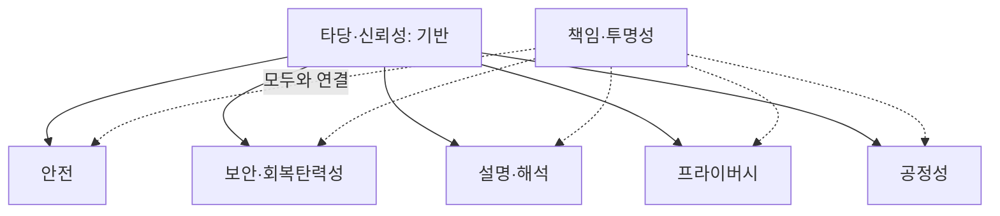

# 신뢰할 수 있는 AI 특성

> NIST AI RMF가 정리한 신뢰할 수 있는 AI의 7가지 특성: 타당·신뢰성, 안전, 보안·회복탄력성, 책임·투명성, 설명·해석 가능성, 프라이버시, 공정성(해로운 편향 관리).

## 쉽게 말하면
튼튼한 의자의 조건처럼 다리 4개 중 하나라도 약하면 앉을 수 없다. 신뢰는 "가장 약한 특성만큼"만 강하다.

## 자세히
출처: NIST AI RMF 특성 페이지(2026-11-15 확인).
1. **타당하고 신뢰할 수 있음**: 타당성 = 의도한 용도를 충족한다는 객관적 증거, 신뢰성 = 기대 조건에서 오래 고장 없이 작동. 정확성·견고성이 뒷받침. **다른 특성의 필요조건이자 기반**.
2. **안전**: 정의된 조건에서 사람·재산·환경을 위태롭게 하지 않음.
3. **보안·회복탄력성**: 기밀성·무결성·가용성을 지키고, 역경을 견디며 부드럽게 성능이 저하됨.
4. **책임·투명성**: 투명성 = 상호작용하는 사람이 얻는 정보량. 책임은 투명성에 의존.
5. **설명·해석 가능성**: 설명 = 작동 메커니즘("어떻게"), 해석 = 출력의 의미("왜"), 투명성 = "무슨 일이".
6. **프라이버시 강화**: 자율·정체성·존엄 보호, 익명성·기밀성·통제.
7. **공정·해로운 편향 관리**: 시스템적, 계산·통계적, 인지적(사람) 편향 세 범주.
- **관계**: 책임·투명성은 나머지 전부와 연결. 개별 특성을 각각 잘 다뤄도 신뢰가 보장되진 않는다.
- **상충**: 해석 가능성 vs 프라이버시, 예측 정확도 vs 해석 가능성, 데이터가 적을 때 프라이버시 기술이 정확도를 낮춰 공정성에 영향. 상충은 맥락·가치에 따라 투명하고 정당하게 해결한다.
- 측정 방법은 [TEVV](#tevv).

## 그림으로 보기

## 예시
- 대출 심사 AI: 정확도(타당성)가 높아도 설명이 안 되면 거절 사유를 못 알려 책임·투명성이 약해진다. 설명을 위해 추가 변수를 쓰면 프라이버시와 충돌할 수 있다.

## 헷갈리는 것과 비교
| 개념 | 차이 |
|---|---|
| 투명성 | 무슨 일이 있었나 |
| 설명 가능성 | 어떻게 작동하나 |
| 해석 가능성 | 출력이 왜·무슨 뜻인가 |
| [AI 안전·윤리](#ai-safety) | 상위 분야 |

## 더 읽을거리
- [AI RMF: AI Risks and Trustworthiness](https://airc.nist.gov/airmf-resources/airmf/3-sec-characteristics/) — 7가지 특성 원문 설명
