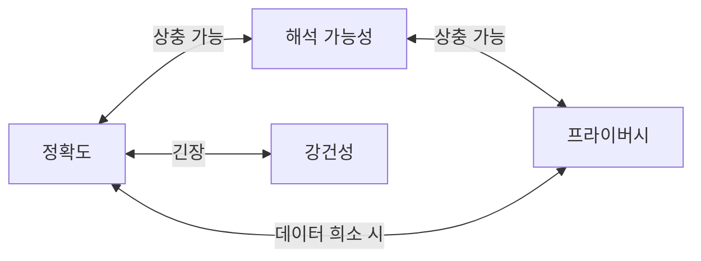
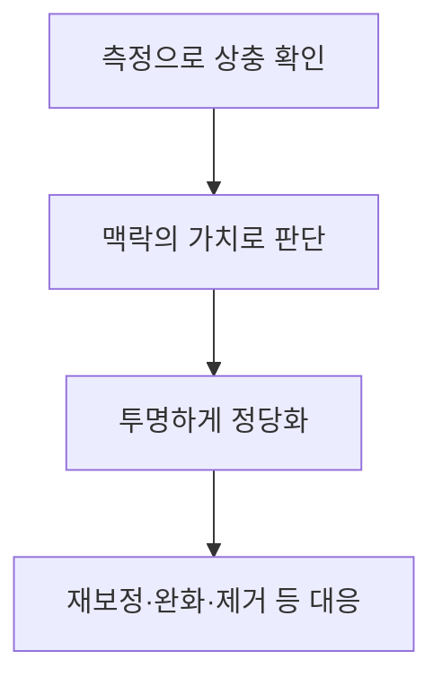

# 신뢰 특성 간 상충

> 정확도·해석 가능성·프라이버시·공정성·보안 같은 신뢰 특성은 서로 영향을 주고, 하나를 높이면 다른 하나가 떨어질 수 있다. NIST AI RMF는 이 상충을 숨기지 말고 맥락에 맞게 투명하게 균형을 잡으라고 한다.

## 쉽게 말하면
자동차를 가볍게 만들면 연비는 좋아지지만 충돌 안전이 줄 수 있다. 모든 장점을 동시에 최대로 만들 수는 없으니, 어떤 가치를 더 중시할지 정하고 이유를 밝혀야 한다.

## 자세히
출처: NIST AI 100-1(AI RMF 1.0, 2023) §3 신뢰 특성 서두와 MEASURE 서두(PDF를 내려받아 읽음).
- **원칙**: 특성을 하나씩만 챙겨서는 신뢰가 보장되지 않는다. 상충이 흔하고, 모든 특성이 모든 상황에 적용되지는 않으며, 신뢰는 "가장 약한 특성만큼만 강한" 사회적 개념이다.
- **NIST가 든 예**: ① 해석 가능성 vs 프라이버시, ② 예측 정확도 vs 해석 가능성, ③ 데이터가 희소한 조건에서 프라이버시 강화 기법이 정확도를 떨어뜨려 공정성 등 판단에 영향.
- **나쁜 조합의 예**: 보안은 높지만 불공정한 시스템, 정확하지만 불투명한 시스템, 부정확하지만 안전·프라이버시·투명한 시스템은 모두 바람직하지 않다.
- **정확도와 강건성**도 긴장 관계라고 §3.1이 말한다([타당하고 신뢰할 수 있음](#valid-and-reliable)).
- **분석의 한계**: 분석은 상충의 존재와 크기를 보여 주지만 어떻게 풀지는 알려 주지 않는다. 그것은 맥락의 가치에 달려 있고 "투명하고 정당화 가능하게" 해결해야 한다.
- **측정의 역할**: 상충이 생기면 측정이 관리 결정의 추적 가능한 근거가 된다. 선택지는 재보정, 영향 완화, 시스템 제거 등과 여러 통제다.
- **참여**: 배치 결정은 이해관계자를 넓게 포함해 위험·이익·비용과 특성을 맥락적으로 평가해 내려야 한다.

## 그림으로 보기

## 예시
- 의료 영상 모델: 가장 정확한 심층 모델은 설명이 어렵다. 환자 설명이 중요한 용도라면 정확도를 조금 양보하고 해석 가능한 모델을 택할 수 있다. 어떤 선택이든 이유를 문서화.
- 프라이버시 강화(노이즈 추가)로 소수 집단 데이터의 정확도가 크게 떨어지면 공정성 평가를 같이 다시 한다.

## 헷갈리는 것과 비교
| 개념 | 차이 |
|---|---|
| [타당하고 신뢰할 수 있음](#valid-and-reliable) | 기반 조건, 상충 논의의 출발 |
| 단순 점수 합산 | NIST는 점수 합산이 아닌 맥락적 판단과 정당화를 요구 |
| [MEASURE 함수](#measure-function) | 상충을 보이게 하는 측정 단계 |

## 더 읽을거리
- [NIST AI RMF 1.0 (AI 100-1) PDF](https://nvlpubs.nist.gov/nistpubs/ai/nist.ai.100-1.pdf) — §3 상충 예시와 MEASURE 서두(열어서 확인)
