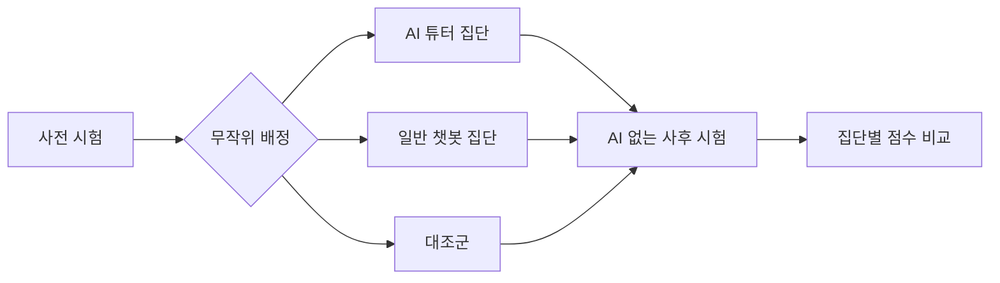

# AI 튜터 성과 측정

> AI 튜터가 실제로 학습을 높였는지는 대화 만족도가 아니라, AI 없이 치른 사전·사후 시험을 대조군과 비교해 잰다.

## 쉽게 말하면
다이어트 앱이 좋았는지는 "앱이 재밌었나"가 아니라 체중계 숫자로 본다. 튜터도 연습 중 점수가 아니라 AI를 치운 뒤의 시험 점수가 체중계다.

## 자세히
- 핵심 설계: **사전 시험 → 처치(튜터 사용) → AI 금지 사후 시험**, 그리고 AI를 안 쓴 **대조군**.
- 대표 사례: Bastani 외 연구(터키 고등학교 수학, 약 1,000명, PNAS 2025). 연습 문제 점수는 GPT Base 집단 +48%, GPT Tutor 집단 +127%였지만, AI 없는 시험에서는 GPT Base가 대조군보다 17% 낮고 GPT Tutor는 대조군과 비슷했다.
- 교훈: **연습 중 성과(수행)와 시험 성과(학습)를 분리**해 재야 한다. 가드레일이 해를 막은 것은 확인됐지만 학습을 "더 키웠다"고는 말하지 못한 점도 중요하다.
- 실무 지표 후보: 사후 점수 차이, 전이(새 유형 문제), 지연 시험(1~4주 뒤), 힌트 요청 횟수, 포기율. 대조군이 어렵다면 반 단위 비교나 시차 도입을 쓴다.

## 그림으로 보기

## 예시
사내 교육에서 신규 입사자 두 반에게 한쪽만 튜터를 쓰게 하고, 2주 뒤 AI 없이 같은 실무 퀴즈를 풀게 해 평균과 오답 유형을 비교한다.

## 헷갈리는 것과 비교
| 개념 | 차이 |
|---|---|
| 수행 지표 | AI를 쓰는 중의 점수 — 과대평가되기 쉬움 |
| 학습 지표 | AI 없이 본 시험 — 진짜 효과 |
| [학습 vs 수행](#learning-vs-performance) | 이 구분이 측정 설계의 근거 |
| [AI 평가·벤치마크](#ai-evaluation) | 모델 성능 평가, 여기서는 학습자 성과 평가 |

## 더 읽을거리
- [Bastani 외, SSRN 초록](https://papers.ssrn.com/abstract=4895486) — 연구 설계와 결과.
- [Wharton Knowledge 해설](https://knowledge.wharton.upenn.edu/article/without-guardrails-generative-ai-can-harm-education) — 연구 쉬운 설명.
