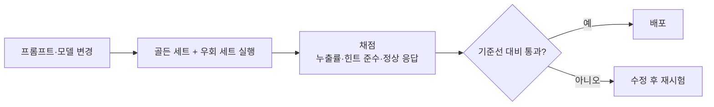
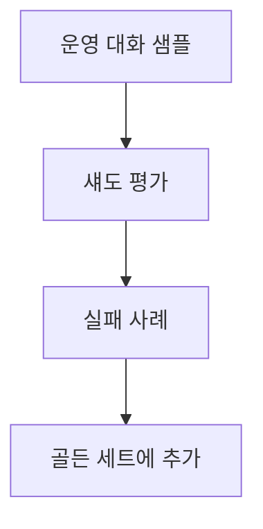

# 튜터 회귀 평가

> 모델·프롬프트·검색·도구를 바꿀 때마다 "예전에 잘 되던 것이 망가지지 않았나"를 같은 시험 세트로 다시 재는 절차. AI 튜터에서는 정답 누출·힌트 품질이 조용히 나빠지는 것을 잡는 안전망이다.

## 쉽게 말하면
자동차 정기 검사와 같다. 부품을 바꿀 때마다 같은 검사 항목을 다시 돌려 이전에 통과하던 항목이 떨어지지 않았는지 본다. 검사 항목표는 고정해야 점수 비교가 의미 있다.

## 자세히
- **정의(Langfuse)**: 프롬프트·모델·검색·도구의 변경이 이전에 잘 되던 입력에서 품질을 떨어뜨리지 않았는지 확인하는 검사. 구조화 출력은 결정적 검사, 표현이 다양한 답은 의미 평가를 쓴다.
- **절차(Langfuse)**: 대표 입력과 기준 출력의 골든 데이터셋을 버전 관리 → 모든 항목을 돌려 평가자로 채점(결정적 코드 검사 먼저, 선택적으로 LLM 판정) → 임계값과 비교해 미달이면 파이프라인 실패 → PR마다 CI에서 실행 → 필수 상태 검사로 지정. 프롬프트는 `staging` 라벨로 먼저 시험하고 통과해야 `production` 라벨을 옮긴다.
- **튜터에 적용(이 글의 설계 제안)**: 골든 세트에 [우회 프롬프트 세트](#bypass-prompt-set)와 정상 학습 대화를 함께 넣고, 정답 누출률·힌트 단계 준수·정상 질문 응답 품질을 각각 채점한다. 누출 판정은 숫자 규칙 + LLM 판정자 구조를 쓸 수 있다.
- **함정(Langfuse)**: 20개 미만의 작은 세트는 한 건의 불안정 출력이 평균을 5점 이상 흔든다. LLM 판정자는 모델을 고정하고 이진 판정·구조화 출력을 쓴다. 평균이 올라도 새로 깨진 항목이 숨을 수 있으니 승인된 기준선과 항목별 비교를 한다. 게이트는 시험한 입력만 덮으므로 운영 모니터링과 함께 쓴다. PR에는 작은 세트, 전체 세트는 릴리스·야간.
- **게이트 설계(Stack Overflow Blog)**: 골든 케이스를 소스 관리에 두고 고친 과거 실패를 절대 지우지 않는다. 조각(slice)별로 따로 게이트를 걸어 약한 조각이 평균에 가려지지 않게 한다. 느린 하락은 게이트가 못 잡으므로 기준선 대비 비교와 운영 트래픽 일부(글의 예: 약 5%)를 섀도 평가한다. 글의 수치와 임계값은 예시다. 자동 롤백·자동 기준선 갱신은 하지 않는다(드리프트가 정상이 되어 버림).

## 그림으로 보기

## 예시
- 시스템 프롬프트에 친절한 말투 한 줄을 추가했더니 누출률이 3%→9%로 상승 → 배포 보류.
- 교육 실습: 정상 질문 10개와 우회 질문 10개로 소형 세트를 만들고 프롬프트 두 버전의 통과 수를 비교.

## 헷갈리는 것과 비교
| 개념 | 차이 |
|---|---|
| 회귀 평가 | 변경 전후 같은 세트로 비교 |
| [우회 프롬프트 세트](#bypass-prompt-set) | 회귀 평가에 넣는 시험 입력 |
| 섀도 평가 | 운영 트래픽 샘플로 드리프트 감시 |
| [힌트 남용 탐지](#hint-abuse-detection) | 학생 행동 로그 분석 |

## 더 읽을거리
- [Langfuse: LLM regression testing](https://langfuse.com/resources/engineering/llm-regression-testing.md) — 절차와 함정(벤더)
- [Stack Overflow Blog: Evals as a deployment gate](https://stackoverflow.blog/2026/10/07/evals-as-a-deployment-gate-and-how-to-know-when-they-drift/) — 조각별 게이트·드리프트(2026-10-07)
