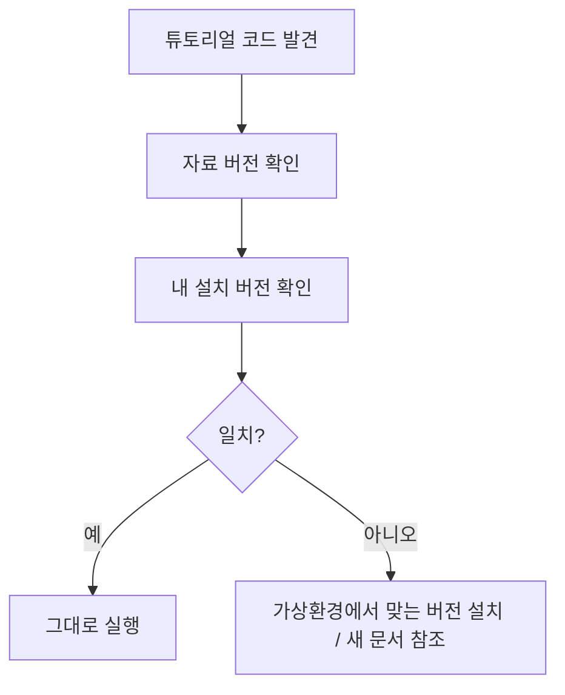
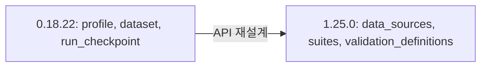

# 튜토리얼 버전 확인 습관

> 라이브러리 튜토리얼·블로그·AI가 준 코드를 실행하기 전에 **자료가 어느 버전 기준인지, 내 설치 버전이 무엇인지 먼저 대조하는 습관**이다. 빠르게 변하는 AI·데이터 도구는 버전이 다르면 같은 코드가 import부터 실패한다.

## 쉽게 말하면
내비게이션 지도가 3년 전 것이면 새로 뚫린 도로가 없고 사라진 도로를 안내한다. 코드 자료도 "언제 판 지도인지" 확인하고 따라가야 길을 잃지 않는다.

## 자세히
(이 세션에서 great_expectations **0.18.22**와 **1.25.0**을 각각 별도 가상환경에 설치해 같은 시험 스크립트를 **직접 실행**한 결과. 공식 마이그레이션 문서는 확인하지 않았다.)
- **실험 결과(실행)**
  | 시험 | 0.18.22 | 1.25.0 |
  |---|---|---|
  | `import great_expectations.profile.user_configurable_profiler` | 성공 | **ModuleNotFoundError** |
  | `import great_expectations.dataset` | 성공 | **ModuleNotFoundError** |
  | 컨텍스트 `run_checkpoint` / `add_checkpoint` | 있음 | **없음** |
  | 컨텍스트 `data_sources` / `suites` / `validation_definitions` | 없음 | 있음 |
  | `get_validator` | 있음 | 있음 |
  → 같은 라이브러리 이름이라도 **API 구조가 통째로 달라진다**. → [GX 1.x에서 사라진 기능](#gx-removed-features-1x)
- **습관 체크리스트(제안)**
  1. **내 버전 확인**: `python -c "import great_expectations as gx; print(gx.__version__)"` 또는 `pip show 패키지`.
  2. **자료의 버전 확인**: 글 작성일·설치 명령의 버전 핀(`==0.18.22`)·import 경로·공식 문서의 버전 선택기를 본다.
  3. **첫 줄 시험**: 튜토리얼 맨 위 import 한두 줄만 먼저 실행해 본다. 실패하면 버전 불일치를 의심한다.
  4. **버전 고정**: 옛 자료를 따라야 하면 가상환경에서 해당 버전을 설치(`pip install "pkg==X"`). 새 버전을 쓰려면 새 API 문서를 따른다.
  5. **AI가 만든 코드도 동일**: 모델의 학습 시점 이후에 바뀐 API는 틀릴 수 있다. 실행 전에 버전을 확인하게 하고, 오류가 나면 오류 메시지와 설치 버전을 함께 알려 준다(해석).
- **한계**: 이 실험은 한 라이브러리의 두 버전만 비교했다. 모든 도구에서 같은 폭의 변화가 있다는 뜻은 아니다.

## 그림으로 보기

## 예시
- 블로그의 `PandasDataset` 예제가 `ModuleNotFoundError`로 실패 → 글 작성 시점이 0.x임을 확인하고, 새 API 문서로 다시 작성.
- 교육 활동: 두 버전을 설치해 같은 스크립트를 돌리고 차이를 표로 만들어 발표.

## 헷갈리는 것과 비교
| 개념 | 차이 |
|---|---|
| 튜토리얼 버전 확인 | 자료와 설치 버전을 대조 |
| 의존성 고정(lock) | 프로젝트 전체 버전을 재현 가능하게 고정 |
| [GX 1.x에서 사라진 기능](#gx-removed-features-1x) | 구체적 변화 사례 |
| [GX API 버전 차이](#gx-api-version-differences) | 상위 노드 |

## 더 읽을거리
- [Great Expectations 문서](https://docs.greatexpectations.io/docs/) — 공식 문서(이 노드의 표는 직접 실행 결과이며 문서 본문은 근거 아님).
