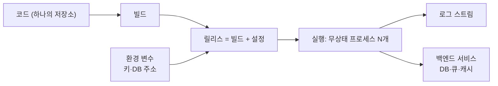

# 12-Factor App

> 클라우드에서 돌리는 서비스형 앱을 이식성·확장성 좋게 만들기 위한 12가지 원칙으로, Heroku 공동 창업자 출신 Adam Wiggins가 쓴 방법론이다(마지막 갱신 2017).

## 쉽게 말하면
레고 블록처럼 앱을 만드는 규칙집이다. 어느 방(개발 PC·테스트·운영 서버)에 놓아도 똑같이 끼워지고, 필요하면 같은 블록을 더 얹어 키울 수 있다. 방마다 달라지는 것(비밀번호·DB 주소)은 블록 안에 굳히지 않고 밖에서 꽂아 준다.

## 자세히
12factor.net(2026-11 확인)의 12가지:
1. **코드베이스** — 하나의 저장소, 여러 배포
2. **의존성** — 명시적으로 선언·격리
3. **설정(Config)** — 코드가 아닌 환경에서 주입 → [.env와 .gitignore](#dotenv-gitignore), [env.example](#env-example)의 근거
4. **백엔드 서비스** — DB·큐·캐시를 교체 가능한 리소스로
5. **빌드·릴리스·실행** — 세 단계를 분리
6. **프로세스** — 무상태(stateless)
7. **포트 바인딩** — 앱이 직접 포트를 열어 서비스
8. **동시성** — 프로세스를 늘려 확장
9. **폐기 가능성** — 빠른 시작, 우아한 종료
10. **개발·운영 일치** — 환경 차이를 최소화
11. **로그** — 이벤트 스트림으로 출력
12. **관리 프로세스** — 마이그레이션 등은 일회성 프로세스로

바이브코딩 맥락: AI가 API 키를 코드에 박아 넣거나 로컬 파일에 상태를 저장하는 코드를 쓰기 쉬우므로, 3번(설정)·6번(무상태)·11번(로그)을 요구 사항으로 먼저 알려 주면 배포가 편해진다.

## 그림으로 보기

## 예시
- 프롬프트: "이 앱을 12-Factor 원칙에 맞게 점검해 줘. 특히 설정이 코드에 하드코딩된 곳, 로컬 디스크에 상태 저장하는 곳을 찾아 줘."
- `DATABASE_URL`을 환경 변수에서 읽게 하고, 값은 `.env`(커밋 금지)와 견본 `.env.example`로 관리.

## 헷갈리는 것과 비교
| 개념 | 차이 |
|---|---|
| 12-Factor | 클라우드 앱 설계 원칙 모음 |
| [.env 견본](#env-example) | 3번 원칙(설정 분리)의 실무 도구 |
| 컨테이너(Docker) | 실행 단위 — 12-Factor를 따르면 컨테이너화가 쉬움 |

## 더 읽을거리
- [The Twelve-Factor App](https://12factor.net/) — 원문 12개 항목(Adam Wiggins, 2017 갱신).
