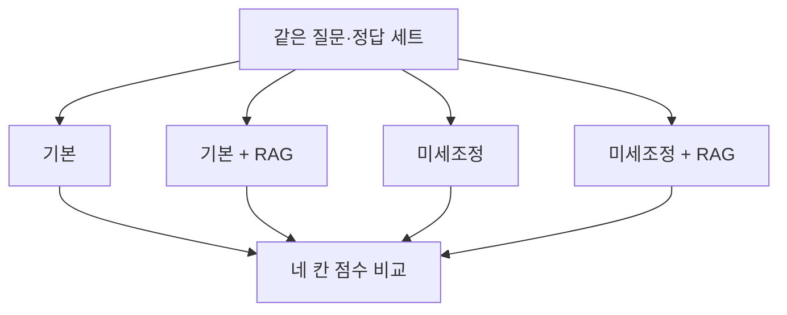

# 2×2 어블레이션

> **기본 / RAG / 미세조정 / 미세조정+RAG** 네 칸을 같은 질문 세트로 모두 돌려, 각 요소의 단독·결합 효과를 분리해서 보는 평가 설계다.

## 쉽게 말하면
새 칼과 새 레시피를 함께 도입했을 때 칼만, 레시피만, 둘 다 바꾼 경우를 각각 비교해야 무엇이 효과였는지 안다. 평가도 네 칸 표로 만든다.

## 자세히
(Ovadia 외, "Fine-Tuning or Retrieval? Comparing Knowledge Injection in LLMs"(arXiv 2312.05934 v3) PDF를 직접 읽었다. 2023~2024년의 7B급 모델(Mistral 7B, Llama2 7B, Orca2 7B) 실험이며 질문은 객관식이다.)
- **구성(논문)**: 기본 모델, 기본+RAG, 미세조정(FT), FT+RAG. 현재 사건 과제 표에서 FT-reg(원본 데이터로 미세조정)와 FT-par(**여러 번 바꿔 쓴** 데이터로 미세조정)로 나눠 비교한다. 그리드 서치로 RAG에 넣는 청크 수 K ∈ {0,…,5}, 0-shot vs 5-shot도 변화시켰다.
- **데이터(논문)**: **MMLU**의 해부학·천문학·대학 생물·대학 화학·선사 시대와, 모델 학습 컷오프 **이후**(2023-08~11 미국 사건, 위키백과 범주) 사건에 대한 객관식. 후자로 "새 지식"을 시험. 청크 240개에 2개 바꿔 쓰기를 검증용으로 따로 두었고, 현재 사건은 청크마다 10개 바꿔 쓰기를 만들었다.
- **결과 예(논문 Table 2, 현재 사건 정확도)**: Mistral 7B — 기본 0.481, 기본+RAG **0.875**, FT-reg 0.504, FT-par 0.588, FT-reg+RAG 0.810, FT-par+RAG 0.830. Llama2 7B — 기본 0.353, +RAG 0.585, FT-reg 0.219, FT-par 0.392, FT-reg+RAG 0.326, FT-par+RAG 0.520. Orca2 7B — 0.456, 0.876, 0.511, 0.566, 0.820, 0.826.
- **해석(논문 초록)**: 비지도 미세조정은 일부 개선을 주지만 **RAG가 일관되게 더 낫다**(기존 지식과 새 지식 모두). 미세조정+RAG가 항상 RAG만보다 낫지는 않았다(위 표에서 FT+RAG가 기본+RAG보다 낮음).
- **한계**: 비지도(라벨 없는) 미세조정, 7B 모델, 객관식 한정. 다른 결합 방식이나 지도 미세조정은 시험하지 않았다.

## 그림으로 보기

## 예시
- 사내 신규 제품 문서를 "알려 주는" 방법을 정할 때, 문서 200개로 네 칸을 모두 평가한 뒤 가장 비용 효율적인 칸을 고른다(제안).

## 헷갈리는 것과 비교
| 칸 | 의미 |
|---|---|
| 기본+RAG | 문서만 붙임 |
| 미세조정 | 지식을 가중치에 주입 |
| FT+RAG | 둘 다 |
| [지식 주입](#knowledge-injection) | 이 비교의 상위 개념 |

## 더 읽을거리
- [Ovadia et al. (2023)](https://arxiv.org/abs/2312.05934) — 직접 읽음.
