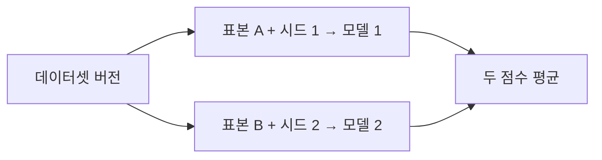
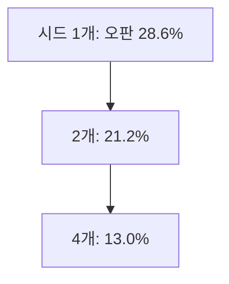

# 두 시드 평균

> 데이터셋 버전을 비교하는 소규모 실험(ablation)에서 **서로 다른 무작위 데이터 표본과 서로 다른 초기화 시드로 모델을 두 번 학습해 점수를 평균**하는 방법이다. 우연한 잡음이 "어느 데이터가 더 좋은가" 판단을 뒤집지 않게 줄인다.

## 쉽게 말하면
두 요리법을 비교하려고 한 번씩만 만들어 맛보면 그날 컨디션 탓에 틀린 결론을 낼 수 있다. 각각 두 번씩 만들어 평균을 내면 우연의 영향이 줄어든다.

## 자세히
- FineWeb 논문(arXiv 2406.17557 PDF 본문 직접 읽음): "무작위 데이터 부분집합 선택이 평가 점수에 미치는 영향을 줄이려고, 데이터셋 버전마다 **같은 크기이되 서로 다른 무작위 부분집합과 서로 다른 초기화 시드로 모델 2개**를 학습해 평균 점수를 비교"했다. 모델은 1.71B 파라미터 Llama 구조, 필터 ablation은 약 280억 토큰, 일부 중복 제거 ablation은 3,500억 토큰. 이렇게 70개 넘는 모델 학습에 H100 약 **80,000 GPU시간**을 썼다.
- 이유: 소규모 실험에서는 시드·표본에 따른 점수 변동이 데이터 차이만큼 클 수 있다. 시드를 바꾸는 것은 초기화 잡음, 다른 데이터 부분집합을 쓰는 것은 표본 잡음을 각각 평균에 반영한다.
- 직접 시뮬레이션(가정: 시드 하나의 점수 표준편차 0.5점, 두 데이터셋의 진짜 차이 0.4점, 정규 잡음, 20만 회): 잘못된 순서(더 나쁜 데이터가 높은 점수)가 나올 확률은 **시드 1개 28.6%, 2개 21.2%, 4개 13.0%**, 평균 점수의 표준편차는 0.50 → 0.35 → 0.25. 시드를 늘릴수록 오판이 줄지만 **2개만으로는 여전히 21%가 오판**일 수 있다. 가정이 임의라 실제 수치는 아니며 √(시드 수)로 잡음이 줄어드는 구조만 보여 준다.
- 실무(제안): 차이가 작은 비교는 시드를 더 늘리거나 평가 샘플을 늘린다. 차이가 시드 간 변동보다 작으면 결론을 유보한다. 두 시드가 서로 크게 어긋나면 평가 지표 자체를 의심한다([벤치마크 선택](#benchmark-selection-small-scale)).

## 그림으로 보기

## 예시
- 두 필터 설정의 효과 비교: 각각 시드 2개로 학습해 평균 점수 차이가 시드 간 차이보다 큰지 확인.
- 교육: 반복 측정과 평균으로 잡음을 줄이는 기본 통계 사고.

## 헷갈리는 것과 비교
| 개념 | 차이 |
|---|---|
| 시드 평균 | 반복 학습 결과의 평균 |
| 검증 세트 확대 | 평가 잡음을 줄임(학습 잡음과 별개) |
| 신뢰구간 | 평균의 불확실성 범위 표현 |

## 더 읽을거리
- [The FineWeb Datasets (arXiv 2406.17557)](https://arxiv.org/abs/2406.17557) — 두 모델 평균과 ablation 설정(PDF 본문 읽음).
