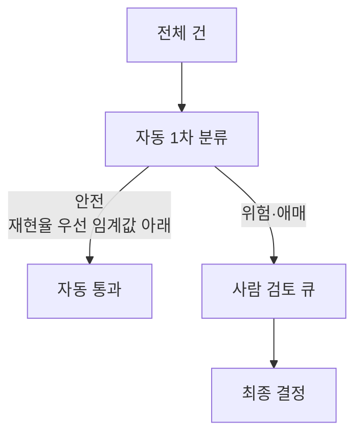
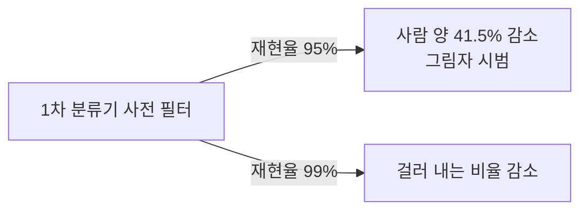

# 2단계 분류

> 2단계 분류는 자동 1차 분류기가 건을 "안전·위험·애매"로 먼저 나누고, 사람은 위험·애매한 건만 보게 하는 구조다. 쉬운 건에 사람 시간을 쓰지 않으려는 설계로, 1차 분류기에는 "위험을 놓치지 않는 것(재현율)"이 가장 중요하다.

## 쉽게 말하면
공항 검색대에서 기계가 가방 대부분을 통과시키고, 의심스러운 가방만 직원이 열어 본다. 기계가 진짜 위험한 가방을 놓치면 안 되므로, 확실히 안전한 것만 통과시키고 조금이라도 의심되면 사람에게 보낸다.

## 자세히
- **Google 연구(Supporting Human Raters…, arXiv 2406.12800, 본문 열람)**: 댓글 약 5만 건, 정책 4개(혐오 발언·폭력적 극단주의·괴롭힘·선거 허위 정보)에서 LLM(PaLM 2)이 사람 판정과 대체로 90% 안팎 일치했다. LLM을 **사전 필터**로 써서 명백히 문제없는 건을 사람 검토 전에 제거하는 시뮬레이션에서, 위반 재현율 95%를 유지하며 문제없는 댓글의 85.2~99.3%를 걸러 낼 수 있었다. 재현율 99%를 요구하면 54.5~98.2%다(정책별 범위).
- **실제 시범(그림자 모드)**: 영어 2,700건·30일. LLM을 재현율 95.1%로 설정하면 사람이 평가할 양을 41.5% 줄였을 것이라고 보고한다.
- **확신 점수로 에스컬레이션**: "Yes" 토큰 확률을 확신 점수로 쓰고 임계값을 조절한다. 0.5 위는 정밀도, 아래는 재현율을 우선한다. 사전 필터는 재현율, 즉시 에스컬레이션은 높은 정밀도가 필요하다. 정밀도 95% 요건에서는 정책에 따라 위반의 41.5~97.4%를 자동 에스컬레이션할 수 있었고, 99% 정밀도는 혐오·괴롭힘에서 이 데이터로는 불가능했다.
- **한계(저자 명시)**: 정책 4개·영어·한 플랫폼의 댓글만, 정답 라벨 오류 가능성(위반 최대 2%, 비위반 최대 8%가 오라벨일 수 있음), 긴 댓글에서 정확도 하락, PaLM 2만 시험, 프롬프트 주입·드리프트·편향 위험.
- **비판적 시각(Huang, arXiv 2409.03219, 초록·본문 일부 열람)**: LLM 조정을 정확도로만 평가하면 오해를 부른다. LLM의 쓸모는 정확도 향상이 아니라 쉬운 건과 어려운 건을 가르고, 설명·맥락을 사람에게 주는 것이다. LLM과 사람 조정자의 불일치, 낮은 모델 확신을 어려운 건의 신호로 제안하며, LLM의 정확도 이득은 비용·지연으로 상당 부분 상쇄된다고 주장한다.
- **일반 패턴(검색 요약, 블로그 수준)**: 규칙 → 경량 분류기 → LLM → 사람의 계단식 구조로 대부분을 싸게 처리하고 비싼 판단을 소수에 남긴다.

## 그림으로 보기

## 예시
- 댓글 검수: 문제없음이 압도적으로 많은 큐에서 LLM이 확실한 정상을 먼저 걸러 내고, 사람은 나머지만 본다. 걸러 낸 건 중 일부를 무작위 표본으로 다시 사람이 확인한다([자동 승인 표본 감사](#audit-sampling-auto-approved)).
- 교육 활용: 재현율 95%와 99% 사이의 절충(사람 부담 vs 놓치는 위반)을 숫자로 토론한다.

## 헷갈리는 것과 비교
| 개념 | 차이 |
| --- | --- |
| [검토 큐 설계](#review-queue-design) | 상위 주제. 2단계 분류는 큐에 들어오는 양을 줄이는 방법 |
| [이중 임계값 정책](#double-threshold-policy) | 확신 점수 기준선 두 개. 2단계 분류는 그 구조를 쓰는 운영 모델 |
| 위임 학습 | 위임 규칙을 학습으로 만듦. 여기는 임계값 설정이 중심 |

## 더 읽을거리
- [Supporting Human Raters with the Detection of Harmful Content using LLMs (arXiv 2406.12800)](https://arxiv.org/html/2406.12800v1) — 사전 필터·에스컬레이션 시뮬레이션과 시범
- [Huang: LLM content moderation 평가 논문 (arXiv 2409.03219)](https://arxiv.org/html/2409.03219v1) — 정확도 중심 평가 비판
