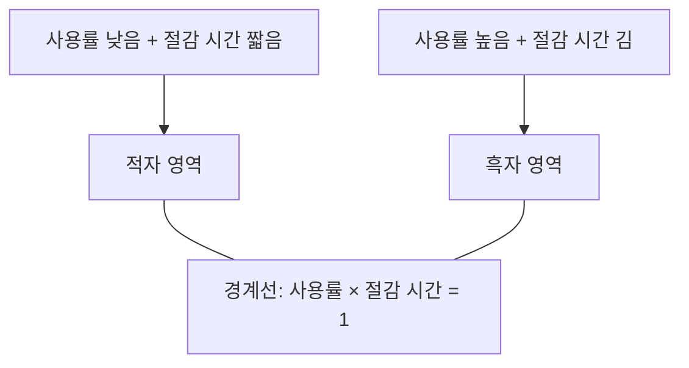

# 이원 민감도 분석

> 이원(two-way) 민감도 분석은 두 입력을 동시에 바꿔 가며 결과를 격자표나 히트맵으로 보는 방법이다. 일원 분석이 놓치는 "두 변수가 함께 움직일 때의 효과"와 결론이 뒤집히는 경계선을 보여 준다.

## 쉽게 말하면
요리에서 소금과 불 세기를 각각 따로 바꿔 보는 것이 일원 분석이라면, 소금 3단계 × 불 3단계의 9가지 조합을 모두 맛보고 "이 조합부터는 맛있다"는 경계를 표시하는 것이 이원 분석이다.

## 자세히
- **정의**: 모델의 전체 결과가 두 핵심 입력을 동시에 바꿀 때 얼마나 견고한지 확인한다(YHEC 용어집 요약, 검색 결과만 확인하고 해당 페이지는 열람 실패). Briggs 등의 교재를 직접 확인하지 못했다.
- **분류**: 결정론적 민감도 분석의 한 형태로 "두 개 또는 여러 개 모수 묶음"을 함께 바꾸는 방식이다(PMC7790801, 열람). 같은 글은 고전적 결정론 분석 일반의 한계로 임의의 범위, 숨은 비선형성, 가능성 정보 없음, 모수 간 상관 무시를 든다. 이원 분석도 이 한계를 그대로 갖는다.
- **상관이 있는 입력에 유용(검색 요약)**: 두 변수가 서로 상관되어 있다면 각각 독립적으로 바꾸는 일원 분석이 오해를 부를 수 있어 이원 분석이 낫다.
- **의사결정 경계 표시**: 격자 색으로 "어느 전략이 최적인가"를 표시하면 경계가 보인다. 예를 들어 BMC Medicine의 성과 연동 지급 모델은 인센티브 지급액과 사망 감소 효과의 조합별 최적 전략을 이원 분석으로 보인다(검색 결과의 그림 설명, 본문은 열람 실패).
- **임계값 분석과의 관계(검색 요약)**: 결과가 뒤집히는 입력 값(임계값)을 찾는 분석이 있다. 확률적 임계값 분석 논문은 결정론적 임계값 분석이 부정확할 수 있다고 한다(본문 미열람).
- **가상 예시(직접 계산)**: AI 도구 100명, 인당 월 라이선스 30,000원, 시간당 인건비 30,000원 가정. 연 순효과(백만 원) = 36 × 사용률 × 월 절감시간 − 36.

| 월 절감 시간 \ 사용률 | 30% | 50% | 70% | 90% |
| --- | --- | --- | --- | --- |
| 1시간 | −25.2 | −18.0 | −10.8 | −3.6 |
| 2시간 | −14.4 | 0.0 | +14.4 | +28.8 |
| 3시간 | −3.6 | +18.0 | +39.6 | +61.2 |
| 4시간 | +7.2 | +36.0 | +64.8 | +93.6 |

  손익분기선은 사용률×절감 시간 = 1(예: 50%·2시간)이다. 한 변수만 바꾸는 일원 분석으로는 이 곱셈 구조가 안 보인다. 수치는 설명용 가상값이다.
- **한계**: 변수가 셋 이상이면 격자가 폭증한다(전역 방법이나 몬테카를로로 보완).

## 그림으로 보기

## 예시
- AI 도입 ROI: 사용률×절감 시간 격자를 만들어 경영진에게 "사용률이 50% 미만이면 3시간 이상 절감돼야 흑자"처럼 조건을 말한다.
- 교육 활용: 엑셀로 4×4 표를 직접 만들고 손익분기선을 색으로 칠하는 실습.

## 헷갈리는 것과 비교
| 개념 | 차이 |
| --- | --- |
| [일원 민감도 분석](#one-way-sensitivity) | 변수 하나씩. 이원은 두 변수의 조합 |
| [시나리오 분석](#scenario-analysis-roi) | 입력 여러 개를 묶어 낙관·기준·비관으로 이동 |
| [몬테카를로 ROI](#monte-carlo-roi) | 모든 입력을 분포로 흔들어 확률 분포를 얻음 |

## 더 읽을거리
- [Deterministic sensitivity analysis 개요 (PMC7790801)](https://pmc.ncbi.nlm.nih.gov/articles/PMC7790801) — 일원·이원 DSA와 한계
