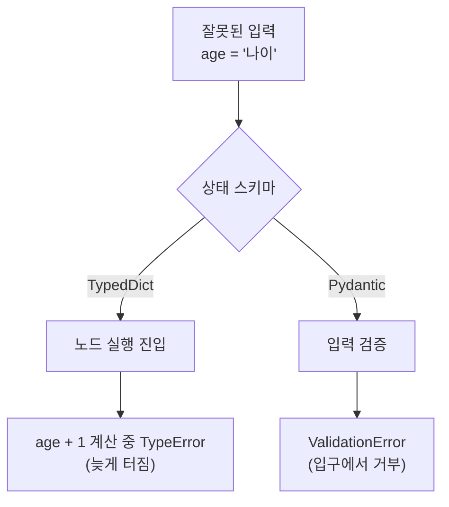

# TypedDict vs Pydantic

> LangGraph의 상태 스키마는 **`TypedDict`(가볍고 빠른 타입 힌트)** 또는 **Pydantic `BaseModel`(입력을 실제로 검증)** 로 정의할 수 있다. 차이는 **잘못된 입력이 언제, 어떤 모습으로 드러나는가**다.

## 쉽게 말하면
TypedDict는 "이 서류는 나이 칸에 숫자를 쓰는 양식이에요"라는 안내문만 붙인 서식이고, Pydantic은 접수 창구에서 "숫자 아니면 접수 안 받습니다"라고 직접 검사하는 직원이다. 안내문만 있으면 틀린 서류가 접수되고 뒤쪽 담당자가 계산하다 터진다.

## 자세히
- **TypedDict**: 딕셔너리의 키와 값 타입을 적은 힌트로, **실행 중에 검사하지 않는다**(타입 검사기·에디터용). 상태는 딕셔너리로 다룬다(`state["age"]`).
- **Pydantic `BaseModel`**: 필드 타입을 **실제로 검증**하고 변환한다. 노드 안에서 상태를 속성으로 다룬다(`state.age`). 기본값·검증기를 쓸 수 있다.
- **직접 실행**(langgraph 1.2.24, pydantic 2.13.5): 상태 `age: int`인 그래프에서 노드가 `age + 1`을 반환.

| 상태 정의 | 입력 `{"age": 1}` | 입력 `{"age": "나이"}` |
|---|---|---|
| `TypedDict` | `{'age': 2}` | **`TypeError`**: str과 int를 더할 수 없음 — **노드 안에서 늦게, 엉뚱한 위치에서** 터짐 |
| `Pydantic BaseModel` | `{'age': 2}` | **`ValidationError`**: 필드 `age` 검증 실패 — **입력 단계에서 명확히** 거부 |

  두 경우 모두 결과는 딕셔너리(`dict`)로 반환됐다(출력 형태는 같음).
- **선택 기준**:
  1. 속도·단순함이 중요하고 입력이 신뢰됨 → `TypedDict`.
  2. 사용자·LLM이 만든 불확실한 입력이 들어옴 → `Pydantic`(입력 경계에서 검증).
  3. LLM이 만든 구조화 출력은 어느 쪽이든 **받은 뒤 검증**([JSON 스키마 검증](#json-schema-validation)).
- **주의**: Pydantic 검증은 **그래프 입력**에서 일어나며, 노드가 반환하는 중간 갱신에 대한 검증 범위는 LangGraph 버전·설정에 따라 다를 수 있다. 공식 문서의 상태 스키마 절을 확인한다. 검증 비용도 있으니 성능이 중요하면 측정한다.
- 한계: 위 실험은 단순 `int` 필드 하나다. 중첩 모델·검증기·기본값에서는 동작이 더 다양하다.

## 그림으로 보기


## 예시
```python
from typing import TypedDict
from pydantic import BaseModel

class TD(TypedDict):
    age: int          # 힌트일 뿐, 실행 중 검사 없음

class PD(BaseModel):
    age: int          # 실제로 검증됨

def inc_pd(s: PD):    # 속성 접근
    return {"age": s.age + 1}
```
- 실무 감각: 외부 입력(웹 폼·LLM 출력)을 받는 첫 노드의 상태는 Pydantic, 내부 노드끼리 주고받는 가벼운 상태는 TypedDict로 나누는 설계도 있다.

## 헷갈리는 것과 비교
| 개념 | 차이 |
|---|---|
| TypedDict | 타입 힌트(실행 중 검사 안 함), 딕셔너리 접근 |
| Pydantic BaseModel | 실제 검증·변환, 속성 접근 |
| dataclass | 검증 없는 간단한 데이터 클래스(LangGraph도 지원) |
| [리듀서](#langgraph-reducer) | 상태 키를 합치는 규칙(스키마와 별개로 붙음) |

## 더 읽을거리
- [LangGraph: Graph API](https://docs.langchain.com/oss/python/langgraph/graph-api) — 상태 스키마 정의 방법.
- [Pydantic 문서](https://docs.pydantic.dev/latest/) — 검증과 모델 정의.
