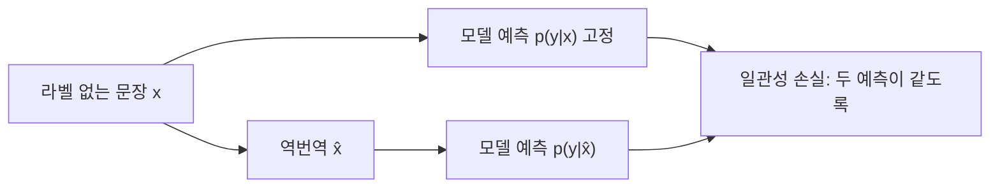
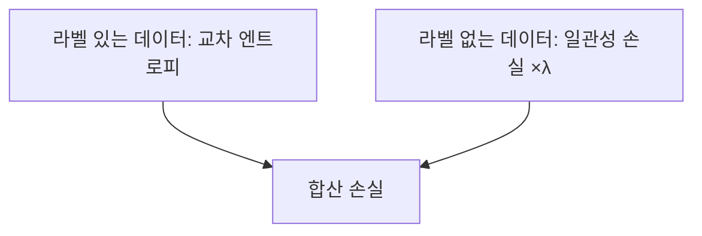

# UDA 일관성 학습

> **같은 정답 없는 데이터(라벨 없음)를 원본과 증강본으로 두 번 모델에 넣고, 두 예측이 같아지도록 학습하는 준지도 학습 방법**이다. 라벨이 거의 없어도 라벨 없는 데이터를 학습 신호로 쓸 수 있고, 핵심은 가우시안 노이즈 같은 단순 잡음 대신 **역번역·RandAugment 같은 고품질 증강**을 쓰는 것이다.

## 쉽게 말하면
정답이 없는 문제집이 있어도, 같은 문제를 말만 바꿔 두 번 보여 주고 "답이 같아야 한다"고 가르칠 수 있다. 문장을 영어→프랑스어→영어로 돌려 쓴 다른 표현도 원래 문장과 같은 감정(긍정/부정)이어야 하기 때문이다.

## 자세히
(Xie 외 2019/2020, arXiv 1904.12848 PDF 본문을 직접 읽음)
- 목적식: 라벨 있는 데이터의 교차 엔트로피 + λ × 라벨 없는 데이터의 **일관성 손실** CE(p(y|x) ‖ p(y|증강 x̂)). 원본 쪽 예측 p_θ̃는 파라미터를 고정한 복사본이라 기울기를 흘리지 않는다. λ=1이 기본이고 일관성 손실에는 더 큰 배치를 쓴다.
- 핵심 주장: 증강의 **품질**이 중요하다. 근거 세 가지(저자 논의): 유효한 잡음(라벨을 유지), 다양한 잡음(큰 변형 가능), 목표 지향 잡음(전이 가능한 유익한 변형). 단순 잡음 대신 RandAugment(이미지)와 **역번역**(텍스트)을 쓰면 같은 프레임에서 크게 좋아진다.
- 텍스트 증강: 역번역(WMT'14 영어↔프랑스어 번역 모델로 문장을 왕복)과 TF-IDF 기반 단어 치환(정보량 낮은 단어를 바꾸고 높은 단어는 유지)을 쓴다.
- 보조 기법: ① 신뢰도 마스킹 — 현재 모델의 최고 확률이 임계값 β보다 큰 예제에만 일관성 손실을 계산(CIFAR-10·SVHN은 0.8, ImageNet은 0.5) ② 예측 날카롭게(낮은 softmax 온도 τ) ③ 학습 신호 어닐링 등.
- 결과(논문 주장): IMDb에서 라벨 20개만으로 오류율 4.20으로, 라벨 25,000개로 학습한 당시 최고 모델을 앞섰다. CIFAR-10에서 라벨 250개로 오류율 5.43. BERT 미세조정과도 결합 가능. 6개 언어 과제·3개 비전 과제에서 개선. 2019~2020년 결과다.
- 한계: 증강이 라벨을 바꾸면(의미 변화) 일관성 학습이 틀린 신호를 준다 → [텍스트 증강 라벨 점검](#text-augmentation-label-check).

## 그림으로 보기

## 예시
- 라벨이 20개뿐인 리뷰 감성 분류에 라벨 없는 리뷰 수만 개를 역번역해 일관성 학습.
- 교육: "정답 없이도 '같은 문제는 같은 답'이라는 규칙으로 배운다."

## 헷갈리는 것과 비교
| 개념 | 차이 |
|---|---|
| UDA | 증강 품질에 초점인 일관성 학습 |
| 지도 학습 증강 | 라벨 있는 데이터를 늘림 |
| 의사 라벨링 | 모델 예측을 정답으로 삼아 재학습 |
| [역번역](#back-translation) | UDA가 쓰는 텍스트 증강 |

## 더 읽을거리
- [Unsupervised Data Augmentation for Consistency Training (arXiv 1904.12848)](https://arxiv.org/abs/1904.12848) — 목적식·역번역·결과(PDF 본문 읽음).
