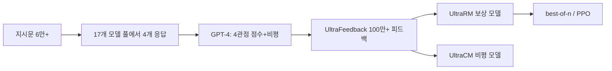
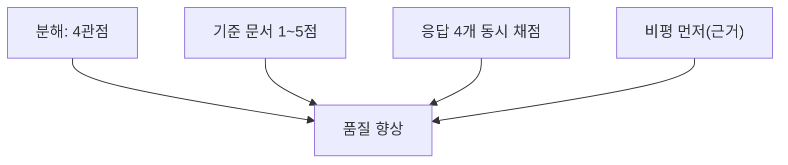

# UltraFeedback

> 6만 개가 넘는 지시문에 17개 모델이 낸 응답을 GPT-4가 4가지 관점으로 점수·비평한, 100만 건 이상 규모의 공개 AI 피드백(선호) 데이터셋이다(2023, 칭화대 등).

## 쉽게 말하면
사람 심사위원 수백 명 대신 GPT-4 한 명이 같은 채점표로 답안 수십만 개를 점수 매기고 "왜 이 점수인지" 코멘트까지 단 성적표 묶음이다. 오픈소스 모델을 사람 선호에 맞추는(정렬) 재료로 쓴다.

## 자세히
(Cui 외, arXiv 2310.01377 초록과 PDF 본문을 직접 열어 확인.)
- **규모**: 지시문 **6만+**, 모델 풀 **17개**(GPT-4, gpt-3.5-turbo, Bard, UltraLM, WizardLM, Vicuna, LLaMA2-Chat, Alpaca, MPT, Falcon, StarChat, Pythia 등). 지시문 하나당 풀에서 **무작위 4개 모델**이 응답. 점수+텍스트 비평으로 **100만 건 이상** 피드백(초록: 약 25만 대화에 대한 GPT-4 피드백).
- **4가지 관점**: instruction-following(지시 이행), truthfulness(진실성), honesty(모르는 걸 아는 척하지 않기), helpfulness(도움됨). 지시문은 TruthfulQA 등 여러 출처에서 모음.
- **편향·잡음 완화 4기법**: ① **분해**(관점 4개로 나눠 채점) ② **기준**(관점별 1~5점 채점 기준 문서 제공) ③ **참조**(한 지시문과 응답 4개를 한 프롬프트에 넣어 동시에 채점) ④ **근거**(점수를 매기기 전에 GPT-4가 비평 생성).
- **파생 모델**: LLaMA2-13B 미세조정 보상 모델 **UltraRM**(공개 보상 모델들보다 우수하다고 보고), UltraRM으로 best-of-n·PPO를 적용한 UltraLM, 비평 모델 UltraCM.
- **한계(저자도 언급)**: AI 피드백은 답변 위치 등 특성에 편향될 수 있다. 보상 모델 실험에서도 첫 번째 응답을 선호하는 위치 편향이 관찰되어 순서를 바꿔 평균했다고 한다. 주장: 구체 점수는 이번에 확인하지 않음.

## 그림으로 보기

## 예시
- Hugging Face에서 데이터셋을 받아 선호 쌍을 만들어 DPO/보상 모델 학습 실습.
- 교육 활용: "AI가 만든 평가 데이터로 AI를 가르친다"의 장점(규모)과 위험(편향)을 토론.

## 헷갈리는 것과 비교
| 개념 | 차이 |
|---|---|
| UltraFeedback | GPT-4가 매긴 AI 선호 데이터 |
| 사람 선호 데이터(HH-RLHF 등) | 사람이 라벨, 비싸고 작음 |
| [AI 판정의 위치·길이 편향](#ai-judge-position-bias) | UltraFeedback도 겪는 한계 |

## 더 읽을거리
- [UltraFeedback (arXiv 2310.01377)](https://arxiv.org/abs/2310.01377) — 구축 파이프라인·UltraRM.
