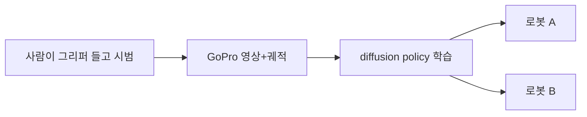
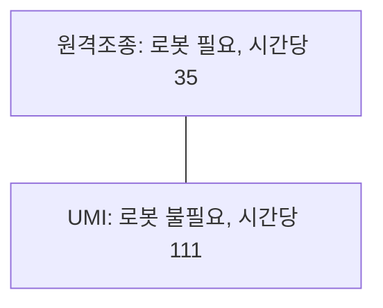

# UMI 그리퍼

> **UMI(Universal Manipulation Interface)**는 손에 쥐고 쓰는 평행 집게 그리퍼에 손목 카메라(GoPro)를 달아, **로봇 없이 사람이 돌아다니며 시연 데이터를 모으고** 그 정책을 여러 로봇에 옮겨 쓰는 프레임워크다(프로젝트 페이지 기준).

## 쉽게 말하면
로봇 팔을 조종 장치로 가르치는 대신, 집게 달린 막대를 들고 "이렇게 집어" 하고 직접 시범을 찍는 방식이다. 로봇이 옆에 없어도 어디서나 시범을 찍을 수 있다.

## 자세히
- 하드웨어: 손에 드는 평행 집게 + 손목 GoPro. 페이지에 가격은 없다.
- 수집 속도(컵을 접시에 올리는 과제): UMI **시간당 111개**, 맨손 231개, 스페이스마우스 원격조종 35개. 원격조종보다 3배 이상 빠르고 맨손의 약 48%.
- 학습: diffusion policy를 쓰고, 추론 지연을 맞추는 **latency matching**과 상대 궤적 행동 표현을 쓴다.
- 과제: 물체 던져 분류, 컵 올리기, 양팔 스웨터 접기, 설거지(7단계), 야외 컵 작업.
- 주장: 다양한 환경의 시연으로 학습하면 새 환경·물체에 zero-shot 일반화. 페이지에는 수치 성공률이 없어 정량 검증은 논문 본문 확인 필요.
- [ALOHA](#aloha-act)가 로봇을 직접 조종해 시연한다면, UMI는 로봇 없이 시연 수집을 분리해 규모를 키우는 접근이다.

## 그림으로 보기

## 예시
- 식당 주방, 가정집 등 여러 장소에서 접시 정리 시범을 수집해 한 정책을 학습.
- 교육: "데이터 수집 도구 설계가 AI 성능을 좌우한다"는 사례.

## 헷갈리는 것과 비교
| 개념 | 차이 |
|---|---|
| UMI | 로봇 없는 휴대 수집 |
| [ALOHA](#aloha-act) | 로봇 직접 원격조종 수집 |
| [모방 학습](#imitation-learning) | 둘이 공유하는 학습 방식 |

## 더 읽을거리
- [UMI 프로젝트 페이지](https://umi-gripper.github.io/) — 수집 속도·과제(읽음).
