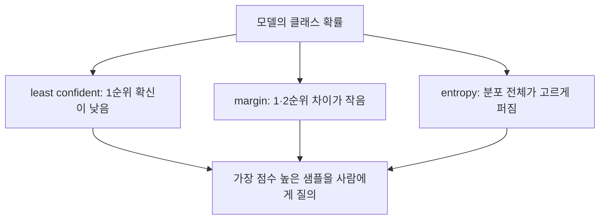
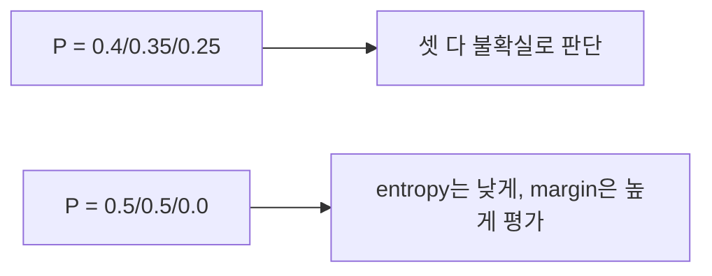

# 불확실성 샘플링 3종

> 능동 학습에서 "모델이 가장 헷갈려 하는 샘플"을 골라 사람에게 라벨을 묻는 전략이다. 헷갈림을 재는 방식에 따라 least confident, margin, entropy 3가지가 있다.

## 쉽게 말하면
학생이 풀다 막힌 문제만 선생님께 물어보는 것과 같다. "1순위 답의 확신이 낮은 문제", "1·2순위 답이 비슷한 문제", "보기 전체의 확신이 고르게 흩어진 문제" 중 무엇을 '헷갈림'으로 볼지가 다르다.

## 자세히
(Settles, "Active Learning Literature Survey", UW-Madison TR 1648, 3.1절을 직접 읽고 확인.)
- **기원**: Lewis & Gale(1994). 이진 분류에서는 사후확률이 0.5에 가장 가까운 샘플을 묻는다.
- **Least confident**: x* = argmax(1 − P(ŷ|x)), ŷ는 가장 확률 높은 라벨. 1순위 라벨만 보고 나머지 분포는 버린다. 시퀀스 모델(Viterbi)에 많이 쓴다.
- **Margin**(Scheffer 외 2001): x* = argmin(P(ŷ₁|x) − P(ŷ₂|x)), 1·2순위 확률 차가 작을수록 모호. 라벨 수가 매우 많으면 나머지 클래스는 무시한다.
- **Entropy**(Shannon): x* = argmax(−Σ P(yᵢ|x) log P(yᵢ|x)). 전체 분포를 쓰며 다중 라벨·시퀀스·트리로 일반화된다.
- **차이**: 이진 문제에서는 셋이 같다. 3클래스 이상에서는 모두 확률이 균등한 중심점이 가장 유익하지만, 한 클래스가 매우 낮고 나머지 둘이 비슷한 샘플은 entropy가 덜 선호하고 least confident·margin은 유용하다고 본다.
- **어느 것이 낫나**: 저자는 실험 비교 결과가 엇갈리며 응용에 따라 다르고 대체로 무작위(수동) 학습보다 낫다고 정리한다. 직관: entropy는 log-loss 최소화, margin·least confident는 분류 오류 감소에 맞는다.
- **한계**: 결정 경계의 이상치(outlier)를 고를 수 있어 밀도 가중으로 보완한다(3.6절).

## 그림으로 보기

## 예시
- 라벨 200개 모델로 라벨 없는 문서 1만 건의 확률을 계산하고, margin이 가장 작은 50건을 라벨러에게 보낸다.
- 교육 활용: "AI가 모르는 것만 사람에게 묻는 협업"의 설명.

## 헷갈리는 것과 비교
| 방식 | 보는 것 | 특징 |
|---|---|---|
| Least confident | 1순위 확률 | 단순, 나머지 분포 무시 |
| Margin | 1·2순위 차이 | 모호한 경계 포착 |
| Entropy | 전체 분포 | 다중 클래스·구조 출력에 일반화 |

## 더 읽을거리
- [Active Learning Literature Survey (Settles)](https://burrsettles.com/pub/settles.activelearning.pdf) — 3.1절 불확실성 샘플링.
