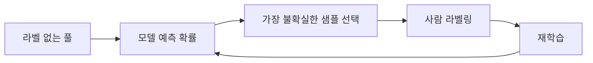

# 불확실성 샘플링

> 능동 학습에서 **모델이 가장 확신하지 못하는 샘플을 골라 사람에게 라벨을 요청**하는 가장 단순하고 흔한 방식이다(Lewis & Gale, 1994).

## 쉽게 말하면
시험공부에서 이미 아는 문제는 건너뛰고 가장 헷갈리는 문제만 선생님께 물어보는 것이다. 라벨링 비용을 헷갈리는 샘플에 집중한다.

## 자세히
(Burr Settles, "Active Learning Literature Survey"(위스콘신-매디슨 대학 Computer Sciences Technical Report 1648, 2009) PDF를 직접 읽었다. 2009년 문헌 조사라 최신 딥러닝 기법은 다루지 않는다.)
- **이진 분류(문헌)**: 양성일 사후확률이 **0.5에 가장 가까운** 샘플을 질의.
- **3가지 변형(다클래스)**:
  - **least confident**: 가장 가능성 높은 라벨의 확률이 가장 낮은 샘플(x* = argmax 1 − P(ŷ|x)). 기대 0/1 손실로 해석. 가장 가능성 높은 라벨만 보므로 나머지 분포 정보를 "버린다".
  - **margin**(Scheffer 외 2001): 1위와 2위 확률 차이가 가장 작은 샘플. 마진이 작으면 모호.
  - **entropy**: 전체 라벨 분포의 불확실성(Shannon 엔트로피). 시퀀스 같은 구조화 출력으로 일반화 용이.
- **이진에서의 동치(문헌)**: 세 방식 모두 **클래스 사후확률이 0.5에 가장 가까운 샘플**을 질의하는 것과 같다.
- **선택 지침(문헌)**: 엔트로피는 꼬리 확률이 긴 분포에도 민감하므로 분류 오류를 줄이려면 margin·least confident가 더 적합할 수 있다는 서술. 실무에서는 비교 시험이 필요하다.
- **한계(해석)**: 불확실성이 큰 샘플이 이상치나 잘못된 라벨일 수 있다.

## 그림으로 보기

## 예시
- 고객 문의 분류에서 1위·2위 확률 차이가 작은 문의 200건을 먼저 사람에게 라벨링(margin sampling, 제안).

## 헷갈리는 것과 비교
| 방식 | 기준 |
|---|---|
| least confident | 최상위 확률이 낮음 |
| margin | 1·2위 차이가 작음 |
| entropy | 전체 분포가 퍼짐 |
| [위원회 질의](#query-by-committee) | 여러 모델의 불일치 |

## 더 읽을거리
- [Settles (2009) — Active Learning Literature Survey](https://burrsettles.com/pub/settles.activelearning.pdf) — 직접 읽음.
