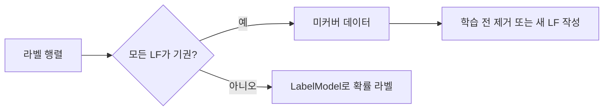
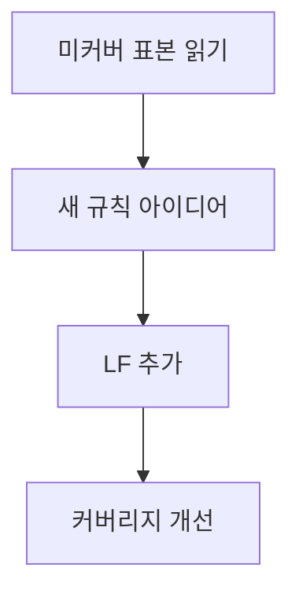

# 라벨 못 붙인 데이터

> 어떤 LF도 라벨을 붙이지 않은(전부 기권한) 학습 데이터다. 지도 신호가 없어 Snorkel은 분류기 학습 전에 걸러 낸다.

## 쉽게 말하면
채점 기준표에 해당하는 항목이 하나도 없어서 점수를 못 준 답안과 같다. 억지로 점수를 주면 오히려 노이즈가 된다.

## 자세히
(Snorkel 튜토리얼 소스를 직접 읽고 확인.)
- **원인**: LF가 일부 데이터만 다루고(기권 허용), 규칙에 걸리지 않는 문서가 남는다. 단일 LF가 전체를 정확히 라벨하면 분류기도 필요 없지만, 대부분 문제는 그렇지 않아 여러 LF를 합친다.
- **처리**: 튜토리얼은 "지도 신호를 주지 않고 성능을 해치는 경향이 있으므로" 분류기 학습 전에 `filter_unlabeled_dataframe(X, y, L)`로 제거한다.
- **그래도 분류기가 일반화한다**: 분류기는 라벨이 붙은 데이터로 학습하지만 텍스트 특징을 배워 LF가 닿지 않은 새 데이터도 예측한다. 튜토리얼에서 분류기가 LabelModel만 쓴 경우보다 점수가 몇 포인트 높았다고 설명(정확한 수치는 노트북 실행 결과로 이번에 확인하지 않음).
- **대응(제안)**: 미커버 샘플을 읽어 새 LF를 만든다(예: 아직 없는 키워드·패턴), 미커버 비율을 추적, 편향 확인(특정 주제·언어만 미커버인지).

## 그림으로 보기

## 예시
- 상담 로그 10만 건 중 3만 건이 미커버 → 표본 100건을 읽어 새 키워드 LF 5개 추가.
- 교육 활용: "AI가 모르는 영역을 사람이 발견하는 과정"을 설명.

## 헷갈리는 것과 비교
| 개념 | 차이 |
|---|---|
| 미커버 데이터 | 라벨 신호가 아예 없음 |
| 충돌 데이터 | 신호는 있으나 서로 다름 |
| [LF 기권](#lf-abstain) | 개별 LF가 기권, 전부 기권이면 미커버 |

## 더 읽을거리
- [Snorkel 튜토리얼 소스(spam)](https://github.com/snorkel-team/snorkel-tutorials/blob/master/spam/01_spam_tutorial.py) — filter_unlabeled_dataframe 설명.
