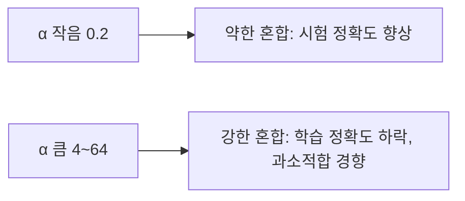
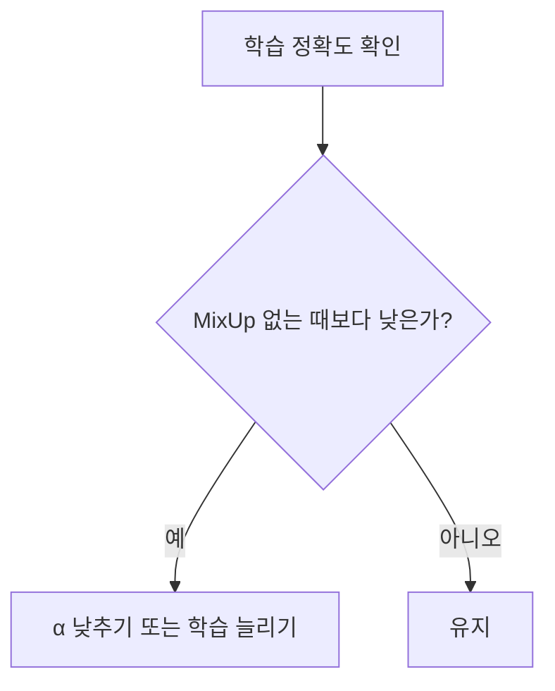

# MixUp 과소적합

> MixUp의 혼합 강도 α를 너무 크게 하면 학습 입력이 대부분 "두 예제를 반반 섞은 흐릿한 것"이 되어 모델이 **학습 데이터조차 충분히 맞히지 못하는 과소적합**이 생길 수 있다.

## 쉽게 말하면
수학 문제집을 풀 때 매번 두 문제를 절반씩 겹쳐 인쇄해 놓고 풀게 하면, 어려워서 제대로 연습이 안 된다. 약간 겹치는 정도는 도움이 되지만 너무 겹치면 오히려 실력이 안 는다.

## 자세히
- **원 논문의 서술**(앞서 정리한 [MixUp의 Beta 혼합 비율](#mixup-beta-alpha) 노드와 mixup 초록): ImageNet에서 α는 0.1~0.4가 ERM(일반 학습)보다 낫고, α가 크면 과소적합이 생긴다.
- **직접 실행**(scikit-learn 숫자 손글씨 `digits` 1,797장, 학습 60%·시험 40%, 은닉 128 MLP, Adam 60 에폭, 배치마다 λ~Beta(α,α)로 섞음, **학습 정확도는 섞지 않은 원본 학습 데이터로 측정**, 3 시드 평균):

| α | 학습 정확도 | 시험 정확도 |
|---|---|---|
| 0(MixUp 없음) | 1.000 | 0.974 |
| 0.2 | 1.000 | **0.981** |
| 1 | 0.999 | 0.974 |
| 4 | 0.994 | 0.967 |
| 16 | 0.991 | 0.964 |
| 64 | 0.989 | 0.968 |

- 해석: 약한 혼합(α=0.2)은 시험 정확도를 0.974→0.981로 올렸다. α가 4 이상으로 커지면 **학습 정확도가 1.000에서 0.99 안팎으로 내려가는** 과소적합 경향이 보이고 시험 정확도도 0.964~0.968로 기준선(0.974)보다 낮다. 다만 이 쉬운 문제에서는 낙폭이 작다. 시험 차이 0.01 안팎은 3 시드의 변동 안에 들 수 있어 단정하지 않는다. 데이터가 어렵거나 모델이 작을수록 과소적합이 더 두드러질 것이다(가설).
- **진단 요령(제안)**: ① 학습 정확도(원본 기준)가 MixUp 없는 경우보다 눈에 띄게 낮으면 α를 줄인다. ② 학습 손실이 높은 채로 평평하면 과소적합 신호. ③ 정칙화가 필요한 용량 큰 모델·긴 학습에서 이득이 크고, 작은 모델에는 α를 작게.
- **주의**: 학습 정확도를 섞은 데이터로 재면 당연히 낮게 나오므로 원본으로 잰다.

## 그림으로 보기

## 예시
- 소규모 사내 이미지 분류에서 α=0.2로 시작해 학습 정확도가 떨어지면 0.1로.
- 교육: digits 실험을 α별로 돌려 학습/시험 곡선을 비교.

## 헷갈리는 것과 비교
| 개념 | 차이 |
|---|---|
| 과소적합 | 학습 데이터도 못 맞힘 |
| 과적합 | 학습은 잘 맞히고 시험은 못 맞힘. MixUp이 줄이려는 것 |
| [베타 분포의 모양](#beta-distribution-shape) | α별 혼합 강도 |
| [MixUp α](#mixup-beta-alpha) | 권장 범위 |

## 더 읽을거리
- [mixup: Beyond Empirical Risk Minimization](https://arxiv.org/abs/1710.09412) — mixup 개요(초록 확인).
- [scikit-learn digits 데이터셋](https://scikit-learn.org/stable/datasets/toy_dataset.html) — 실험에 쓴 1,797장 8x8 손글씨 데이터(열어 확인).
