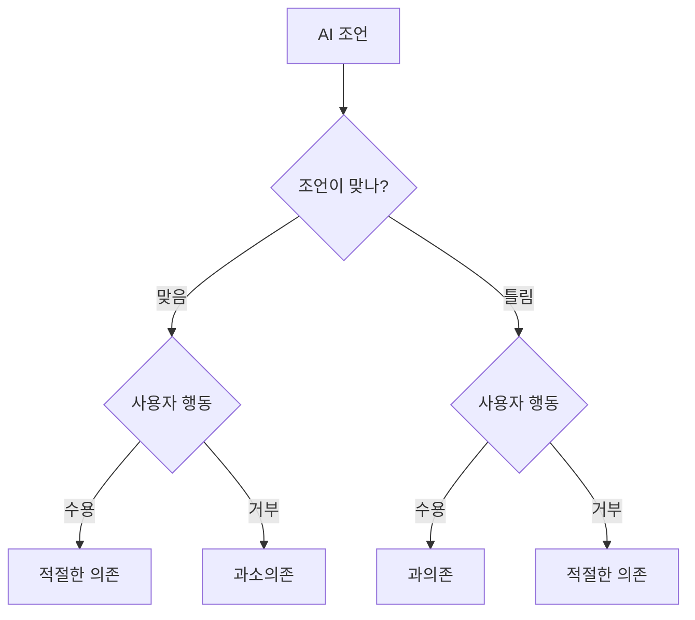
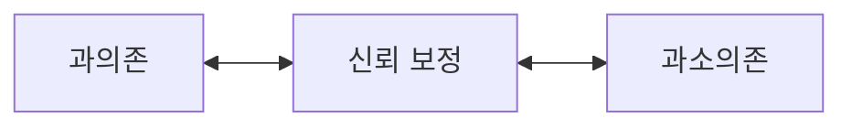

# AI 과소의존

> AI가 낸 답이 맞는데도 믿지 않고 버리는 오류. 맹신(과의존)의 반대편이며, 둘 다 "신뢰가 실제 정확도와 안 맞는" 보정 실패다.

## 쉽게 말하면
내비게이션이 한 번 엉뚱한 길을 안내한 뒤로는 맞는 안내도 끄고 직접 운전하는 사람과 같다. 가끔은 현명하지만, 맞는 안내까지 거부하면 오히려 더 헤맨다.

## 자세히
- **정의**: 과의존은 틀린 AI 조언을 받아들이는 것, 과소의존은 맞는 조언을 거부하는 것. 적절한 의존은 맞는 조언과 틀린 조언을 구별해 그에 맞게 행동하는 능력이다(검색 요약의 두 arXiv 논문 정리 기준, 2604.23896 초록은 이 정의를 직접 적지 않았다).
- **알고리즘 회피(algorithm aversion)**: 알고리즘이 틀리는 것을 본 뒤 그것을 버리는 경향(Dietvorst 등 2015). 반대로 일반인이 알고리즘 조언을 더 무겁게 보는 "알고리즘 호감"(Logg 등 2019)도 있어 어느 쪽도 보편 경향이 아니고 맥락·과제에 달렸다(두 원전은 열지 않았고 검색 요약의 2차 정리 기준).
- **대응 설계(Queen's Smith 글, 열람)**: 설명(XAI)은 과의존을 줄이지 못하고 오히려 신뢰를 높이거나 AI 예측에 고정시킬 수 있다. AI 추천을 보기 전에 먼저 결정하게 하거나 추천을 늦추는 **인지 강제 기능**이 과의존을 더 줄인다. 동료·제2 AI 의견을 함께 보이면 과의존은 줄지만 과소의존이 늘 수 있고, 언제 두 번째 의견을 볼지 사용자가 고르게 하면 과소의존을 늘리지 않고 과의존을 줄일 수 있다는 보고. 팀은 틀린 AI 추천을 더 잘 뒤집는다.
- **측정 논쟁**: arXiv 2604.23896은 연구마다 구성 개념이 파편화되어 있고, 신뢰 측정이 적절한 의존을 알려 주지 않는다는 증거가 있다고 정리한다(초록 열람). 객관 지표에 대한 합의를 주장한다.
- **교육 시사점(해석)**: 과소의존 대응은 "AI는 틀리니 믿지 마라"가 아니라 "언제 맞고 언제 틀리는지" 알려 주는 쪽이어야 한다.

## 그림으로 보기

## 예시
- 번역 AI가 틀린 적이 있다고 이후 정확한 번역도 전부 다시 직접 번역 → 시간 손실.
- 교육 실습: AI 답 10개 중 맞는 것과 틀린 것을 섞어 주고 각각 수용/거부 선택 후 과의존·과소의존 개수를 센다.

## 헷갈리는 것과 비교
| 개념 | 차이 |
|---|---|
| 과소의존 | 맞는 AI 조언도 거부 |
| [신뢰 보정](#trust-calibration) | 둘의 균형이라는 설계 목표 |
| [의도적 마찰 설계](#friction-by-design) | 맹신을 줄이는 UX 장치 |
| 과의존 | 틀린 조언도 수용 |

## 더 읽을거리
- [From Trust to Appropriate Reliance (arXiv 2604.23896)](https://arxiv.org/abs/2604.23896) — 측정 구성 개념 정리(초록 열람)
- [Queen's Smith: Why Humans and AI Assistants…](https://smith.queensu.ca/insight/content/Why-Humans-and-AI-Assistants.php) — 개입별 효과 요약(열람)
