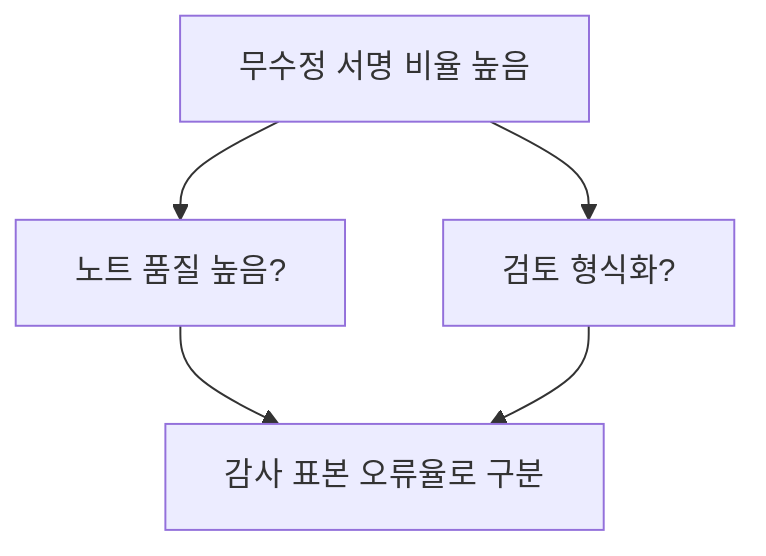
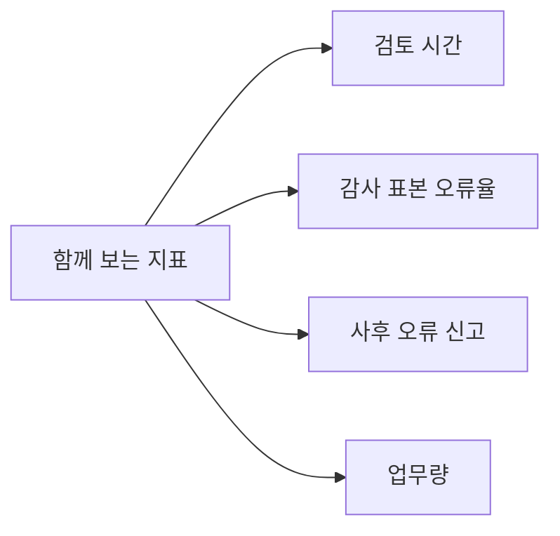

# 무수정 서명 비율

> AI가 쓴 기록을 의사가 한 글자도 고치지 않고 서명한 비율. 검토가 형식화되고 있는지를 감지하는 운영 지표지만, 이 비율만으로 좋고 나쁨을 판단할 수는 없다.

## 쉽게 말하면
교정 담당자가 원고를 단 한 번도 고치지 않고 승인만 한다면 원고가 완벽해서일 수도 있고 읽지 않아서일 수도 있다. 비율은 신호일 뿐 이유는 따로 확인해야 한다.

## 자세히
출처는 자동화 편향 체계적 고찰(Goddard 등, PMC3240751, 열람)이다. "무수정 서명 비율"이라는 지표 자체를 시험한 연구는 이번에 확인하지 못했고, 아래는 이 고찰의 결과를 운영 지표에 적용한 해석이다.
- **왜 보는가**: 자동화 편향은 사용자가 컴퓨터 출력을 덜 경계하며 확인하는 경향이고, 틀린 조언일 때 의료진이 대조군보다 약 26% 더 자주 틀린 결정을 했다(위험비 1.26, 95% CI 1.11~1.44, 비교 가능한 4개 연구 통합). 올바른 답이 조언 뒤 틀린 답으로 바뀐 경우가 6~11%였다는 별도 결과도 있다.
- **높은 비율의 두 해석**: 노트 품질이 높아 고칠 게 없거나, 검토가 형식화되었거나. 이 지표만으로는 구별되지 않는다.
- **구별하는 법(해석)**: 무수정 비율과 함께 ① 검토 시간(또는 노트 열람 시간) ② 감사 표본에서 사람이 찾아낸 오류율 ③ 환자·사건별 사후 오류 신고 ④ 업무량·시간 압박(자동화 편향의 환경 요인)을 같이 본다. 검토 시간이 줄고 무수정 비율이 오르며 감사 표본 오류가 그대로면 형식화를 의심한다.
- **함정**: 이 지표를 낮추라고 목표로 삼으면 의미 없는 수정이 늘 수 있다(지표의 목표화 문제, 일반적 우려). 목표는 "실질 검토"이지 "수정 횟수"가 아니다.
- **연결**: 수정 관련 지표로 [수락 후 수정률](#post-acceptance-edit-rate)과 [수정 없이 수락하는 비율](#accept-without-edit-rate)이 이미 정리돼 있다.

## 그림으로 보기

## 예시
- 한 의사가 무수정 서명 비율 98%에 노트당 검토 시간이 10초 미만이면 형식화 신호로 보고 해당 의사의 서명 노트를 감사 표본으로 뽑는다(운영 예시).
- 교육 실습: 가상 지표 5개(무수정 비율, 검토 시간, 감사 오류율, 신고 건수, 업무량)가 주어졌을 때 형식화 여부를 판단하는 규칙을 한 줄 쓴다.

## 헷갈리는 것과 비교
| 개념 | 차이 |
|---|---|
| 무수정 서명 비율 | 형식화 감지용 운영 지표 |
| [수락 후 수정률](#post-acceptance-edit-rate) | 수락한 뒤 얼마나 고쳤나 |
| [한 번 클릭 인증의 약점](#attestation-weakness) | 비율이 감지하려는 설계 문제 |
| 감사 표본 오류율 | 사람이 놓친 오류를 직접 찾음 |

## 더 읽을거리
- [Goddard 외: Automation bias (PMC3240751)](https://pmc.ncbi.nlm.nih.gov/articles/PMC3240751) — 위험비 1.26과 매개 요인(열람)
