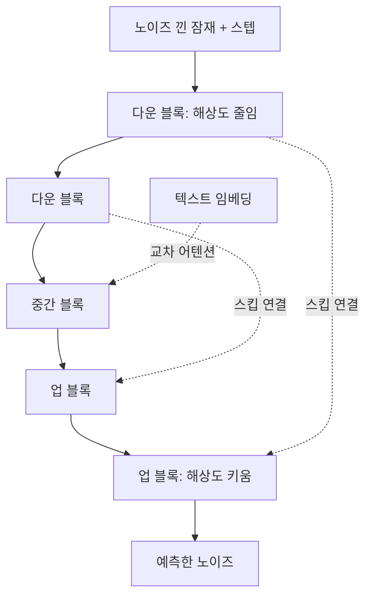
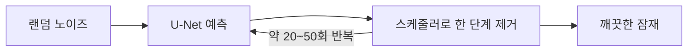

# U-Net 잡음 제거기

> 확산 모델에서 "지금 이미지에 섞인 노이즈가 무엇인지"를 예측하는 신경망. 입력과 출력의 크기가 같고, 줄였다가 다시 키우는 U자 구조라 U-Net이라 부른다.

## 쉽게 말하면
흐릿하게 번진 그림에서 번짐만 골라 내는 복원가다. 전체 윤곽(큰 그림)을 먼저 보고, 다시 세부(작은 그림)로 내려오며 "여기에 낀 얼룩은 이것"이라고 짚는다. 한 번에 다 지우지 않고 수십 번 조금씩 걷어 낸다.

## 자세히
- **구조**: 인코더(해상도를 줄이며 특징을 압축) → 중간 블록 → 디코더(다시 키움). 같은 해상도끼리 **스킵 연결**로 세부 정보를 건너 전달한다.
- **무엇을 예측하나**: 이미지가 아니라 **노이즈 잔차**. 스케줄러가 이 예측으로 다음 단계의 덜 흐린 잠재를 계산한다(PNDM 기본, DDIM, K-LMS 등).
- **조건 주입**: 중간중간 **교차 어텐션**으로 [CLIP 텍스트 인코더](#clip-text-encoder)의 77×768 임베딩을 참조해 "프롬프트에 맞는 방향"으로 걷어 낸다. 스텝 번호(시간)도 함께 입력한다.
- **잠재 공간**: SD v1은 512px 이미지를 4×64×64 잠재로 줄여 그 위에서 돌아 계산이 싸다([잠재 확산](#latent-diffusion)).
- 최근 모델(SD3, Flux 등)은 U-Net 대신 Transformer(DiT)를 쓰는 추세다. 틀은 같고 뼈대만 바뀐다.

## 그림으로 보기

## 예시
- diffusers에서 `pipe.unet`이 이 모듈이다. 스텝 수를 50→20으로 줄이면 빨라지지만 세부가 거칠어질 수 있다.
- 이미지 편집(inpainting)은 U-Net 입력에 마스크 채널을 더 넣어 만든다.

## 헷갈리는 것과 비교
| 개념 | 차이 |
|---|---|
| U-Net | 노이즈 예측기(반복 호출) |
| VAE | 픽셀↔잠재 변환기(처음·끝 한 번) |
| [CLIP 텍스트 인코더](#clip-text-encoder) | 조건(프롬프트) 제공자 |
| DiT | U-Net을 Transformer로 대체한 뼈대 |

## 더 읽을거리
- [Stable Diffusion with Diffusers](https://huggingface.co/blog/stable_diffusion) — U-Net과 스케줄러 반복 과정.
- [Diffusers LoRA 학습 가이드](https://huggingface.co/docs/diffusers/main/en/training/lora) — U-Net 어텐션 층에 어댑터를 붙이는 실제 코드.
