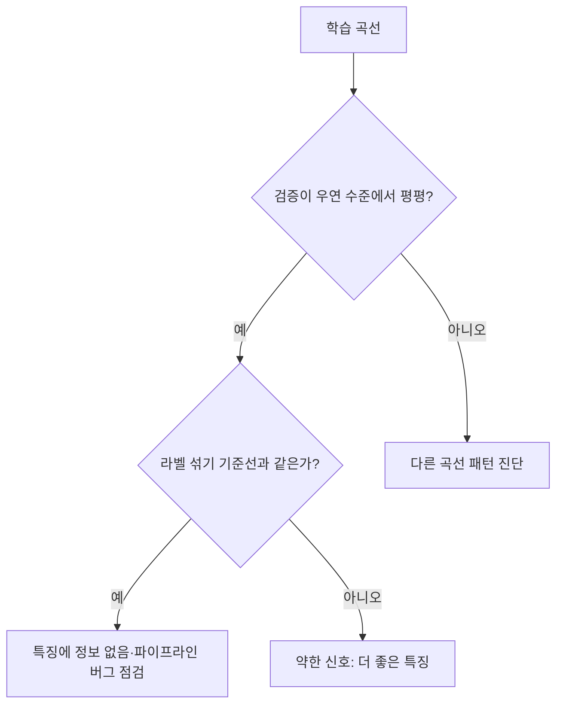
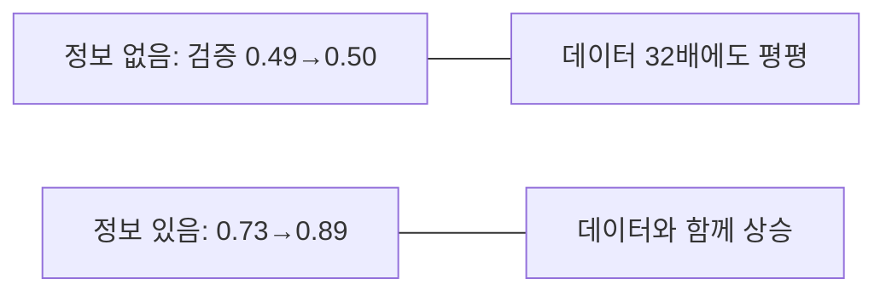

# 정보 없는 특징의 곡선

> 입력 특징에 정답에 대한 정보가 없으면 **검증 점수가 데이터를 늘려도 우연 수준(이진 분류면 50%)에서 평평**하다. 학습 점수만 우연보다 높아 보이는(암기) 큰 간격이 남고, 곡선이 거의 움직이지 않는 것이 특징이다.

## 쉽게 말하면
점쟁이가 손금(정보 없는 특징)으로 운세를 맞히려 하면 상담 건수를 늘려도 적중률은 50%에서 안 변한다. 기존 고객 기록을 외우는 건 가능해도 새 고객에게는 안 통한다.

## 자세히
- **직접 시뮬레이션(순수 파이썬, 5-최근접 이웃, 10개 가우시안 특징, 크기별 8회 평균, 검증 400개)**
  | 학습 크기 | **정보 없음**: 학습 정확도 | **정보 없음**: 검증 정확도 | 정보 있음(특징 1개에 신호): 학습 | 정보 있음: 검증 |
  |---|---|---|---|---|
  | 10 | 0.700 | 0.487 | 0.838 | 0.728 |
  | 40 | 0.634 | 0.482 | 0.934 | 0.863 |
  | 160 | 0.697 | 0.499 | 0.949 | 0.892 |
  | 320 | 0.683 | **0.501** | 0.941 | **0.892** |
  정보 없는 경우 검증 정확도는 **크기 10부터 320까지 전부 0.48~0.50**으로 데이터를 32배 늘려도 안 변한다. 정보 있는 경우는 0.728 → 0.892로 오른다. 정보 없는 경우의 학습 정확도가 약 0.63~0.70로 우연보다 높은 것은 KNN이 **자기 자신을 이웃에 포함**해(K=5 중 1개) 자기 라벨을 반영하기 때문이다(실제 학습에서의 암기 효과의 예).
- **곡선 모양 진단표**
  | 모양 | 의심 |
  |---|---|
  | 검증이 우연 수준에서 **평평**, 학습-검증 간격 큼 | 특징에 정보 없음(또는 라벨과 무관) |
  | 검증이 낮게 정체, 학습도 낮음 | 높은 편향([높은 편향 곡선](#high-bias-learning-curve)) |
  | 검증이 노이즈율 천장에서 정체 | [라벨 노이즈 정체](#noisy-label-plateau) |
- **원인**: ① 라벨과 무관한 특징만 사용(ID, 타임스탬프의 의미 없는 사용) ② 라벨 자체가 무작위 ③ 특징 전처리 오류로 정보 손실 ④ 학습/검증 라벨 불일치(순서 섞임 같은 파이프라인 버그).
- **점검 순서(권장)**
  1. **무작위 라벨 기준선**: 라벨을 섞어 학습했을 때와 점수가 같으면 특징이 무정보.
  2. 단일 특징별 성능(상관·상호정보)으로 신호 있는 특징 찾기.
  3. 사람이 같은 입력으로 맞힐 수 있는지([사람 수준](#human-level-definition)): 사람도 못 맞히면 정보가 부족한 문제.
  4. 데이터 파이프라인(특징-라벨 정렬) 점검.
- **교육 포인트**: "데이터를 더 모으면 낫다"가 성립하려면 입력에 신호가 있어야 한다.
- **한계**: 위는 이진·균형·가우시안 특징·KNN 한 설정이다. 정보가 약하지만 있으면 곡선이 느리게 오른다.

## 그림으로 보기



## 예시
```python
y_shuffled = rng.permutation(y_train)
base = cross_val_score(model, X_train, y_shuffled, cv=5).mean()   # 우연 수준 기준선
real = cross_val_score(model, X_train, y_train, cv=5).mean()
print(real - base)    # 거의 0이면 특징에 신호가 없음
```
- 고객 이탈 모델이 검증 50%에서 평평: 특징이 고객 ID·가입일뿐이었다면 사용 패턴 특징을 추가.

## 헷갈리는 것과 비교
| 상황 | 검증 곡선 | 학습-검증 간격 |
|---|---|---|
| 정보 없음 | 우연 수준에서 평평 | 큼(암기) |
| 높은 편향 | 낮게 수렴 | 작음 |
| 라벨 노이즈 | 1−e에서 정체 | 작음 |
| 정상 | 데이터와 함께 상승 | 점차 감소 |

## 더 읽을거리
- [scikit-learn: Learning curves](https://scikit-learn.org/stable/modules/learning_curve.html) — 학습 점수가 검증보다 훨씬 높으면 표본 추가가 일반화에 도움, 두 점수가 낮은 값으로 수렴하면 추가 데이터의 이득이 작다는 해석(열어 확인; 이 문서는 '정보 없음' 사례를 따로 다루지 않음). 위 표는 이 글의 직접 시뮬레이션.
