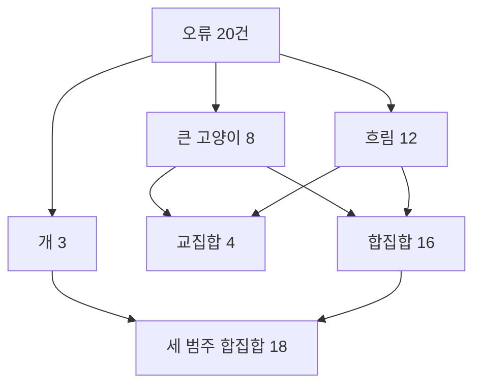
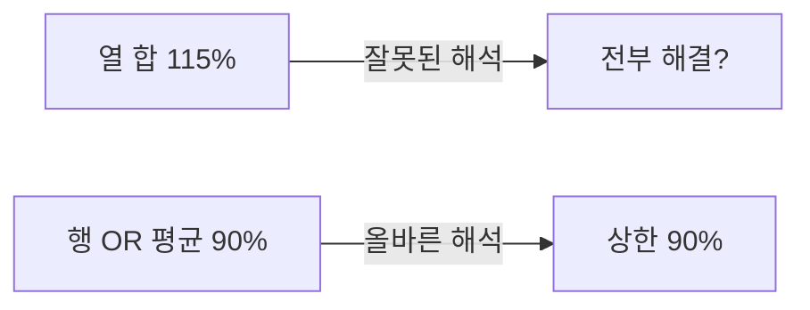

# 합집합 상한 계산

> 오류 분석 표에서 **여러 범주를 함께 고칠 때 줄어드는 오류의 상한**은 범주 비율의 합이 아니라, 그 범주 열 중 하나라도 체크된 예시의 비율(**합집합**)이다. 표에서 직접 세면 정확하다.

## 쉽게 말하면
불만 20건 중 "배송 지연" 8건, "포장 불량" 12건이라고 해서 두 문제를 모두 고치면 20건이 해결되는 게 아니다. 둘 다 해당하는 4건을 두 번 센 셈이므로, 실제로 해결되는 건 "둘 중 하나라도 해당하는 건수"다.

## 자세히
- **원칙(Ng, Machine Learning Yearning 초안 15장, 본문 확인)**: 한 예시가 여러 범주에 속할 수 있어 하단 비율의 합이 100%를 넘을 수 있다(개 8%·큰 고양이 43%·흐림 61%). 단일 범주 상한은 그 범주 비율(개를 고치면 최대 8% 감소).
- **직접 계산한 20건 표(가상)**
  | 구분 | 개수 |
  |---|---|
  | 개 | 3 |
  | 큰 고양이 | 8 |
  | 흐림 | 12 |
  | 열 합계 | 23 (115%) |
  | 큰 고양이∩흐림 | 4 |
  | 큰 고양이 ∪ 흐림 | 8 + 12 − 4 = **16 (80%)** |
  | 세 범주 합집합 | **18 (90%)** |
  | 어느 범주에도 없음 | 2 (10%) |
  합계 115%를 믿고 "세 범주를 고치면 오류가 다 사라진다"고 하면 틀린다. 실제 상한은 **90%**다.
- **계산법**: 열마다 체크를 0/1로 두고 행 단위 OR(하나라도 1이면 1)의 평균. 두 범주면 포함-배제 공식 |A∪B| = |A| + |B| − |A∩B|. 세 범주 이상은 직접 OR을 센다.
- **오류율로 환산**: 개발 세트 전체 오류율이 10%이고 합집합이 90%이면 세 범주를 **완전히** 고칠 때 오류율은 10% × (1 − 0.9) = **1%**까지만 내려간다(상한). 큰 고양이∪흐림만이면 10% × 0.2 = 2%.
- **교집합을 모를 때의 범위**: max(A, B) ≤ |A∪B| ≤ min(100%, A+B). 큰 고양이 43%·흐림 61%면 합집합은 61~100%([중복 오류 범주](#overlapping-error-categories)).
- **실제 효과는 더 작다**: 상한은 "범주 오류를 전부 고친다"는 낙관적 가정이다. 기대 효과는 효율을 곱한다([상한 vs 효율](#improvement-efficiency-vs-ceiling)). 한 범주 수정이 다른 범주에 부작용을 줄 수도 있다.
- **표본 불확실성**: 20건 표의 비율은 불안정하다. 100건 이상에서 계산하고 [구간](#category-share-confidence-interval)을 붙인다.

## 그림으로 보기



## 예시
```python
import pandas as pd
df = pd.DataFrame({"dog":[...], "great_cat":[...], "blurry":[...]})   # 0/1 체크
print(df.mean())                                  # 열별 비율(합이 100% 초과 가능)
union = df[["great_cat","blurry"]].any(axis=1).mean()   # 두 범주 합집합
union_all = df.any(axis=1).mean()                 # 세 범주 합집합 = 상한
err_after = overall_err * (1 - union_all)         # 모두 완전 해결 시 오류율
```

## 헷갈리는 것과 비교
| 값 | 뜻 |
|---|---|
| 열 비율 | 범주 하나의 상한 |
| 열 합 | 겹침이 중복된 값(상한 아님) |
| 합집합 | 여러 범주를 모두 고칠 때의 상한 |
| 기타/무범주 | 어떤 범주로도 설명 안 되는 오류 |

## 더 읽을거리
- [Andrew Ng, Machine Learning Yearning(초안 PDF) 15장](https://home-wordpress.deeplearning.ai/wp-content/uploads/2022/03/andrew-ng-machine-learning-yearning.pdf) — 겹치는 범주와 비율 합(본문 열어 확인; 20건 표는 이 글의 가상 계산).
