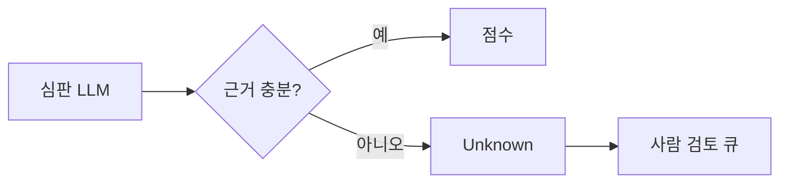
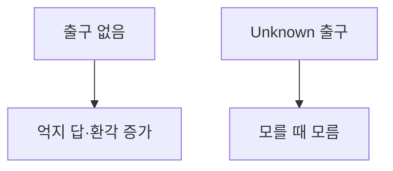

# Unknown 출구

> 모델 기반 채점·판정에서 **근거가 부족하면 "Unknown(모름)"이라고 답할 수 있는 선택지**를 주어, 억지로 답을 지어내는 환각을 줄이는 장치. (Anthropic 엔지니어링 글 열람 2026-11-28)

## 쉽게 말하면
시험에 "모르겠음" 보기를 넣어 주는 것이다. 보기가 정답뿐이면 모르는 학생도 아무거나 찍어 점수가 오염된다.

## 자세히
- 글의 팁: 모델 기반 채점기에는 **빠져나갈 길**을 준다. 예를 들어 정보가 부족하면 `Unknown`을 반환하게 해 환각을 줄인다.
- 함께 권장: 명확하고 구조적인 루브릭, **차원마다 별도 LLM 심판**, 사람 전문가와의 교정.
- 효과의 크기는 글에 수치가 없다. 다른 연구에서 정량 확인한 자료는 이번에 찾지 않았다.
- 설계 주의(내 제안): ① Unknown 비율을 측정(너무 높으면 과제·루브릭이 모호) ② Unknown을 점수에 어떻게 반영할지(제외·사람 검토 큐로 이동) 정의 ③ 정답이 있는 문항에서 Unknown 남용(항상 모름) 방지.
- 연결: 심판의 판단을 믿을 수 없을 때 사람에게 넘기는 안전장치로도 쓸 수 있다.

## 그림으로 보기



## 예시
```text
주어진 답변과 자료만으로 판단할 수 없으면 "Unknown"만 출력하라.
```
- 교육: 같은 평가를 출구 유무로 돌려 환각 판정 비율을 비교.

## 헷갈리는 것과 비교
| 개념 | 차이 |
|---|---|
| Unknown 출구 | 판단 유보 선택지 |
| 낮은 점수 | 판단했는데 나쁨 |
| [채점기 교정](#grader-calibration) | 심판을 사람과 맞춤 |

## 더 읽을거리
- [Demystifying evals for AI agents](https://www.anthropic.com/engineering/demystifying-evals-for-ai-agents) — 모델 기반 채점기 팁(읽음).
