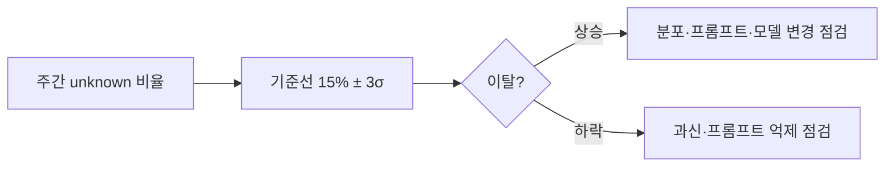
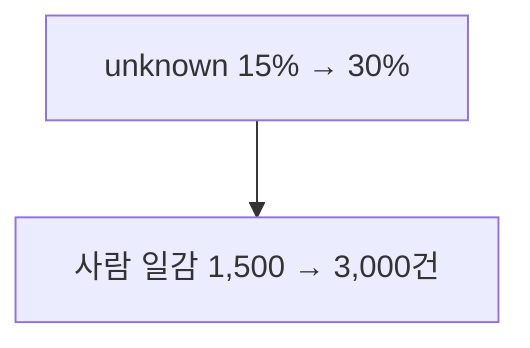

# unknown 비율 모니터링

> LLM 라벨러가 "모르겠음(unknown)"으로 보류하는 항목의 비율을 주기적으로 감시하는 일이다. 비율이 너무 높으면 자동화 이득이 사라지고 사람 일이 늘며, 너무 낮으면 모델이 모르는 것도 찍고 있을 수 있다.

## 쉽게 말하면
"패스"하는 비율이 갑자기 늘면 문제가 어려워졌거나 시험 범위가 바뀐 것이고, 한 번도 패스하지 않는다면 모르는 문제도 찍고 있을 가능성이 크다.

## 자세히
- **의미(해석)**: 거절 비율은 커버리지(자동 처리 비율)의 반대다([위험-커버리지 트레이드오프](#risk-coverage-tradeoff)). 이전에 본 판단 불가 선택지와 같은 성격이다([판단 불가 선택지](#cannot-decide-option)).
- **직접 계산(1만 건 기준 사람 일감)**:

| unknown 비율 | 자동 처리 비율 | 사람이 볼 건수 |
| --- | --- | --- |
| 5% | 95% | 500 |
| 15% | 85% | 1,500 |
| 30% | 70% | 3,000 |
| 50% | 50% | 5,000 |

  unknown이 15%에서 30%로 두 배가 되면 사람 일감이 1,500건에서 3,000건으로 늘어난다.
- **감시 방법(해석, 관리도 이론은 Wikipedia Control chart)**: 기준 비율이 15%일 때 주간 표본 건수에 따른 3σ 한계선(p-관리도, 직접 계산)은 n=100이면 [4.3%, 25.7%], n=200이면 [7.4%, 22.6%], n=500이면 [10.2%, 19.8%]다. 한계를 벗어나면 점검한다([라벨링 관리도](#control-chart-for-labeling)).
- **원인 점검(해석)**: 비율 상승: ① 입력 분포 변화(새 유형·언어·길이) ② 프롬프트·지침 변경 ③ 모델 버전 변경 ④ unknown 선택 기준 문구 변경. 비율 하락: 프롬프트가 unknown을 억제하게 바뀜, 모델 과신. unknown으로 분류된 샘플을 모아 유형을 분석하고 지침·예시에 반영한다([불일치 샘플 토론](#disagreement-discussion)).
- **주의(해석)**: unknown 비율만 보면 안 된다. 같은 기간 자동 확정된 항목의 정확도(사후 점검, [LLM 라벨 사후 점검 주기](#llm-labeler-recheck-schedule))를 함께 봐야 한다. 비율이 낮아졌는데 정확도도 떨어졌다면 과신이다.

## 그림으로 보기

## 예시
- 주 200건 중 unknown이 60건(30%)이면 한계 22.6%를 넘어 경보 → 지난 주 변경 이력과 입력 유형을 점검한다.
- 교육 활용: unknown 샘플 30개를 모아 공통 유형을 분류해 본다.

## 헷갈리는 것과 비교
| 개념 | 차이 |
| --- | --- |
| unknown 비율 | 거절 비율 감시 |
| 오류율 | 확정된 항목의 틀린 비율 |
| [위험-커버리지 트레이드오프](#risk-coverage-tradeoff) | 거절과 오류율의 교환 관계 |
| [LLM 라벨 사후 점검 주기](#llm-labeler-recheck-schedule) | 정확도 재검증 |

## 더 읽을거리
- [Control chart (Wikipedia)](https://en.wikipedia.org/wiki/Control_chart) — p-관리도와 3σ 한계
