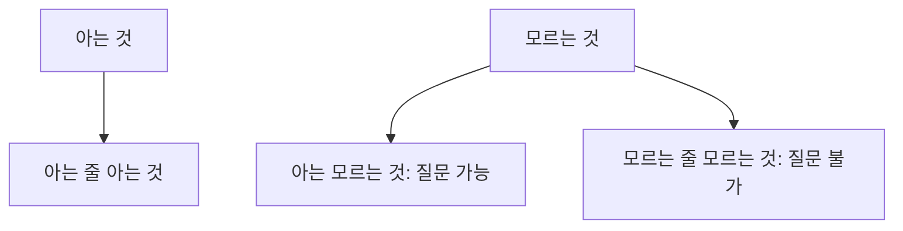
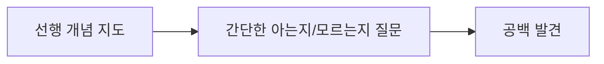

# 모르는 줄 모르는 것

> **내가 모른다는 사실조차 모르는 지식 공백.** 이름을 붙이지 못하므로 검색도 질문도 못 하며, 학습에서 가장 먼저 넘어야 할 문턱이다.

## 쉽게 말하면
지도에 아예 그려지지 않은 구역이다. "저 숲에 뭐가 있지?"라는 질문조차 떠오르지 않는다. 그래서 먼저 누군가가 지도의 윤곽을 보여 줘야 한다.

## 자세히
(검색 결과 요약 기준. 열람 2026-11-28.)
- 교육 연구에서 확인되는 문제: arXiv 2508.11892(RPKT)는 학습자가 **자신이 무엇을 배워야 하는지 인식하기 어렵다**는 점을 "unknown unknowns"로 부르며, 학생이 자기 이해도를 과대평가하고 빠진 선행 개념을 못 찾는다는 연구를 인용한다.
- 전문가의 맹점: 영역을 숙달한 강사는 초보자에게 필요한 기초 개념을 무의식적으로 건너뛴다.
- 이 논문의 해법은 **구조적**이다: LLM으로 선행 개념을 지도화하고 학습자에게 "아는지/모르는지" 같은 간단한 질문을 던져, 모르는 것을 스스로 말로 표현하지 않아도 되게 한다. 저자들은 "전문가가 선행 구조를 완벽히 명시할 수 있다 / 학생이 자기 공백을 알아낼 수 있다"는 가정이 관련 연구 전반의 핵심 한계라고 말한다. (PDF 본문은 읽지 못해 방법의 세부는 확인하지 못했다.)
- 열린 질문의 약점: GitHub 이슈 해결 연구(arXiv 2501.11709)는 지식 공백이 모든 대화 방식에 존재하며 **맥락 부족**이 가장 반복된다고 보고. "내가 놓친 게 뭐야?" 같은 막연한 질문은 모델이 맥락을 모르면 일반적인 답을 낼 가능성이 크다(해석).
- 실용 템플릿: 켄트 대학 프롬프트 은행의 "Help me identify what I don't understand"는 과정 수준, 원문 텍스트 등 구체적 맥락을 주고 그 텍스트에 묶인 쉬운 설명을 요청한다.
- 주의: "AI에게 뭘 놓쳤냐고 물으면 공백이 메워진다"는 통제된 연구는 이번에 찾지 못했다.

## 그림으로 보기

## 예시
- 입문자가 "임베딩"이라는 단어를 몰라서 RAG 설명 중 막히는데 무엇을 모르는지 못 말하는 경우.
- 교육: 개념 지도의 하위 노드 제목들만 보여 주고 "아는 것·들어본 것·처음 보는 것"으로 체크하게 하는 진단.

## 헷갈리는 것과 비교
| 개념 | 차이 |
|---|---|
| 모르는 줄 모르는 것 | 존재 자체를 인지 못 함 |
| 아는 모르는 것 | 질문으로 바꿀 수 있음 |
| [선행 개념 그래프](#prerequisite-graph) | 공백을 드러내는 구조 도구 |

## 더 읽을거리
- [RPKT (arXiv 2508.11892)](https://arxiv.org/abs/2508.11892) — unknown unknowns를 다룬 튜터 연구(검색 요약, PDF 본문 미확인).
- [Kent 프롬프트 은행](https://student.kent.ac.uk/studies/using-generative-ai-in-your-studies/prompt-bank/help-me-identify-what-i-don-t-understand) — 공백 확인 프롬프트(검색 결과 확인).
