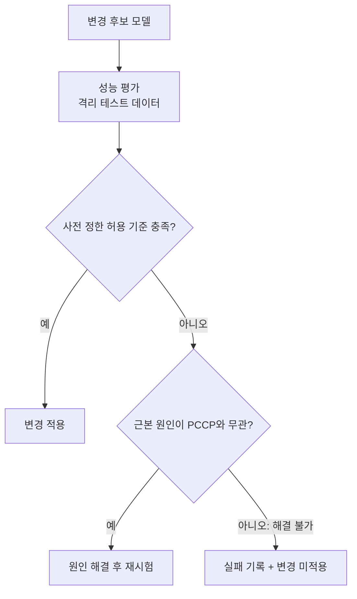

# 해결 불가 실패 처리

> PCCP의 변경 프로토콜이 "성능 평가에서 해결할 수 없는 실패가 나오면, 실패를 기록하고 그 변경은 **적용하지 않는다**"고 미리 명시하는 규칙. 사전 지정한 허용 기준을 못 넘으면 업데이트를 내보내지 않는다.

## 쉽게 말하면
학교 정기 점검에서 불합격이면 그 설비는 쓰지 않는다. 합격 기준을 미리 정해 두고, 불합격이면 어떤 사정이 있어도 투입하지 않는다고 약속하는 것이다.

## 자세히
출처: FDA 지침 "PCCP for AI-Enabled Device Software Functions"(2024-12-04 최초, 2025-08-18 재발행) PDF, 성능 평가 절과 이탈(deviation) 설명(내려받아 읽음).
- **요구**: 변경 프로토콜은 특정 변경의 성능 평가에서 **해결 불가능한 실패**(예: 그 변경에 대해 사전 정의한 허용 기준을 충족하지 못함)가 나오면 실패를 **기록**하고 해당 변경은 **적용하지 않는다**고 명시적으로 밝혀야 한다.
- **해결 가능한 실패의 예외**: 근본 원인 분석에서 실패가 PCCP의 특정 측면과 무관한 것으로 밝혀지면 해결 불가능한 실패로 보지 않으며, 성능 시험을 다시 수행할 수 있다.
- **성능 평가의 구성(같은 절 요지)**: 평가를 무엇이 촉발하는지, 임상 집단·의도한 용도를 대표하는 **격리된 테스트 데이터**를 어떻게 적용하는지, 어떤 성능 지표를 계산하는지, 변경별 성능 목표에 관한 가설을 검정할 통계 분석 계획.
- **이탈과의 관계**: PCCP를 따르지 않았거나 따를 수 없으면 이탈이다. 재학습 실패, 사전 지정 성능 기준 미달이 예로 나온다. 실패한 변경을 그대로 배포하면 이탈이 될 수 있다.
- **지침의 성격**: 비구속 권고. 어느 수준의 "롤백"을 해야 하는지(배포 후 문제 발견 시)는 이 절이 아니라 다른 절에서 다룬다. 이 글은 시험 단계의 보류 규칙만 다룬다.

## 그림으로 보기

## 예시
- 재학습 모델의 하위 집단 민감도가 기준에 못 미침 → 원인이 데이터 오염으로 밝혀지면 정리 후 재평가, 모델 한계라면 기록하고 배포하지 않음.
- 프로토콜 문구 예: "허용 기준 미달 시 해당 변경은 시행하지 않으며 실패 보고서를 보관한다."

## 헷갈리는 것과 비교
| 개념 | 차이 |
|---|---|
| [PCCP 이탈](#pccp-deviation) | 계획을 따르지 않은 상황, 이 규칙은 이탈을 막는 사전 장치 |
| 배포 후 롤백 | 이미 배포한 변경을 되돌리는 것, 이 노드는 배포 전 보류 |
| [변경 프로토콜](#modification-protocol) | 상위 요소 |
| [AI PCCP 최종 지침](#pccp-ai-final-guidance) | 이 규칙이 담긴 문서 |

## 더 읽을거리
- [PCCP for AI-Enabled Device Software Functions (FDA 지침 PDF)](https://www.fda.gov/media/166704/download) — 성능 평가와 해결 불가 실패 문구(내려받아 확인)
