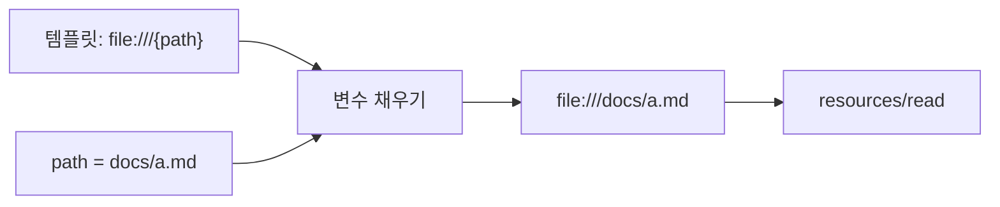
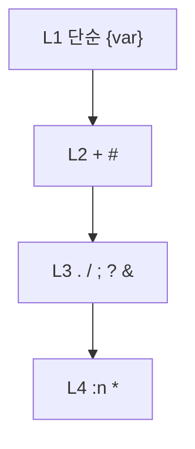

# URI 템플릿 RFC 6570

> `{변수}` 자리가 있는 주소 양식을 정의한 인터넷 표준(RFC 6570). 변수 값을 넣으면 실제 URI가 만들어진다. MCP 리소스 템플릿의 `uriTemplate`이 이 표준을 쓴다.

## 쉽게 말하면
편지 봉투 양식 "○○시 ○○구 ○○로 {번지}"와 같다. 번지만 바꿔 끼우면 수많은 주소가 한 양식에서 나온다. 서버는 "이 양식으로 요청하세요"라고 알려 주고, 클라이언트(와 모델)는 값만 채운다.

## 자세히
- MCP: `resources/templates/list` 응답의 `uriTemplate` 예 `file:///{path}`. 인자는 completion API로 자동완성할 수 있다.
- RFC 6570 레벨별 연산자(변수 var="value", hello="Hello World!", x=1024, y=768 기준):
  - L1 `{var}`→`value`, `{hello}`→`Hello%20World%21`(퍼센트 인코딩)
  - L2 `{+hello}`→`Hello%20World!`(예약 문자 통과), `{#var}`→`#value`
  - L3 `{/var,x}`→`/value/1024`, `{;x,y}`→`;x=1024;y=768`, `{?x,y}`→`?x=1024&y=768`, `{&x,y}`→`&x=1024&y=768`, `{.var}`→`.value`
  - L4 `{var:3}`→`val`(앞 3글자), `{?list*}`→`?list=red&list=green&list=blue`(펼치기)
- 서버는 받은 URI를 반드시 검증해야 한다(MUST) — `{path}`에 `../`가 들어올 수 있으므로 경로 이탈 방어.

## 그림으로 보기

## 예시
- DB 서버: `postgres://db/{table}/schema` → `postgres://db/users/schema`.
- 검색 API: `https://api.example.com/items{?q,page}` → `...items?q=ai&page=2`.

## 헷갈리는 것과 비교
| 개념 | 차이 |
| --- | --- |
| URI 템플릿 | 변수 자리가 있는 양식 |
| 정규식·글롭 | 문자열 패턴 매칭용(생성이 아님) |
| [리소스 템플릿](#mcp-resource-templates) | MCP에서 이 표준을 쓰는 기능 |
| [자동완성](#mcp-completion) | 템플릿 변수 값을 추천 |

## 더 읽을거리
- [RFC 6570: URI Template](https://www.rfc-editor.org/rfc/rfc6570) — 표준 원문
- [MCP 사양: Resources](https://modelcontextprotocol.io/specification/2025-06-18/server/resources) — resourceTemplates 예시
