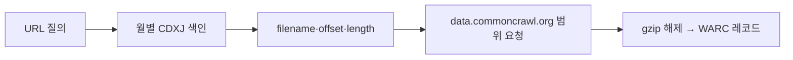
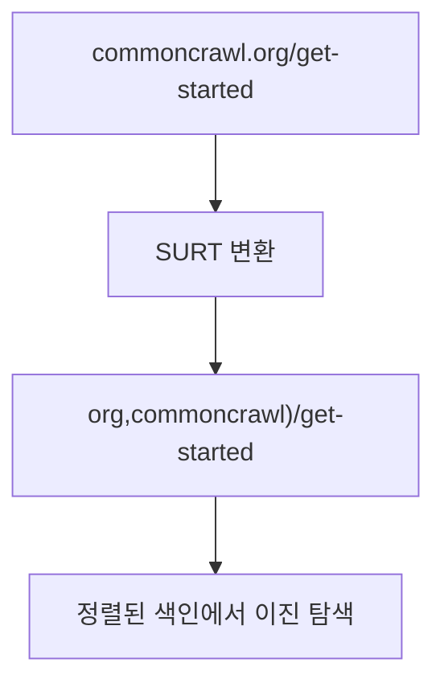

# URL 색인(CDX)

> Common Crawl에서 "이 URL이 어느 WARC 파일의 몇 번째 바이트에 있나"를 찾게 해 주는 색인이다. 수십억 페이지를 통째로 내려받지 않고 원하는 페이지 하나만 범위 요청으로 꺼낼 수 있다.

## 쉽게 말하면
도서관의 청구기호 카드 목록이다. 책(웹 페이지)을 찾으려고 서가 전체를 뒤지는 대신 카드에서 "3층 B서가 4번째 줄"을 보고 바로 가서 그 책만 꺼낸다.

## 자세히
(Common Crawl의 CDXJ 색인 페이지를 직접 열어 확인하고, SURT 변환은 직접 코드로 실행. 실제 색인 서버 조회는 시도했지만 시간 초과로 실행하지 못했다.)
- **위치**: `index.commoncrawl.org`와 S3 `s3://commoncrawl/cc-index/collections/`. **월별 크롤마다 색인이 따로** 있고 전체를 아우르는 색인은 없다. 목록은 `collinfo.json`. 직접 호출하니 2026-11-19 기준 **129개 크롤**(최신 `CC-MAIN-2026-43` "October 2026 Index", 가장 오래된 `CC-MAIN-2008-2009`)이 나왔다.
- **구조**: 정렬된 평문을 **3,000줄 블록 단위로 gzip** 압축해 임의 접근이 가능.
- **한 줄 = JSON**: `urlkey`, `timestamp`, `url`, `mime`, `mime-detected`, `status`, `digest`, `length`, `offset`, `filename`, `languages`, `encoding`.
- **SURT 키**: URL의 호스트를 뒤집어 쉼표로 이어 정렬하기 좋게 만든 형태. `commoncrawl.org/get-started` → `org,commoncrawl)/get-started`(문서 예, 직접 재현). `www.`는 제거되고 `example.co.uk/a?b=1`은 `uk,co,example)/a?b=1`(내 간단 구현 기준이며 실제 규칙은 더 복잡).
- **조회 후 꺼내기**: 색인에서 URL을 조회하면 `filename`·`offset`·`length`가 나온다. `https://data.commoncrawl.org/<filename>`에 `offset`부터 `offset+length-1`까지 범위 요청(`curl -r`)을 하고 `gzip -dc`로 풀면 WARC 레코드 하나가 나온다. 문서 예: offset 160581106, length 12695 → `-r 160581106-160593800`(직접 계산).
- **도구**: `pip install cdx_toolkit`, `cdxt --crawl <크롤> iter <url>`로 캡처 목록, `warc` 하위 명령으로 레코드 다운로드.
- **URL 색인(CDX 서버 API)의 파라미터 목록은 이번 자료에서 확인하지 못했다.** 열 기반(Parquet·Athena) 색인은 이전 이름이 "Columnar Index"이며 이번에 열어 보지 못했다.
- **주의**: 색인 서버는 부하가 커서 시간 초과(504)가 날 수 있다. 직접 호출 시 2회 시도 모두 응답을 받지 못했다(서버 상태에 따라 다름).

## 그림으로 보기



## 예시
```bash
# 크롤 목록 확인
curl -s https://index.commoncrawl.org/collinfo.json | head -c 300
# (색인에서 얻은 값으로) 범위 요청 — 값은 예시
curl -s -r 160581106-160593800 https://data.commoncrawl.org/<filename> | gzip -dc | head
```
- 특정 도메인의 페이지만 모아 도메인 특화 코퍼스를 만들 때(예: 의료 사이트) 전체 크롤을 받지 않고 색인으로 후보만 뽑는다.

## 헷갈리는 것과 비교
| 개념 | 차이 |
|---|---|
| CDXJ 색인 | URL → WARC 위치(JSON 줄) |
| `paths.gz` 목록 | 파일 이름 목록만, 내용 위치는 없음 |
| [WARC·WAT·WET](#warc-wat-wet) | 색인이 가리키는 실제 데이터 |
| 열 기반 색인 | Parquet로 SQL 조회(이번에 미확인) |

## 더 읽을거리
- [Common Crawl: CDXJ Index](https://commoncrawl.org/cdxj-index) — 필드·SURT·범위 요청(열어 확인).
- [Common Crawl: Get Started](https://commoncrawl.org/get-started) — 접근 방법(열어 확인).
