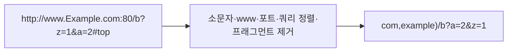
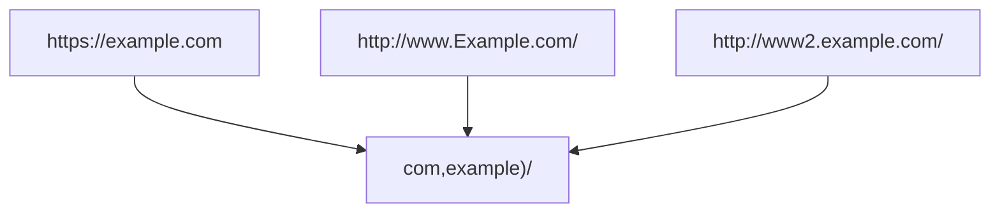

# URL 정규화

> URL 정규화는 **같은 페이지를 가리키는 서로 다른 URL 표기(대소문자, `www.`, 포트, 쿼리 순서, 인코딩 등)를 하나의 표준 형태로 바꾸는** 일이다. 중복 제거·색인·삭제 요청 대응에서 "같은 페이지인가"를 판정하는 기준이 된다.

## 쉽게 말하면
같은 사람을 "김 대리", "김대리님", "Kim D."로 불러도 명단에는 한 줄이어야 한다. URL도 표기가 달라도 같은 페이지면 한 이름으로 맞춰야 한다.

## 자세히
- 직접 실행(파이썬 `surt` 0.3.1 — Internet Archive가 만든 SURT(Sort-friendly URI Reordering Transform) 변환기를 소스에서 내려받아 사용, 2026-11-27):
  | 입력 URL | SURT 결과 |
  |---|---|
  | `http://www.Example.com/` | `com,example)/` |
  | `https://example.com` | `com,example)/` |
  | `http://example.com:80/a/../b?z=1&a=2` | `com,example)/b?a=2&z=1` |
  | `http://EXAMPLE.com/index.html?b=2&a=1` | `com,example)/index.html?a=1&b=2` |
  | `http://example.com/path?a=1&b=2#frag` | `com,example)/path?a=1&b=2` |
  | `http://blog.example.co.uk/x/` | `uk,co,example,blog)/x` |
  | `http://example.com/%7Euser/` | `com,example)/~user` |
  | `http://www2.example.com/` | `com,example)/` |
  | `http://example.com//dup//slashes/` | `com,example)/dup/slashes` |
- 읽는 법: 이 변환기는 ① **스킴(http/https) 제거** ② 호스트 **소문자화·`www`/`www2` 접두 제거** ③ **기본 포트(:80) 제거** ④ 경로의 `..` 정리·중복 슬래시 병합·**끝 슬래시 제거** ⑤ **쿼리 파라미터를 키 순으로 정렬** ⑥ **프래그먼트(#…) 제거** ⑦ `%7E`를 `~`로 풀어 **인코딩 정규화** ⑧ 호스트를 **거꾸로(도메인 → 서브도메인) 나열**해 `com,example)`로 만든다(이 거꾸로 순서는 [접두사 범위 조회](#prefix-range-query)의 기반).
- 판단이 갈리는 부분: `http`와 `https`를 같은 페이지로 본 점, `index.html`을 **유지**한 점(폴더 루트와 동일하다고 가정하지 않음), 추적 파라미터(`utm_source` 등)는 별도 규칙 없이는 그대로 남는 점(이 시험에서 확인하지 않음, 제안: 필요하면 직접 제거 규칙 추가).
- **정규화는 목적에 따라 강도가 다르다**: 중복 제거·색인에는 공격적으로, 원본 재현에는 보수적으로. 너무 공격적이면 서로 다른 페이지(예: 쿼리로 내용이 달라지는 사이트)를 하나로 합치고, 너무 약하면 같은 페이지가 여러 건이 된다.
- 삭제 요청·옵트아웃 대응 연결(제안): 요청자가 낸 URL을 정규화해 색인의 정규화 키와 대조하면 표기 차이로 놓치는 일이 줄어든다([데이터셋 삭제 요청](#dataset-removal-request)).
- 한계: 라이브러리마다 규칙이 달라 같은 URL도 결과가 다를 수 있다(표준 하나가 있지 않음). `www2.`처럼 의미 있는 서브도메인을 지울 위험도 있다.

## 그림으로 보기



## 예시
```python
from surt import surt
surt("http://EXAMPLE.com/index.html?b=2&a=1")   # 'com,example)/index.html?a=1&b=2'
```
- 교육: 같은 페이지의 여러 URL 표기를 적고 정규화 결과가 하나가 되는지 확인하는 실습.

## 헷갈리는 것과 비교
| 개념 | 차이 |
|---|---|
| URL 정규화 | 같은 페이지의 표기를 통일 |
| 리다이렉트 | 서버가 다른 URL로 보냄(별개 URL임) |
| canonical 링크 | 사이트가 대표 URL을 선언 |
| SURT | 정규화 + 호스트를 거꾸로 정렬 친화적으로 변환 |

## 더 읽을거리
- [internetarchive/surt (PyPI)](https://pypi.org/project/surt/) — 변환기(소스 받아 실행).
- 직접 실행: 9개 URL 변환.
