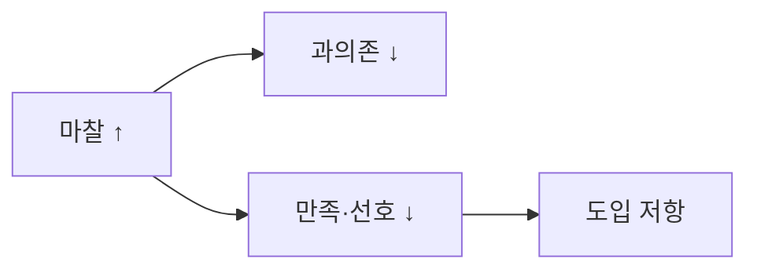

# 사용성과 과의존의 거래

> 사용자가 AI 답을 그냥 받아들이지 못하게 **마찰을 키울수록 과의존은 줄지만, 사용 만족도와 편의는 낮아지는** 교환 관계다.

## 쉽게 말하면
도어락에 비밀번호·지문·OTP를 겹겹이 걸수록 안전하지만 매일 드나들기 번거로운 것과 같다. 어디까지 감수할지가 설계 결정이다.

## 자세히
(Buçinca·Malaya·Gajos 2021 PDF를 직접 읽었다.)
- **발견(초록)**: 인지 강제 설계가 단순 설명형 AI보다 과의존을 유의하게 줄였지만, **사람들은 과의존을 가장 크게 줄인 설계에 가장 낮은 주관 평점을 줬다.**
- **측정 항목(논문)**: 선호("이 시스템을 자주 쓰고 싶다"), 신뢰("AI의 제안을 신뢰한다"), 정신적 부담("과제가 어려웠다"), 시스템 복잡도, 각 5점 척도.
- **세부 결과**: 신뢰는 단순 설명형이 인지 강제보다 높았으나 유의하지 않았다. AI가 있는 조건이 없는 조건보다 유의하게 선호됐고 AI 없음이 정신적 부담이 가장 컸다. 단순 설명형 AI는 인지 강제 또는 AI 없음 조건보다 시스템이 덜 복잡하다고 평가됐다. 같은 범주 안 조건끼리는 주관 평가 차이가 없었다.
- **상관**: 신뢰와 선호는 전체 성과, 틀린 AI 예측에서의 판별 성과와 **음의 상관**, 틀린 예측에 대한 의존과는 **양의 상관**이었다(논문 서술). 즉 마음에 드는 시스템이 틀린 예측에는 더 취약했다.
- **누구에게 유리한가**: Need for Cognition이 높은 사람은 인지 강제로 틀린 예측에서 전체·판별 성과가 유의하게 좋아졌고, 낮은 사람은 판별만 개선돼 이득이 불균등했다.
- **시사(해석)**: 모든 사용자에게 같은 마찰을 주기보다, 위험도가 높은 결정이나 AI 신뢰가 낮은 상황에 선택적으로 켠다.

## 그림으로 보기

## 예시
- 고위험 승인 화면에는 확인 단계를 넣고, 일상 요약 기능에는 넣지 않는다(제안).
- 교육 소재: 만족도와 정확도 중 무엇을 우선할지 토론.

## 헷갈리는 것과 비교
| 개념 | 차이 |
|---|---|
| 사용성 | 쓰기 편한 정도 |
| 과의존 | 틀린 AI도 따르는 정도 |
| [의도적 마찰 설계](#friction-by-design) | 이 거래를 의도적으로 활용 |

## 더 읽을거리
- [Buçinca, Malaya, Gajos (2021)](https://arxiv.org/abs/2102.09692) — 직접 읽음.
