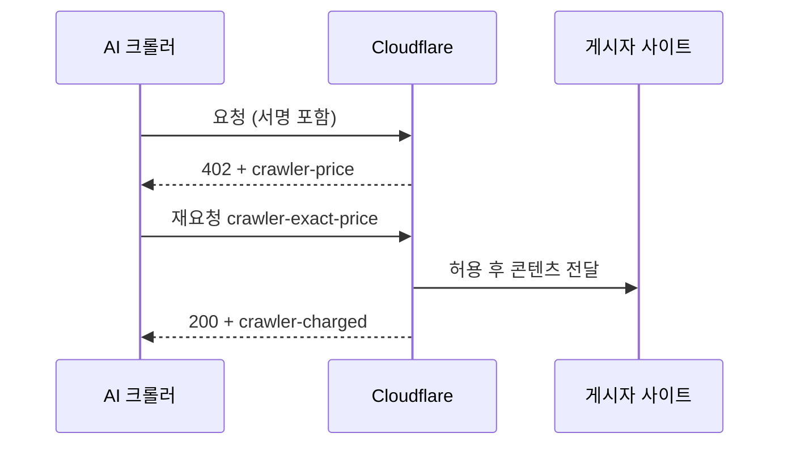
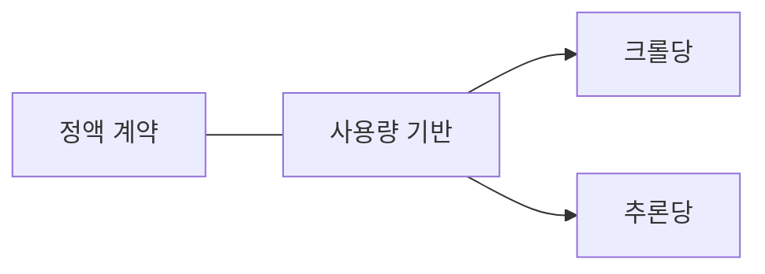

# 사용량 기반 라이선스

> AI가 콘텐츠를 **가져가거나(크롤) 답변에 쓸 때(추론) 건수·횟수 단위로 값을 내는** 라이선스 방식이다. 한 번에 큰돈을 받는 정액 계약과 달리 **쓴 만큼** 정산한다.

## 쉽게 말하면
공원 입장권이 연간 회원권(정액)과 1회권(사용량)으로 나뉘듯, AI 회사도 "연 얼마"가 아니라 "페이지 한 장 가져갈 때마다 얼마"로 낼 수 있다. 크롤러가 문 앞에서 가격을 보고 낼지 말지 정한다.

## 자세히
(Cloudflare 블로그 「Introducing pay per crawl」(2025-07-01 게시, 비공개 베타)과 RSL 사양 페이지를 WebFetch로 직접 확인. 시장 규모 수치는 확인하지 못했다.)
- **Cloudflare pay per crawl(블로그)**: HTTP **402 Payment Required** 응답을 활용한다. 유료 URL에 결제 의사 없이 요청하면 서버가 **402와 `crawler-price` 헤더**로 가격을 알린다.
  - **반응형**: 크롤러가 `crawler-exact-price`를 달아 재요청(그 가격에 동의).
  - **선제형**: 처음부터 `crawler-max-price`를 보냄. 설정 가격이 한도 이하면 **200과 `crawler-charged` 헤더**로 결제 확인, 초과면 402. 한 요청에 두 헤더 중 하나만 쓸 수 있다.
  - **크롤러 등록**: Ed25519 키 쌍 생성 → JWK 공개키를 디렉터리에 공개 → Cloudflare에 등록 → **HTTP Message Signatures(RFC 9421)**로 요청에 서명해 신원 확인·사칭 방지.
  - **게시자 제어**: 도메인 전체에 **요청당 단일 가격**을 정하고 크롤러별로 **Allow / Charge / Block**을 고른다. 기존 WAF·봇 관리 규칙 뒤에 적용된다.
  - **정산**: Cloudflare가 **Merchant of Record**로서 결제 이벤트를 모아 크롤러 운영자에게 청구하고 게시자에게 분배한다.
- **RSL의 지급 유형(사양)**: `crawl`(크롤당), `use`(AI 출력에 기여할 때마다), `training`(학습) 등을 선언할 수 있다. → [집단 라이선스(RSL)](#collective-licensing-rsl)
- **장단점(해석)**: 소규모 게시자도 가격을 붙일 수 있지만, 가격이 도메인 단위 단일이라 문서별 가치 차이를 못 담고, 크롤링과 학습·답변 기여를 구분하는 계측이 어렵다.
- **관련 문제**: 사용량 정산이 정확하려면 어떤 데이터가 출력에 기여했는지 알아야 한다. → [중복 데이터와 가치 평가](#duplicate-data-valuation)

## 그림으로 보기

## 예시
- 뉴스 사이트가 도메인 전체에 요청당 $0.01을 설정하고, 한 AI 크롤러는 Charge, 검색 크롤러는 Allow로 지정.
- 교육 활동: 하루 크롤 1만 건 × 요청당 가격으로 월 수익을 계산해 정액 계약과 비교.

## 헷갈리는 것과 비교
| 개념 | 차이 |
|---|---|
| 사용량 기반 | 건수·횟수에 따라 정산 |
| 정액 계약 | 기간 단위 고정금 |
| [AI 콘텐츠 라이선스 계약](#ai-content-licensing-deals) | 개별 계약 형태 전반 |
| 크롤 차단 | 접근 자체를 막음. 과금과 다름 |

## 더 읽을거리
- [Introducing pay per crawl (Cloudflare 블로그)](https://blog.cloudflare.com/introducing-pay-per-crawl/) — HTTP 402, 가격 헤더, 크롤러 등록, Merchant of Record(직접 확인).
- [RSL 1.0 사양](https://rslstandard.org/rsl) — crawl·use 지급 유형(직접 확인).
