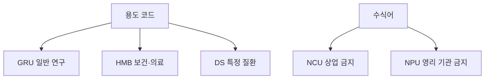

# 용도 정의 예시

> 데이터 허용 용도 정책에서 "분석", "학습", "연구"처럼 **모호한 용어를 코드·정의·예시로 못 박는 일**이다. 같은 단어를 사람마다 다르게 읽으면 허용 여부 판단이 흔들리므로, 용어마다 포함·제외 예시를 붙인다.

## 쉽게 말하면
"차량 출입 가능"이라는 표지판은 오토바이는 되는지, 화물차는 되는지 모호하다. "승용차·오토바이 가능, 화물차 불가"라고 목록과 예시를 적으면 분쟁이 줄어든다. 데이터 용도도 "연구용"이라고만 쓰지 않고 "일반 연구 / 보건 연구 / 특정 질환 연구 / 영리 목적 불가"처럼 세분하고 정의를 적는다.

## 자세히
(GA4GH의 Data Use Ontology(DUO) 저장소 README를 직접 읽었다. 유전체·의료 데이터 공유 분야의 사례이며, 코드의 정확한 정의는 README가 모두 풀어 쓰지 않아 표 설명을 의역한 것이다.)
- **DUO란(README)**: 데이터셋에 **사용 제한을 태그**로 달기 위한 OWL 온톨로지. 서비스가 데이터셋을 사용자의 권한 수준이나 의도한 연구 용도와 **자동으로 맞출 수** 있게 한다. EMBL-EBI의 EGA와 Broad Institute의 DUOS가 쓴다. NIH dbGaP 범주, Consent Codes(Dyke 외, 2016), ADA-M(Woolley 외, 2018)을 바탕으로 한다.
- **주 용도 범주(README, 의역)**: **GRU**(일반 연구 용도 허용), **HMB**(건강·의료·생의학 연구로 한정), **DS**(지정한 질환 분야로 한정, `DS={질환}`), 제한 없음(DUO:0000004).
- **수식어로 금지·한정 표현(README, 의역)**: **NCU**(향후 상업적 사용 금지), **NPU**(영리 기관의 사용 금지), **NMDS**(방법론 연구 금지), **NAGR**(집계 수준 데이터의 일반 연구 사용 금지), **NCTRL**(명시한 질환 외 대조군으로 사용 금지), **RS-G**(특정 성별 연구로 한정), **RS-PD**(소아 연구로 한정), **RS-POP-XX**(특정 집단으로 한정, 자유 서술), 동의서 날짜 이후 수집 샘플로 한정. 인구 기원 코드는 표에 POA/NPOA가 보이나 README는 "PS"나 "IRB approval"을 정의하지 않는다.
- **기계가 읽는 방식(README)**: 각 용어는 안정적인 ID(`DUO_0000004` 등)를 갖고 삭제되지 않으며, 의미가 바뀌면 폐기하고 새 ID를 만든다. 용어는 계층 구조(DAG)이며 가장 구체적인 수준에서 질의한다. 폐암 질의는 "암 일반" 데이터셋을 반환하지만 암 질의가 폐암 전용 데이터셋을 반환하지는 않는다. 연구 목적을 코드에 매핑한다(질환 중심 목적은 GRU 또는 HMB 또는 해당 질환 태그와 맞음, 상업적 목적은 NPU·NCU가 모두 거짓인 데이터셋과 맞음). 라벨은 언어 태그가 있어 번역을 합칠 수 있다.
- **정책 문서에 옮기는 법(일반 원칙)**: ① 모호한 용어마다 **정의 한 줄 + 포함 예시 + 제외 예시**(예: "분석: 집계 통계 산출은 포함, 개인 단위 예측 모델 학습은 별도 용도") ② 안정적인 코드 ID를 붙여 시스템이 읽게 함 ③ 용어가 바뀌면 옛 ID를 유지한 채 새 ID 발급 ④ 모호하면 더 보수적으로 해석한다는 규칙.
- **한계**: DUO는 생명과학 데이터에 맞춘 어휘이므로 기업 데이터의 용도 분류에 그대로 쓸 수 없다. 개념과 구조(코드·계층·수식어·안정 ID)를 참고한다.

## 그림으로 보기

## 예시
| 모호한 문구 | 개선 예 |
|---|---|
| "분석 목적 사용 가능" | 집계 보고서·대시보드 포함 / 개인별 예측 모델 학습 제외 |
| "내부 연구용" | 자사 직원이 수행하는 연구 포함 / 외부 위탁 학습 제외 |
- 교육 소재: 같은 정책 문구를 팀별로 해석해 보고 차이를 비교.

## 헷갈리는 것과 비교
| 개념 | 차이 |
|---|---|
| 용도 정의 예시 | 모호한 용어에 정의·예시를 붙이는 작업 |
| [허용 용도 정책](#allowed-use-policy-data) | 용도 정의를 담는 상위 정책 |
| [동의 범위와 용도 제한](#consent-scope-limit) | 동의가 허용한 목적과 일치하는지 |
| [용도 예외 승인 절차](#use-exception-approval) | 정의 밖 용도를 승인하는 절차 |

## 더 읽을거리
- [GA4GH Data Use Ontology (EBISPOT/DUO)](https://github.com/EBISPOT/DUO) — 용도 코드·수식어·기계 판독(README 직접 읽음).
